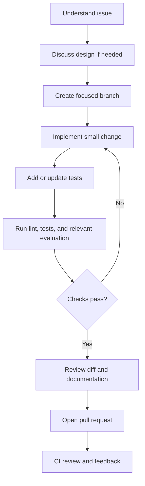

# Contributing to Advanced-RAG

Thank you for helping improve Advanced-RAG. Contributions should make the system more correct, understandable, secure, testable, or maintainable—not simply larger.

## Before making a change

1. Read the [README](README.md) to understand the project goal.
2. Review the [architecture](docs/architecture.md) and [architecture decision record](docs/decisions/0001-architecture-and-technology-stack.md).
3. Check existing issues and discussions to avoid duplicating work.
4. For significant design changes, explain the problem and trade-offs before implementing them.

## Contribution principles

- Keep changes focused and easy to review.
- Preserve source provenance through ingestion, chunking, retrieval, and citations.
- Never invent legal facts, document metadata, citations, or evaluation results.
- Treat insufficient evidence as a valid reason to abstain.
- Use parameterized database operations; never concatenate untrusted input into SQL.
- Do not commit secrets, tokens, credentials, private documents, or user data.
- Avoid adding dependencies or infrastructure without a demonstrated need.
- Update documentation when behavior or architecture changes.
- Do not claim a feature works until tests or reproducible checks support the claim.

## Development workflow

The exact installation and test commands will be finalized after the dependency configuration is verified. Until then, do not assume a command is supported merely because it appears in an example elsewhere.

The intended workflow is:

## Pull requests

A useful pull request should include:

- **Problem:** What is wrong or missing?
- **Change:** What did you change and why?
- **Validation:** Which tests, lint checks, or evaluation checks ran?
- **Evidence:** Include relevant output or before/after metrics when available.
- **Risks:** Note limitations, migrations, compatibility concerns, or behavior changes.
- **Documentation:** Identify any docs updated.

Keep pull requests narrow. Separate unrelated refactoring from functional changes.

## Testing expectations

Add or update tests for the behavior you change. Depending on the change, consider:
- chunk boundaries and preservation of source metadata;
- lexical and semantic retrieval behavior;
- rank fusion and metadata filters;
- insufficient-evidence abstention;
- citation traceability;
- API validation and safe error responses;
- database failure handling; and
- regression checks using the evaluation set.

Tests should not require production credentials or incur cloud costs. Mock or isolate external integrations where appropriate.

## Documentation and claims

Keep README instructions concise and reproducible. Architecture diagrams must match the implementation. Label unimplemented features as planned. Publish performance or quality metrics only when the measurement method and results can be reproduced.

## Security issues

Do not report exploitable vulnerabilities in public issues. Follow [SECURITY.md](SECURITY.md).

## Community standards

Participation is governed by [CODE_OF_CONDUCT.md](CODE_OF_CONDUCT.md).
