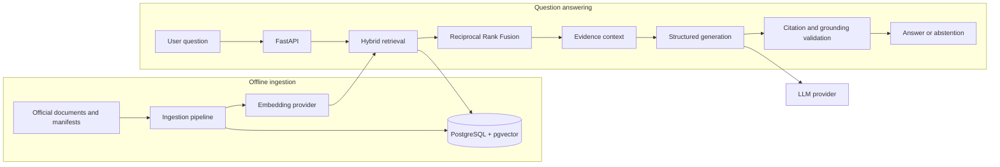
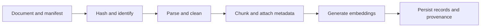
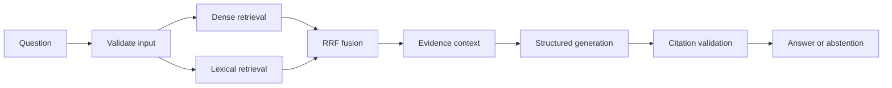

# Advanced-RAG

**Evidence-grounded question answering over official Indian tax and regulatory documents using hybrid retrieval, structured generation, verifiable citations, and evidence-based abstention.**

> **Research aid, not legal or tax advice.** Retrieval-augmented generation can reduce unsupported answers, but it cannot eliminate them. Valid citations do not guarantee that a claim is correct, complete, current, or applicable. See [Grounding and Abstention](docs/retrieval-and-generation.md).

## Overview

Advanced-RAG is a production-oriented retrieval-augmented generation (RAG) system designed to answer questions about Indian tax and regulatory material using retrieved documentary evidence.

Tax and regulatory documents can be lengthy, frequently amended, and distributed across multiple official sources. Keyword search can miss paraphrased questions, vector search can miss exact statutory identifiers, and language models can generate unsupported claims.

Advanced-RAG combines semantic and lexical retrieval, rank fusion, structured answer generation, citation validation, and explicit abstention to make answers easier to inspect and evaluate.

The project is intended for researchers of Indian tax information, engineers learning applied RAG, and technical reviewers evaluating evidence-grounded AI systems.

See the [Project Specification](docs/project-specification.md) for requirements and scope.

## Core capabilities

The system is designed around the following capabilities:

- **Document ingestion:** reproducible ingestion with source provenance, content hashes, version tracking, cleaning, and chunking.
- **Hybrid retrieval:** dense vector search using pgvector combined with PostgreSQL full-text search.
- **Reciprocal Rank Fusion (RRF):** combining retrieval rankings without requiring raw scores from different retrievers to be directly comparable.
- **Metadata-aware retrieval:** filtering evidence using document metadata, including status and effective dates where the source data supports them.
- **Structured generation:** validated answer schemas using Pydantic v2.
- **Verifiable citations:** citations linked to retrieved evidence, with quote-level validation.
- **Evidence-based abstention:** declining to provide a substantive answer when the available evidence is insufficient, with explicit reason codes.
- **Evaluation:** retrieval metrics, answer-grounding checks, citation checks, and a curated golden evaluation dataset.
- **API and observability:** a FastAPI interface, structured logging, and clear boundaries for later tracing and performance monitoring.

These are the target capabilities of the project. See the implementation and tests for the features that are operational in the current revision.

## Architecture

The architecture separates document ingestion from online question answering.



### Ingestion flow



### Query flow



## Technology stack

| Area | Technology |
|---|---|
| Language | Python |
| API | FastAPI |
| Data validation | Pydantic v2 |
| Database access | SQLAlchemy 2.x async |
| Database driver | asyncpg |
| Database | PostgreSQL with pgvector |
| Database migrations | Alembic |
| Embeddings and language models | Provider integration selected through configuration |
| Retrieval | Vector similarity, PostgreSQL full-text search, and RRF |
| Testing | pytest |
| Code quality | Ruff |
| Automation | GitHub Actions |
| Interactive UI | Chainlit |
| Caching | Redis |
| Observability | Structured logging; Langfuse integration |

The core architecture does not depend on LangChain, LangGraph, or Pinecone.

Library compatibility, provider configuration, and deployment requirements must be verified against the actual development environment. Optional components should be introduced only when they provide a clear benefit.

## Repository structure

```text
Advanced-RAG/
├── .github/                 # CI and repository automation
├── data/                    # Local data directories
├── docs/
│   ├── adr/                 # Architecture Decision Records
│   ├── project-specification.md
│   ├── architecture.md
│   ├── data-and-ingestion.md
│   ├── retrieval-and-generation.md
│   ├── api-and-interface.md
│   ├── testing-and-evaluation.md
│   ├── development-and-operations.md
│   ├── security.md
│   └── learning-and-interview-guide.md
├── evals/                   # Evaluation datasets
├── migrations/              # Database migrations
├── scripts/                 # Development utilities
├── src/advanced_rag/        # Application implementation
└── tests/                   # Unit, integration, and evaluation tests
```

## Development environment

The primary development target is **Windows 11 with native PostgreSQL**. Development should remain local-first, with external API usage controlled through configuration.

Before running the application:

1. Install a compatible Python version and create a project virtual environment.
2. Install PostgreSQL and configure pgvector.
3. Configure environment variables using [.env.example](.env.example).
4. Install the project dependencies.
5. Apply database migrations and prepare the evaluation dataset.

Follow [Development Setup](docs/development-and-operations.md) for the exact commands and environment checks. Do not assume that the application is runnable until setup and tests have succeeded.

## Quality and evaluation

Advanced-RAG is designed to be evaluated on retrieval quality, answer grounding, citation validity, and abstention behavior.

Retrieval evaluation can include:

- **Hit@K:** whether a relevant result appears in the top K.
- **Recall@K:** the proportion of relevant evidence retrieved in the top K.
- **MRR:** the reciprocal rank of the first relevant result.
- **nDCG@K:** ranking quality that accounts for relevance and position.

Answer evaluation should additionally check whether claims are supported by retrieved evidence, citations resolve to the correct source passages, and insufficient evidence triggers abstention.

Metrics must be reported only after the evaluation harness has been run against a documented dataset. No benchmark scores or performance claims should be inferred from the architecture alone.

See [Evaluation](docs/testing-and-evaluation.md) and [Testing](docs/testing-and-evaluation.md).

## Security and limitations

- Retrieved documents are untrusted input and may contain misleading instructions or content.
- External model and embedding providers may receive questions and selected evidence passages.
- The initial local-development configuration is not a substitute for production authentication, authorization, or operational security.
- Corpus coverage depends on the documents actually ingested.
- Document amendments, effective dates, and source provenance must be handled carefully.
- Citation validation improves inspectability but does not prove legal correctness.

Review [Security](docs/security.md), [Data Sources](docs/data-and-ingestion.md), and [Grounding and Abstention](docs/retrieval-and-generation.md).

## Roadmap

Development follows this sequence:

1. **Core pipeline:** configuration, database models, ingestion, embeddings, hybrid retrieval, RRF, structured generation, citations, and abstention.
2. **API and evaluation:** API integration, automated tests, golden-set evaluation, and quality reporting.
3. **Developer experience:** interactive UI, observability, and improved debugging.
4. **Performance and deployment:** caching, streaming where justified, optional reranking, and deployment hardening.

The sequence may change as implementation and evaluation reveal the most important gaps.

## Documentation

| Area | Document |
|---|---|
| Requirements and scope | [Project Specification](docs/project-specification.md) |
| Architecture and database | [Architecture](docs/architecture.md) |
| Data sources and ingestion | [Data and Ingestion](docs/data-and-ingestion.md) |
| Retrieval, generation, citations and abstention | [Retrieval and Generation](docs/retrieval-and-generation.md) |
| API and interface | [API and Interface](docs/api-and-interface.md) |
| Tests and quality metrics | [Testing and Evaluation](docs/testing-and-evaluation.md) |
| Setup, observability, caching and deployment | [Development and Operations](docs/development-and-operations.md) |
| Security | [Security](docs/security.md) |
| Learning and interview preparation | [Learning and Interview Guide](docs/learning-and-interview-guide.md) |
| Architecture decisions | [ADRs](docs/adr/README.md) |

## Disclaimer

Advanced-RAG is an engineering and research project for exploring evidence-grounded question answering. It is not a substitute for advice from a qualified tax professional or lawyer. Users should consult the applicable official source and a qualified professional before making legal, financial, or tax decisions.
