<div align="center">

# Advanced-RAG

**A production-grade PDF question-answering system built from first principles.**

Hybrid retrieval (pgvector dense + real BM25 via ParadeDB pg_search), fused with RRF,
verified with claim-level quote matching, and deployed on Azure with CI/CD.

[](https://github.com/adrinjoseph/advanced-rag/actions/workflows/ci.yml)
[](LICENSE)
[](pyproject.toml)
[](https://github.com/astral-sh/ruff)

> **Status: In progress — nothing here is built, benchmarked, or deployed yet.**
> Every number in this README comes from a committed eval result file.
> Tables marked `not yet measured` are filled only after results are committed.

[Architecture](#architecture) · [How it works](#how-it-works) · [Stack](#stack) · [Quickstart](#quickstart-local) · [Results](#results) · [Limitations](#limitations) · [Security](#security) · [Azure deployment](#azure-deployment-and-cost-control) · [Contributing](CONTRIBUTING.md)

</div>

---

## What this project proves

This is not a wrapper around a framework. Every component is built by hand and can be explained line by line.

| Signal | How |
|---|---|
| **Retrieval engineering** | Dense + real BM25 + RRF, ablation table showing each contribution |
| **Trustworthy generation** | Claim-level quote verification, abstention, measured rates |
| **Backend discipline** | Async FastAPI, Alembic migrations, 3-tier modules, typed throughout |
| **Security thinking** | SQL-enforced collection isolation, 3-stage guardrails, injection test suite |
| **Honest measurement** | Dev/test split, held-out document types, no invented numbers |
| **Ownership** | Docker, CI/CD, Azure deployment, scripted pause/destroy/restore |

---

## Architecture

> Animated — arrows show live data flow direction. Best viewed on GitHub.



**Key design decisions baked into the diagram:**

- **One Uvicorn worker** — `asyncio.Semaphore(1)` gates CPU embedding to prevent event-loop starvation. Multiple workers would silently break this.
- **Dense and BM25 run sequentially** — SQLAlchemy async sessions cannot execute two queries concurrently on the same connection. This is not a performance choice; it is a correctness requirement.
- **RRF is a pure Python function** — `score = Σ 1/(k + rank)` over each ranked list. No I/O, no calibration. Fully unit-tested including tie-breaking.
- **Non-streaming responses** — citation verification requires the complete output before returning anything.
- **ParadeDB in a container** — `pg_search` is not available on managed Postgres (Azure Database for PostgreSQL). Self-hosting is not a workaround; it is the only option for real BM25.
- **No LangChain, LlamaIndex, or agent frameworks** — every line is explainable.

---

## How it works

### Ingestion pipeline

```
upload
 → validate: extension, magic bytes, size cap, page cap, scanned-PDF check
 → sha256 → dedupe per collection  (UNIQUE constraint — re-upload adds zero rows)
 → store original under a generated key (never the raw filename)
 → PyMuPDF: extract text blocks with page numbers
 → chunk: ~450 tokens, ~50 overlap, recursive fallback
 → embed in batches via ONNX Runtime, strictly gated by asyncio.Semaphore(1)
 → insert chunks (embedding + text; BM25 index built automatically on text)
 → status: uploaded → processing → indexed | failed(error_code)
```

A document is searchable only after it reaches `indexed`. Deletion removes it from
retrieval immediately, then cleans chunks and the stored file. Idempotent.

### Query pipeline

```
validate input: length, emptiness, injection signal (logged — not the security boundary)
 → embed query WITH the bge query instruction prefix
 → dense search:  pgvector HNSW top-20, WHERE collection_id = ? AND owner_id = ?
 → BM25 search:   pg_search top-20, same filter — run SEQUENTIALLY
 → RRF fusion:    score = Σ 1/(60 + rank), sorted descending
 → context:       top-8 chunks, token budget, dedup, preserve chunk IDs
 → Groq:          non-streaming, structured JSON
                  { answer, claims[{ text, chunk_id, quote }], abstain }
 → verify:        chunk_id in supplied evidence set
                  AND normalized quote is a substring of normalized chunk text
 → any failure → abstain
 → return:        citations resolved to (document filename, page number)
```

### Why this retrieval design

**Dense search** finds semantically similar chunks — it handles paraphrase, synonyms,
and conceptual overlap. It struggles with exact terms (IDs, section numbers, names).

**BM25** scores by term frequency and rarity. It is precise on exact terms and
identifiers. It struggles with paraphrase.

**RRF** fuses the two ranked lists by rank position only — `1/(k + rank)`. Scores
from dense and BM25 are on completely different scales and cannot be summed directly.
Ranks are always comparable. The ablation table in [Results](#results) shows what
each mode contributes.

### Why quote verification matters

PDFs contain arbitrary line breaks, hyphenation, and whitespace. The LLM is asked to
cite the exact passage it used. Without normalization, minor whitespace differences
cause false negatives on every match. Normalization strips whitespace and punctuation
before checking that the quote is a substring of the chunk text. A valid quote proves
the model cited real retrieved text — not that the answer is correct (that is sampled
manually).

---

## Stack

| Layer | Tool | Version | Why |
|---|---|---|---|
| API framework | FastAPI | pinned in pyproject.toml | Async, typed, thin |
| Server | Uvicorn | pinned | ASGI, single worker |
| Validation | Pydantic v2 | pinned | Schema-enforced I/O |
| Database | ParadeDB (Postgres + pgvector + pg_search) | pinned in docker-compose.yml | Vector + BM25 in one container |
| ORM | SQLAlchemy 2 async | pinned | Async queries, no raw SQL for business logic |
| DB driver | asyncpg | pinned | Fast async Postgres driver |
| Migrations | Alembic | pinned | Versioned schema, up/down |
| PDF extraction | PyMuPDF | pinned | Text blocks with page positions |
| Embeddings | bge-small-en-v1.5 via onnxruntime | pinned | 384-dim, CPU-only, ~150MB, no PyTorch |
| Tokenization | transformers AutoTokenizer | pinned | Real token counts for chunking |
| LLM | Groq via httpx (hand-written adapter) | model: see .env.example | Structured JSON, retry/backoff |
| UI | Chainlit | pinned | Thin chat client, no business logic |
| Reverse proxy | Caddy | pinned | Auto TLS, no cert management |
| Cloud | Azure Linux VM (amd64) | Ubuntu LTS | Single VM, Docker Compose |
| IaC | Bicep | — | Azure-native, one resource group |
| CI/CD | GitHub Actions | — | OIDC deploy, no stored secrets |
| Container registry | GHCR | — | Free, next to the code |
| Lint / format | Ruff | pinned | Fast, one tool |
| Tests | pytest | pinned | Unit, integration, security |

---

## Quickstart (local)

**Prerequisites:** Docker Desktop, Git, Python (version in `pyproject.toml`).

```bash
# 1. Clone
git clone https://github.com/adrinjoseph/advanced-rag.git
cd advanced-rag

# 2. Environment
cp .env.example .env
# Open .env and fill in: SECRET_KEY, GROQ_API_KEY, DATABASE_URL, LLM_MODEL

# 3. Start the stack (db, api, ui, caddy)
docker compose -f docker-compose.yml -f docker-compose.override.yml up -d

# 4. Wait for all services to be healthy
docker compose ps

# 5. Run migrations
docker compose exec api alembic upgrade head

# 6. Create a test user
docker compose exec api python scripts/seed_user.py

# 7. Open the UI
open http://localhost
```

**Run tests:**

```bash
# Install Python tooling (outside Docker)
pip install uv
uv sync --all-extras

# Lint
ruff check .
ruff format --check .

# Tests
pytest -m unit                 # no Docker needed
pytest -m integration          # requires stack running
pytest -m security             # requires stack running
pytest                         # full suite
```

**Common issues:**

| Symptom | Likely cause | Fix |
|---|---|---|
| `db` service unhealthy | ParadeDB image not pulled | `docker compose pull db` |
| `api` exits immediately | Missing env var | Check `docker compose logs api` |
| BM25 query returns no results | pg_search extension not enabled | Re-run migrations |
| Embedding hangs | ONNX model file missing | Check `app/clients/embeddings.py` model path |

---

## Configuration

All configuration via environment variables. Copy `.env.example` → `.env`. Never commit `.env`.

| Variable | Description | Default | Required |
|---|---|---|---|
| `SECRET_KEY` | Token signing secret — min 32 random bytes | — | Yes |
| `GROQ_API_KEY` | Groq API key | — | Yes |
| `DATABASE_URL` | `postgresql+asyncpg://user:pass@db:5432/ragdb` | — | Yes |
| `ALLOWED_ORIGINS` | CORS origins, comma-separated | — | Yes |
| `LLM_MODEL` | Groq model name (check current availability) | — | Yes |
| `LLM_TIMEOUT_S` | Groq call timeout in seconds | `30` | No |
| `DENSE_CANDIDATES` | HNSW candidates per query | `20` | No |
| `BM25_CANDIDATES` | BM25 candidates per query | `20` | No |
| `RRF_K` | RRF rank constant | `60` | No |
| `FINAL_CONTEXT_CHUNKS` | Chunks in LLM context window | `8` | No |
| `CHUNK_TOKENS` | Target chunk size in tokens | `450` | No |
| `CHUNK_OVERLAP` | Overlap between chunks in tokens | `50` | No |
| `MAX_UPLOAD_MB` | PDF upload size cap | set after measuring | No |
| `MAX_PAGES` | PDF page cap | set after measuring | No |
| `MAX_QUERY_CHARS` | Query length cap | `2000` | No |

---

## API endpoints

| Method | Path | Auth | Description |
|---|---|---|---|
| `POST` | `/auth/login` | None | Exchange credentials for a signed token |
| `POST` | `/collections` | Token | Create a collection |
| `GET` | `/collections` | Token | List owned collections |
| `POST` | `/collections/{id}/documents` | Token + owner | Upload a PDF |
| `GET` | `/collections/{id}/documents` | Token + owner | List documents with status |
| `DELETE` | `/documents/{id}` | Token + owner | Delete a document and all its chunks |
| `POST` | `/collections/{id}/query` | Token + owner | Ask a question |
| `GET` | `/health` | None | Liveness check — leaks no internals |

**Security invariant:** every endpoint that touches documents or chunks verifies ownership
in SQL, not in application code alone. A forged `collection_id` in the URL cannot access
another user's data. This is tested in `tests/security/`.

---

## Data model

```
users           id · email · password_hash · created_at
  └── collections   id · owner_id → users · name · created_at
        └── documents   id · collection_id · filename · storage_key · sha256
                         pages · status · error_code · created_at
                         UNIQUE(collection_id, sha256)
              └── chunks   id · document_id · collection_id · idx · text
                            page_start · page_end · token_count
                            embedding vector(384)
                            HNSW index (cosine) on embedding
                            BM25 index (pg_search) on text
                            btree index on collection_id

query_logs      id · request_id · collection_id · stage_ms (jsonb)
                n_chunks · abstained · status · created_at
```

---

## Retrieval gotchas (and how they are handled)

| # | Gotcha | Defence | Test |
|---|---|---|---|
| 1 | HNSW + filter returns too few rows | pgvector iterative-scan settings | `tests/integration/test_retrieval.py` |
| 2 | BM25 filter silently wrong | `EXPLAIN` verified in migration tests | `tests/integration/test_bm25.py` |
| 3 | Deleted doc chunks appear in results | Delete removes chunks before file | `tests/integration/test_delete.py` |
| 4 | Embedding blocks event loop | Worker thread + `Semaphore(1)` | Latency benchmark |
| 5 | AsyncSession concurrent queries | Sequential dense then BM25 | `tests/unit/test_retrieval_sequential.py` |
| 6 | Missing query prefix on bge model | Prefix prepended in `clients/embeddings.py` | Embedding similarity test |
| 7 | ONNX pooling/normalization wrong | Cosine similarity verified against reference | Phase 0 spike |
| 8 | Cross-collection chunk leakage | `owner_id` filter in both SQL queries | `tests/security/test_isolation.py` |

---

## Guardrails

| Stage | What is checked |
|---|---|
| **Input** | Query length cap · upload type/size/page caps · scanned-PDF rejection · rate limits · injection-pattern signal (logged only — not the security boundary) |
| **Context** | Evidence wrapped in delimiters labeled "untrusted data" · token budget · no secrets in prompts · collection scoping enforced in SQL |
| **Output** | Pydantic schema · citation `chunk_id` verified in evidence set · normalized quote verified as substring of chunk · length cap · abstain on any failure |

**Security test suite** (`tests/security/`):

- PDF containing "ignore all previous instructions"
- PDF asking the model to reveal other users' data
- Forged `collection_id` on query
- Cross-owner document read and delete attempts
- Malformed or non-JSON model output
- Model cites a chunk ID not in the supplied evidence
- Model quote not in chunk (with and without normalization)
- Oversized and corrupt uploads
- Legitimate security paper triggering injection heuristic (false-positive check)
- Request with missing or invalid token on every protected route

---

## Evaluation

### Corpus

6 public PDFs across different types: legal/tax circular, research paper, technical manual,
report, and 2 more decided in Phase 4. ~50 hand-written questions: direct, paraphrased,
exact identifier, cross-document, and ~12 unanswerable. Each case stores:
`question`, `corpus`, `relevant_chunk_ids`, `expected_answer`, `should_abstain`.

### Split

~60% dev (tune here) / ~40% test (report only this). Fixed before any tuning.

### Held-out

2 additional document types never used for tuning, ~15 questions. The gap between dev
and held-out is the honest answer to "does it work on any PDF?"

### Strategy

LLM-as-a-judge for the iterative dev/ablation loop (saves quota). Manual grading for
the 40% test set and held-out set only. Abstention threshold tuned on dev only.
No thresholding on RRF scores (they are not calibrated).

---

## Results

> Tables filled only after eval harness is complete (Phase 4+).
> Numbers come from committed files in `eval/results/` — never from memory.

### Retrieval — dev split (~60%, N questions)

| Mode | Recall@5 | Recall@10 | MRR | nDCG@10 |
|---|---|---|---|---|
| Dense only | not yet measured | not yet measured | not yet measured | not yet measured |
| BM25 only | not yet measured | not yet measured | not yet measured | not yet measured |
| Hybrid (RRF) | not yet measured | not yet measured | not yet measured | not yet measured |

### Chunk-size ablation (dev split)

| Chunk tokens | Recall@10 | nDCG@10 |
|---|---|---|
| 300 | not yet measured | not yet measured |
| 450 (default) | not yet measured | not yet measured |

### Generation — test split (40%)

| Metric | Value |
|---|---|
| Citation validity (chunk_id in evidence set) | not yet measured |
| Quote-match rate (normalized substring check) | not yet measured |
| Abstention precision | not yet measured |
| Abstention recall | not yet measured |
| Answer correctness (manual sample) | not yet measured |

### Held-out gap

| | Dev split | Held-out set | Gap |
|---|---|---|---|
| Recall@10 | not yet measured | not yet measured | not yet measured |
| Answer correctness | not yet measured | not yet measured | not yet measured |

### System performance

| Metric | Value |
|---|---|
| p50 end-to-end query latency | not yet measured |
| p95 end-to-end query latency | not yet measured |
| Ingestion speed (seconds / page) | not yet measured |
| Average tokens per query | not yet measured |
| Cold-start time (VM start → `/health` healthy) | not yet measured |
| Peak RAM on Azure VM | not yet measured |
| ONNX Runtime footprint vs PyTorch | not yet measured |
| Data disk usage (pgdata + uploads) | not yet measured |

---

## Limitations

- **Text-based PDFs only.** Scanned / image PDFs are rejected with a clear error. OCR is out of scope.
- **No DOCX, TXT, Markdown, spreadsheets, audio, video, or website crawling.**
- **Non-streaming only.** Citation verification requires the complete response.
- **Sequential chunking only.** Semantic / heading-based chunking is not implemented — PDF layouts are too unreliable for it to be reliable.
- **No reranker.** Planned as future work if ablations show a ranking problem.
- **No self-service registration.** Chainlit password login only. No roles, plans, or billing.
- **No guaranteed correctness.** A valid citation proves the model cited real retrieved text. Whether the answer is correct is sampled manually — it is not guaranteed by the system.
- **Single VM.** No horizontal scaling, no Redis, no Kubernetes. `uvicorn --workers 1` is a correctness requirement, not a limitation to fix.
- **Provider dependency.** Generation requires Groq to be reachable. No local model fallback.

---

## Security

- Collection and owner filter enforced in SQL on **both** retrieval paths (dense and BM25). There is no code-only authorization check.
- Three-stage guardrails: input, context, output. Each returns an explicit decision — no silent mutations.
- No secrets in the repo, images, logs, or LLM prompts.
- Forged `collection_id` attacks covered in `tests/security/`.
- Injection-pattern detection is logged — it is not the security boundary.
- No inbound SSH by default. Azure NSG allows only TCP 80 and 443. SSH is added temporarily via `scripts/azure/allow-my-ip.sh` and removed by `down.sh`.

See [SECURITY.md](SECURITY.md) to report a vulnerability.

---

## Azure deployment and cost control

Hosted on a single Azure Linux VM (amd64) running Docker Compose + Caddy.
All infrastructure is defined in `infra/` (Bicep) and can be rebuilt from scratch.

### Power modes

| Mode | VM state | Compute billed | Disks billed | Script |
|---|---|---|---|---|
| **RUN** | Running | Yes | Yes | `scripts/azure/up.sh` |
| **PAUSE** | **Deallocated** | **No** | Yes | `scripts/azure/down.sh` |
| **DESTROY** | Deleted | No | No (data disk detached first) | `scripts/azure/destroy.sh` |

> **Critical:** "Stopped" ≠ "Deallocated". Shutting down from inside the OS leaves the
> VM in "Stopped" state, which still bills for compute. Only `Deallocated` stops compute
> billing. `down.sh` verifies the state is `deallocated` before exiting 0.

### Resource billing summary

| Resource | Billed when paused (deallocated) |
|---|---|
| VM compute | No |
| OS disk | Yes (by GB) |
| Data disk | Yes (by GB) |
| Public IP (Standard/static) | Possibly — verify per ADR |
| Blob Storage (backups) | Yes (by GB stored) |

### Cost guardrails

- Budget alerts at 50%, 75%, 90% of credit (Azure Cost Management).
- VM auto-shutdown enabled daily.
- `docs/cost-control.md` — weekly log: date, credit remaining (from portal), what was running.
- Backups in a **separate resource group** (`rg-advancedrag-backups`) — survive `DESTROY`.

### Deployment workflow

```bash
# Pause (deallocate the VM)
./scripts/azure/down.sh

# Resume and optionally deploy latest image
./scripts/azure/up.sh

# Full status check
./scripts/azure/status.sh

# Destroy everything (run a backup first, backups survive)
./scripts/azure/destroy.sh

# Restore from backup onto a fresh VM
./scripts/azure/restore.sh
```

GitHub Actions `deploy.yml` uses OIDC — no Azure secrets stored in GitHub.
See [docs/runbook.md](docs/runbook.md) for the full deploy, rollback, and restore guide.

### Cold-start flow

```
az vm start  →  Docker Compose up (restart: unless-stopped)
             →  Caddy renews cert if needed
             →  GET /health returns 200
             →  ready
```

Cold-start time: **not yet measured** (target: under 60 seconds).

---

## Project structure

```
advanced-rag/
├── .github/
│   ├── workflows/
│   │   ├── ci.yml               # lint · unit · integration · security · docker-build
│   │   └── deploy.yml           # manual: build → GHCR → az vm run-command
│   ├── ISSUE_TEMPLATE/
│   ├── CODEOWNERS
│   ├── PULL_REQUEST_TEMPLATE.md
│   └── dependabot.yml
├── app/
│   ├── api/
│   │   ├── routes/              # auth · collections · documents · query · health
│   │   ├── schemas.py           # Pydantic request/response models
│   │   └── deps.py              # auth, session, ownership checks
│   ├── services/                # ingestion · chunking · retrieval · fusion
│   │                            # context_builder · generation · citation_check
│   ├── guardrails/              # input.py · context.py · output.py
│   ├── clients/                 # db.py · embeddings.py · llm.py · storage.py
│   └── core/                    # config.py · logging.py · errors.py
├── ui/
│   └── chainlit_app.py          # HTTP calls only, zero business logic
├── eval/
│   ├── corpus/   heldout/
│   ├── cases.jsonl
│   ├── run.py
│   └── results/                 # committed result files; README numbers must match
├── tests/
│   ├── unit/   integration/   security/
│   └── conftest.py
├── migrations/                  # Alembic (env.py · versions/)
├── infra/                       # Bicep templates + params
├── deploy/
│   └── vm-bootstrap.sh          # first-boot: Docker install, mount data disk
├── scripts/
│   ├── seed_user.py
│   ├── backup.sh
│   ├── restore.sh
│   └── azure/
│       └── up · down · status · destroy · allow-my-ip
├── docs/
│   ├── architecture.md
│   ├── runbook.md
│   ├── cost-control.md
│   ├── evaluation.md
│   └── adr/                     # 0001-azure-vm · 0002-paradedb-bm25 · ...
├── docker-compose.yml           # production-safe
├── docker-compose.override.yml  # local only (DB port on 127.0.0.1)
├── Dockerfile
├── Caddyfile
├── pyproject.toml
├── .env.example
└── README.md
```

---

## Interview defence

| Challenge | Answer |
|---|---|
| Why not LangChain? | Built retrieval, fusion, and verification by hand — can whiteboard each |
| Why BM25 and dense? | Dense handles paraphrase, BM25 handles exact terms. Ablation table shows contributions |
| Why RRF over adding scores? | Scores from dense and BM25 are on different scales and not calibrated. Ranks always are |
| Why normalize quotes? | PDFs have arbitrary line breaks. Exact matching causes false negatives on every real PDF |
| Does a valid quote prove the answer is right? | No — it proves the model cited real text. Correctness is sampled manually |
| Why ONNX for embeddings? | Smaller footprint than PyTorch. Measured: [fill after Phase 0] |
| Why one Uvicorn worker? | `Semaphore(1)` around embedding is per-process. More workers break it silently |
| Does it work on any PDF? | Text PDFs only. Held-out gap shows how performance changes on unseen document types |
| Why not streaming? | Verification needs the complete output |
| How is isolation enforced? | In SQL on both retrieval paths, with forged-ID tests in CI |
| Why not always on? | Cost control — VM is deallocated when idle. Cold start: [measured value] s. Recorded demo available |

---

## License

MIT © 2026 Adrin Joseph K.J — see [LICENSE](LICENSE).