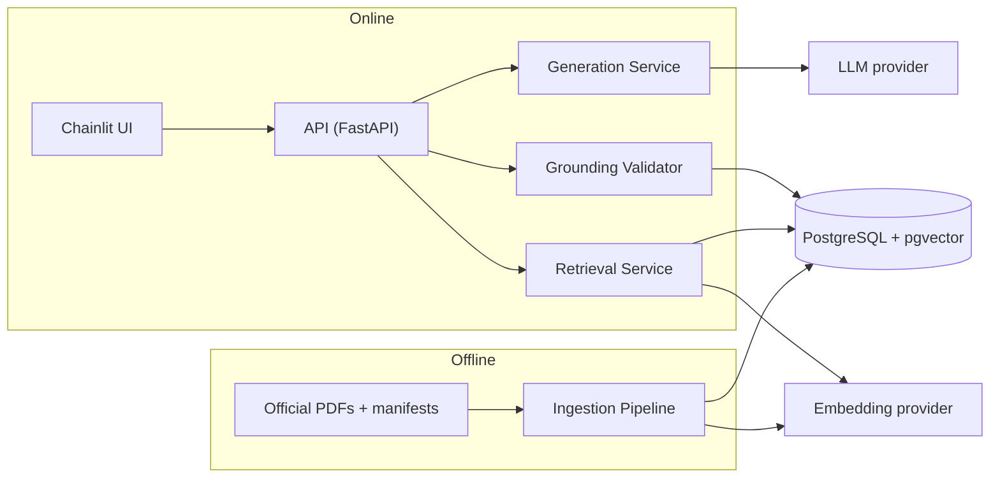
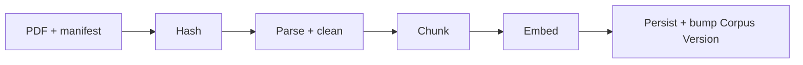
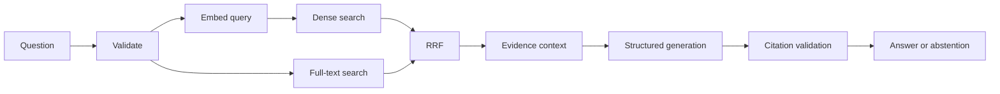

# Advanced-RAG

Evidence-grounded question answering over official Indian tax and regulatory documents: hybrid retrieval, structured generation, verifiable citations, and abstention when evidence is insufficient.

> **Research aid, not legal or tax advice.** RAG reduces unsupported answers; it does not eliminate them. Valid citations do not guarantee a claim is correct or applicable ([details](docs/grounding-and-abstention.md)).

## Implementation status

Honest status table. Update it as work lands; this is the only place a feature becomes **[Implemented]**.

| Capability | Status |
|---|---|
| Ingestion Pipeline | **[Proposed]** |
| Dense + lexical retrieval + RRF | **[Proposed]** |
| Structured generation, citation validation, abstention | **[Proposed]** |
| REST API | **[Proposed]** |
| Chainlit UI | **[Planned]** |
| Evaluation Harness | **[Proposed]** |
| Redis cache, SSE, Langfuse | **[Planned]** |
| Deployment | **[Planned]**, nothing deployed |

No measurements, datasets or benchmarks exist yet, and none are claimed.

## Problem and users

Tax and regulatory material is long, amended and scattered. Keyword search misses paraphrase, vector search misses exact identifiers, and ungrounded LLMs invent. Intended users: researchers of Indian tax information, engineers studying grounded RAG, and technical reviewers. Full statement: [project specification](docs/project-specification.md).

## Key capabilities (design)

- Idempotent, versioned ingestion with full provenance
- Dense (pgvector) and lexical (PostgreSQL full-text) retrieval fused by RRF
- Metadata filters for document status and effective date
- Structured answers (Pydantic v2) with quote-anchored citations
- Explicit abstention with reason codes
- Golden-set evaluation with retrieval and answer metrics

## Architecture

### Ingestion flow

### Query flow

## Technology stack (baseline, see [specification](docs/project-specification.md#7-technology-baseline))

Python 3.14.6 · FastAPI · Pydantic v2 · SQLAlchemy 2.x async + asyncpg · Alembic · PostgreSQL + pgvector · Instructor · Chainlit · Redis (planned) · Langfuse (planned) · pytest · Ruff · GitHub Actions.
Library compatibility with Python 3.14 is **unverified**. LLM and embedding providers are **not chosen**. Excluded: Pinecone, LangChain, LangGraph.

## Prerequisites and setup

Git Bash on Windows 11, Python 3.14.6, native PostgreSQL with pgvector. Step-by-step, with verification status: [development setup](docs/development-setup.md). Configuration: [.env.example](.env.example).

## Commands

Not runnable yet; the code does not exist. Planned commands live in [development setup](docs/development-setup.md#7-migrations-ingestion-run-depend-on-planned-code):

- Run tests, lint: **[Planned]**
- Ingest sample documents: **[Planned]**, `python -m advanced_rag.ingestion <path>`
- Run evaluation: **[Planned]**, `python -m advanced_rag.evaluation run --config <file>`
- API: **[Planned]** `/v1/query`; UI: **[Planned]** Chainlit app ([api-and-ui](docs/api-and-ui.md))

## Security and data limitations

No authentication in the baseline (local use only). Questions and evidence are sent to external providers. Retrieved documents are untrusted input. Corpus coverage is limited to what the owner ingests. See [security](docs/security.md) and [data sources](docs/data-sources.md).

## Roadmap

1. **Phase 1:** ingestion, retrieval, generation, validation, API, evaluation, logs
2. **Phase 2:** Chainlit UI, Langfuse
3. **Phase 3:** Redis, SSE, optional reranking, deployment options

## Documentation map

| Area | Documents |
|---|---|
| Requirements | [project-specification](docs/project-specification.md) · [glossary](docs/glossary.md) |
| Architecture | [architecture](docs/architecture.md) · [data-flow](docs/data-flow.md) · [ADRs](docs/adr/README.md) |
| Data | [data-sources](docs/data-sources.md) · [database](docs/database.md) · [ingestion](docs/ingestion.md) |
| Retrieval and generation | [retrieval](docs/retrieval.md) · [generation](docs/generation.md) · [grounding-and-abstention](docs/grounding-and-abstention.md) |
| Interfaces | [api-and-ui](docs/api-and-ui.md) |
| Quality | [evaluation](docs/evaluation.md) · [testing](docs/testing.md) |
| Operations | [observability](docs/observability.md) · [caching](docs/caching.md) · [deployment](docs/deployment.md) · [development-setup](docs/development-setup.md) |
| Security | [security](docs/security.md) · [SECURITY.md](SECURITY.md) |
| Learning | [learning-guide](docs/learning-guide.md) · [interview-guide](docs/interview-guide.md) |
| Contributing | [CONTRIBUTING](CONTRIBUTING.md) |
