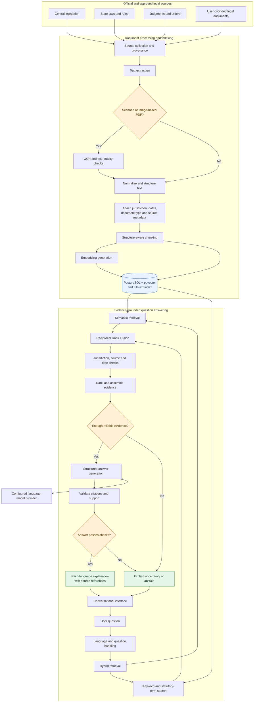
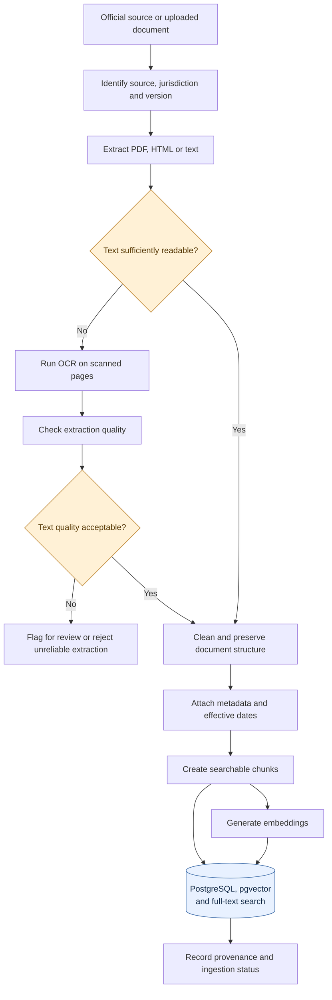
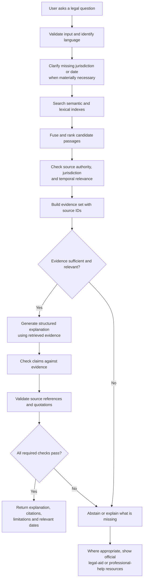

# Advanced-RAG

### Making Indian legal information easier to understand, verify, and access.

An evidence-grounded, multilingual AI assistant for understanding Indian legal documents, locating relevant legal provisions, and navigating complex legal information with source-linked explanations.

> **Important:** This is an engineering project and legal-information aid, not a lawyer or a substitute for qualified legal advice. It must not present generated explanations as definitive legal conclusions.

## The Problem

India has **millions of pending court cases**. Many people struggle to access affordable legal help, and legal documents are often written in language ordinary people find difficult to understand. When someone's landlord withholds their deposit, their employer withholds wages, or they face a legal allegation they do not understand, figuring out what the law says and what to do next can be overwhelming.

Existing digital tools leave important gaps:

- **Search engines return documents, not explanations.** Finding a relevant PDF does not mean understanding the provision that applies.
- **Generic AI chatbots can hallucinate.** An invented section number, outdated provision, or incorrect procedural claim can have serious consequences.
- **Scanned documents are difficult to search.** Important text may be trapped inside image-based PDFs or low-quality scans.
- **Jurisdiction matters.** Central legislation, state amendments, state rules, and local procedures may differ.
- **Language is a barrier.** People may need explanations in their preferred regional language rather than formal legal English.
- **Sources and dates matter.** A provision may have been amended, repealed, or brought into force on a particular date.

The goal is not to replace lawyers or courts. It is to help people understand legal information, inspect the underlying sources, and identify when professional or legal-aid assistance may be appropriate.

India's National Judicial Data Grid publishes court-pendency statistics: [NJDG](https://njdg.ecourts.gov.in/). Free legal services are also available to eligible people through legal services institutions: [NALSA](https://nalsa.gov.in/legal-aid/).

## The Proposed Solution

Advanced-RAG is designed to turn complex legal documents into **understandable, evidence-linked explanations**.

A user should be able to ask a question in plain language, provide a legal document, or ask about a relevant provision. The system should retrieve the most relevant official material, explain it in accessible language, identify the jurisdiction and source date when available, and show the passages supporting its response.

If the system cannot establish an adequate evidentiary basis, it should say so instead of inventing an answer.

### Core objectives

- Explain legal language in plain language without silently changing its meaning.
- Retrieve relevant statutes, rules, judgments, and other approved legal sources.
- Process searchable PDFs and, when implemented, scanned documents using OCR.
- Support multilingual questions and explanations through explicitly configured language capabilities.
- Respect jurisdiction, amendments, effective dates, and source provenance.
- Cite the actual retrieved passages used to support an explanation.
- Distinguish sourced facts from interpretation, uncertainty, and missing evidence.
- Abstain when evidence is insufficient, conflicting, or not verified.
- Direct users toward qualified legal professionals or appropriate legal-aid services when needed.

These are project objectives, not claims that every capability is already implemented.

## How It Works

### 1. System architecture



### 2. Document ingestion and OCR



OCR is not automatically trustworthy. Poor scans, missing pages, or extraction errors must be detected where possible rather than silently treated as authoritative text.

### 3. User question to grounded answer



A valid citation is not proof that the entire answer is legally correct. The system must also consider whether the cited source applies to the question, jurisdiction, and relevant date.

## Technology Stack

| Area | Intended technology |
|---|---|
| Language | Python |
| API | FastAPI |
| Schemas and settings | Pydantic v2, Pydantic Settings |
| Database access | SQLAlchemy 2.x async, asyncpg |
| Database | PostgreSQL with pgvector |
| Lexical search | PostgreSQL full-text search |
| Migrations | Alembic |
| Retrieval | Dense search, lexical search, Reciprocal Rank Fusion |
| OCR | A suitable OCR engine, selected and evaluated during implementation |
| Language models | Configurable provider integration |
| Embeddings | Configurable embedding provider |
| UI | Chainlit |
| Optional caching | Redis |
| Observability | Structured logging and optional Langfuse tracing |
| Testing | pytest |
| Linting | Ruff |
| CI | GitHub Actions |

Provider choices, OCR accuracy, multilingual performance, and library compatibility must be verified against actual requirements and tests. The core architecture should remain modular and local-development friendly.

## Repository Structure

```text
Advanced-RAG/
├── .github/
│   └── workflows/                 # CI automation
├── data/
│   ├── raw/                        # Original documents, subject to access rules
│   ├── processed/                  # Extracted and cleaned documents
│   ├── indexes/                    # Index artifacts
│   └── manifests/                  # Source and ingestion metadata
├── docs/
│   ├── adr/                        # Architecture Decision Records
│   ├── project-specification.md
│   ├── architecture.md
│   ├── data-and-ingestion.md
│   ├── retrieval-and-generation.md
│   ├── api-and-interface.md
│   ├── ui-and-user-experience.md
│   ├── caching-and-performance.md
│   ├── observability-and-tracing.md
│   ├── testing-and-evaluation.md
│   ├── development-and-operations.md
│   ├── security.md
│   └── learning-and-interview-guide.md
├── evals/                          # Golden cases and evaluation schemas
├── migrations/                     # Alembic migrations
├── scripts/                        # Development and evaluation tools
├── src/advanced_rag/
│   ├── api/
│   ├── cache/
│   ├── config/
│   ├── db/
│   ├── embeddings/
│   ├── evaluation/
│   ├── generation/
│   ├── ingestion/
│   ├── observability/
│   ├── retrieval/
│   ├── services/
│   └── ui/
└── tests/
    ├── unit/
    ├── integration/
    └── evaluation/
```

This represents the intended project layout. Empty scaffolding does not imply an implemented feature.

## Safety, Privacy and Legal Boundaries

Legal information can affect people's housing, employment, finances, liberty, and rights. Safety is a core engineering requirement.

- **Ground answers in sources:** do not invent provisions, case citations, quotations, or legal outcomes.
- **Respect jurisdiction:** distinguish central law from applicable state-specific legislation and rules.
- **Track time:** retain publication, amendment, and effective-date metadata where available.
- **Preserve uncertainty:** explain when source coverage or interpretation is incomplete.
- **Protect user documents:** do not expose uploaded documents, personal details, credentials, or case information through logs or shared caches.
- **Treat documents as untrusted input:** retrieved text must not override system safety rules.
- **Do not guarantee outcomes:** legal rights and remedies depend on facts, evidence, procedure, and applicable law.
- **Provide appropriate referrals:** where relevant, help users locate official legal-aid resources instead of implying that an AI response replaces a lawyer.

Official resources:
- [National Judicial Data Grid](https://njdg.ecourts.gov.in/)
- [National Legal Services Authority — Legal Aid](https://nalsa.gov.in/legal-aid/)

## Evaluation Plan

The system must be evaluated before making claims about accuracy or reliability.

**Retrieval**
- Hit@K and Recall@K
- Mean Reciprocal Rank (MRR)
- nDCG@K
- Performance by jurisdiction, document type, and query style

**Evidence and answer quality**
- Citation validity and passage-level support
- Unsupported-claim rate
- Appropriate abstention rate
- Correct handling of conflicting or outdated sources
- OCR extraction quality on representative scanned documents

**Multilingual quality**
- Retrieval and answer quality across each supported language
- Preservation of legal meaning in explanations and translations
- Correct handling of legal terms, names, and statutory references

Every reported metric must come from a reproducible evaluation run against a documented dataset. No benchmark scores are claimed at this stage.

## Implementation Roadmap

1. **Foundation:** project configuration, settings, logging, API entry point and tests.
2. **Legal corpus:** source policy, provenance model, document metadata and ingestion pipeline.
3. **Document understanding:** PDF extraction, OCR, quality checks and structure-aware chunking.
4. **Retrieval:** embeddings, PostgreSQL full-text search, hybrid retrieval and RRF.
5. **Grounded generation:** structured answers, citation validation, jurisdiction checks and abstention.
6. **User experience:** API and Chainlit interface, source inspection and understandable error states.
7. **Language support:** select supported languages and evaluate retrieval and generation quality per language.
8. **Reliability:** golden evaluation set, regression tests, security checks and observability.
9. **Optimization:** optional Redis caching, performance measurement and deployment hardening.

Each milestone should be implemented, tested, and reviewed before being described as complete.

## Documentation

| Topic | Document |
|---|---|
| Scope and requirements | [Project Specification](docs/project-specification.md) |
| Architecture | [Architecture](docs/architecture.md) |
| Legal sources and ingestion | [Data and Ingestion](docs/data-and-ingestion.md) |
| Retrieval, generation and grounding | [Retrieval and Generation](docs/retrieval-and-generation.md) |
| API | [API and Interface](docs/api-and-interface.md) |
| User experience | [UI and User Experience](docs/ui-and-user-experience.md) |
| Caching | [Caching and Performance](docs/caching-and-performance.md) |
| Logs and tracing | [Observability and Tracing](docs/observability-and-tracing.md) |
| Testing and evaluation | [Testing and Evaluation](docs/testing-and-evaluation.md) |
| Setup and operations | [Development and Operations](docs/development-and-operations.md) |
| Security | [Security](docs/security.md) |
| Learning and interviews | [Learning and Interview Guide](docs/learning-and-interview-guide.md) |
| Architecture decisions | [ADRs](docs/adr/README.md) |

---

**Vision:** make complex Indian legal information easier to find, understand, and verify — while keeping evidence, uncertainty, privacy, and access to qualified human help at the centre.
