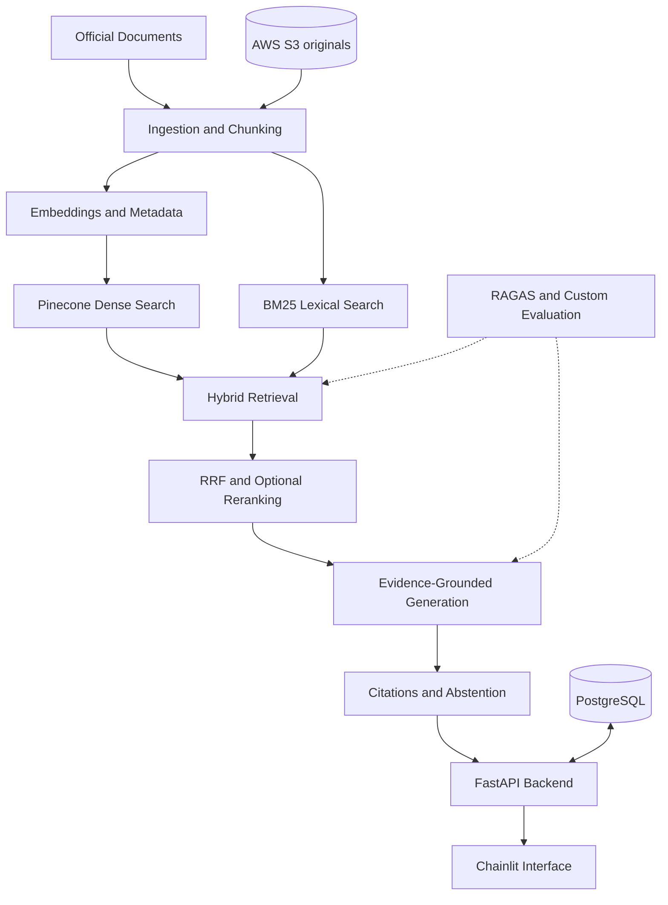

# Advanced RAG: Enterprise Knowledge Intelligence Platform

**Hybrid retrieval · Cited answers · Measured, not assumed**

Advanced RAG is an evidence-grounded question-answering system for official Indian tax and compliance documents. It combines BM25 lexical search, dense vector search, rank fusion and optional reranking to retrieve evidence, then generates answers with **inspectable citations**, and **abstains** when the evidence does not support an answer.

The aim is a reliable, measurable RAG application rather than a basic chatbot. Every retrieval and ranking choice is meant to be justified by evaluation on a labelled query set.

## Why this domain

Tax and legal text stresses every part of a RAG system:

- **Exact references matter** (section numbers, form names), which semantic search alone can miss.
- **Paraphrased questions matter**, which keyword search alone can miss.
- **Versions matter.** Historical and current provisions must not be confused.
- **Wrong answers are costly**, so abstention is a feature, not a failure.

## Key features

| Capability | Approach |
|---|---|
| Lexical retrieval | BM25 via `rank_bm25` |
| Dense retrieval | Pinecone vector search |
| Hybrid retrieval | Candidate merge and Reciprocal Rank Fusion (RRF) |
| Reranking | Optional BGE cross-encoder or Cohere Rerank, kept only if evaluation justifies it |
| Grounded generation | Answers built from retrieved evidence, with citations |
| Abstention | No definitive answer when evidence is insufficient |
| Evaluation | Hit@K, Recall@K, MRR, nDCG, RAGAS, and custom citation, grounding and abstention checks |
| Backend | FastAPI, Pydantic, PostgreSQL 16, SQLAlchemy, Alembic |
| Interface | Chainlit, talking to FastAPI over HTTP |
| Quality | pytest, security tests, Locust load tests, Docker, GitHub Actions |

## Architecture



Details: [docs/architecture.md](docs/architecture.md) and [docs/data-flow.md](docs/data-flow.md).

## Tech stack

| Layer | Technologies |
|---|---|
| Language | Python |
| API | FastAPI, Pydantic |
| Database | PostgreSQL 16, SQLAlchemy, Alembic |
| Retrieval | Pinecone (dense), `rank_bm25` (lexical), RRF, optional reranker |
| Orchestration | LangGraph (bounded workflow, introduced when justified) |
| Evaluation | RAGAS, custom metrics, pytest, Locust |
| UI | Chainlit |
| Storage | AWS S3 (original documents) |
| Infrastructure | Docker, Docker Compose, GitHub Actions |

The LLM provider/model and embedding model are chosen at implementation time and recorded in the documentation. See [docs/decisions](docs/decisions/README.md) for the reasoning behind each choice.

## Dataset

A small, curated set (target: roughly 10-20 documents or sections) of public, authoritative sources: income-tax legislation, GST legislation, official notifications and government guidance. Candidate portals:

- [Income Tax Department](https://www.incometaxindia.gov.in/)
- [CBIC Tax Information Portal](https://taxinformation.cbic.gov.in/)
- [India Code](https://www.indiacode.nic.in/)

The verified list is recorded in a manifest under `data/manifests/`. See [docs/chunking-and-indexing.md](docs/chunking-and-indexing.md).

## Evaluation approach

Retrieval methods (BM25-only, dense-only, hybrid, hybrid plus reranking) are compared on one labelled query set using Hit@K, Recall@K, MRR and nDCG. Answers are assessed with RAGAS and custom checks for faithfulness, citation correctness and correct abstention. A change is accepted only if it measurably helps. See [docs/evaluation.md](docs/evaluation.md) and [docs/benchmarking.md](docs/benchmarking.md).

## Repository structure

```text
Advanced-RAG/
├── src/advanced_rag/
│   ├── domain/          # shared types: Document, Chunk, RetrievalResult, Citation
│   ├── integrations/    # Pinecone, embedder, LLM and S3 clients
│   ├── api/             # FastAPI app, routes, schemas
│   ├── db/              # SQLAlchemy session, models, repositories
│   ├── ingestion/       # loaders, parsing, chunking, pipeline
│   ├── retrieval/       # BM25, dense, hybrid, fusion, reranking, filters
│   ├── generation/      # prompts, answers, citations, abstention
│   ├── evaluation/      # metrics, RAGAS, runner
│   ├── security/        # authentication, authorization
│   └── services/        # query and ingestion orchestration
├── ui/                  # Chainlit app
├── migrations/          # Alembic
├── tests/               # unit, integration, evaluation, security, e2e
├── data/                # manifests, samples, evaluation sets
├── docs/                # detailed documentation
└── scripts/
```

## Documentation

Start at the [documentation index](docs/README.md).

## Disclaimer

This is an engineering and educational project, not a substitute for professional legal or tax advice.

## Author

**Adrin Joseph K.J**, AI/ML engineering student (BS Data Science & AI, IIT Madras). GitHub: [@adrinjoseph](https://github.com/adrinjoseph)
