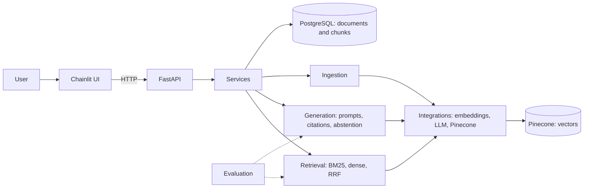

# Advanced-RAG: Indian Tax & Regulatory Knowledge Intelligence

An evidence-grounded question-answering platform for official Indian tax and regulatory documents. Users ask natural-language questions; the system retrieves passages with BM25 and dense search, fuses the rankings, and generates an answer that cites the passages it used, or says the evidence is insufficient.

It is an engineering project, not a chatbot: retrieval quality, source traceability, evaluation, reproducibility and failure handling come first.

## Problem

General-purpose LLMs answer tax questions fluently and sometimes wrongly, with no way to check the source. In this domain a confident wrong answer is worse than no answer. The system must separate **retrieved evidence** from **model-generated explanation**, and refuse to invent a definitive answer when the evidence is missing.

## Why tax and regulatory documents

- **Exact references** (section numbers, form names) favour lexical search.
- **Paraphrased questions** favour dense search, so a hybrid approach is genuinely testable.
- **Versions and effective dates** make "which text applies?" a real correctness problem.
- **Unanswerable questions** are common, so abstention can be measured.

## Objectives

- Ingest a small, curated, verified corpus with full provenance.
- Compare BM25-only, dense-only and hybrid (RRF) retrieval with real metrics.
- Generate answers with citations that map to actual retrieved chunks.
- Abstain when evidence is insufficient; resist prompt injection from documents.
- Keep everything reproducible, tested and documented honestly.

## Architecture



Modular monolith, no microservices. See [docs/architecture.md](docs/architecture.md).

## Technology stack

| Area | Technology |
|---|---|
| Backend | Python, FastAPI, Pydantic v2 |
| Database | PostgreSQL, SQLAlchemy 2.x, Alembic |
| Lexical retrieval | `rank-bm25` |
| Dense retrieval | Embedding model + Pinecone (planned vector store) |
| Fusion | Custom Reciprocal Rank Fusion |
| Generation | LLM provider behind an abstraction (provider and model chosen at implementation and recorded) |
| UI | Chainlit, calling FastAPI over HTTP |
| Quality | pytest, Ruff, GitHub Actions |
| Packaging | Docker, Docker Compose |

## Main user workflow

1. The user asks a question in Chainlit.
2. The UI sends it to FastAPI, which validates it and calls the query service.
3. BM25 and dense retrieval run; results are merged with RRF.
4. Evidence is selected and placed in a grounded prompt, kept separate from instructions.
5. The LLM answers from the evidence; citations are validated against retrieved chunks.
6. If evidence is inadequate, the response says so instead of guessing.

Ingestion is a separate workflow: load, normalize, chunk, hash, persist to PostgreSQL, embed and index, rebuild the lexical index, record results. See [docs/architecture.md](docs/architecture.md).

## Repository structure

```text
Advanced-RAG/
├── src/advanced_rag/
│   ├── api/            # HTTP routes and schemas
│   ├── db/             # sessions, ORM models
│   ├── ingestion/      # load, parse, chunk, pipeline
│   ├── retrieval/      # BM25, dense, hybrid, RRF, filters
│   ├── generation/     # prompts, answers, citations, abstention
│   ├── integrations/   # embedding, LLM, Pinecone clients
│   ├── evaluation/     # datasets, metrics, runner, reports
│   ├── security/       # prompt-injection and input-safety helpers
│   ├── services/       # application workflows
│   └── config.py       # validated configuration
├── ui/                 # Chainlit app and API client
├── migrations/         # Alembic
├── scripts/            # CLI entry points (ingestion, evaluation)
├── tests/
├── docs/
├── Dockerfile  compose.yaml  pyproject.toml  .env.example
```

Treat any module as unimplemented until a test proves otherwise. Many files are currently empty placeholders.

## Setup

Full steps, including troubleshooting: [docs/development-setup.md](docs/development-setup.md). In short (Git Bash):

```bash
python -m venv .venv
source .venv/Scripts/activate
pip install -e .
cp .env.example .env      # then fill in values locally
```

## Environment configuration

All settings come from environment variables loaded by `config.py`. `.env.example` is the source of truth for names; never commit `.env` or real keys. See [docs/security.md](docs/security.md).

## Run the API and the UI

Commands depend on the actual app entry points; confirm them in [docs/development-setup.md](docs/development-setup.md).

```bash
python -m uvicorn advanced_rag.api.main:app --reload
chainlit run ui/chainlit_app.py
```

## Ingest documents

A controlled CLI under `scripts/` is the intended ingestion path (safer and simpler than an open upload endpoint). Source rules and the manifest format: [docs/data-sources.md](docs/data-sources.md).

## Tests and evaluation

```bash
python -m ruff check .
python -m ruff format --check .
python -m pytest -q
python -m alembic heads
```

Evaluation design, metrics and reproducibility rules: [docs/evaluation.md](docs/evaluation.md). No results exist until the evaluation has actually been run.

## Implementation status and limitations

Statuses use four labels: **Implemented**, **Partially implemented**, **Planned**, **Deferred**. A feature counts as implemented only after it has been verified by a test or a recorded run.

| Area | Status |
|---|---|
| ORM models (`Document`, `DocumentChunk`) and first Alembic migration | Present in repository; verification pending |
| Chainlit UI, Docker, Compose, CI, pytest, Ruff config | Present in repository; verification pending |
| Ingestion pipeline | Planned |
| BM25, dense, hybrid retrieval | Planned |
| Grounded generation, citations, abstention | Planned |
| FastAPI query endpoint, UI integration | Planned |
| Evaluation dataset and runner | Planned |
| Reranking, LangGraph, authentication, multi-tenancy, RAGAS | Deferred |

Limitations: small curated corpus; documents may be outdated; answers can still be wrong even with citations; no authentication, so do not expose it publicly.

## Disclaimer

An educational engineering project. It is not professional tax or legal advice. See `LICENSE` for licence terms.
