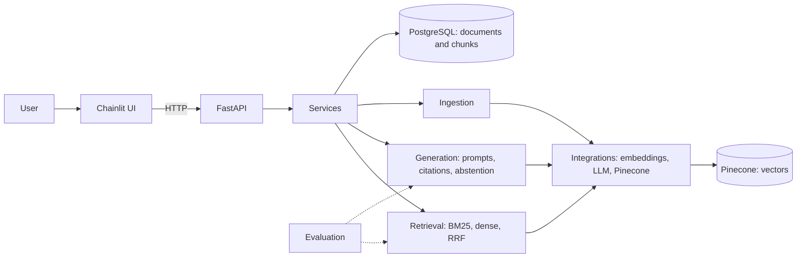

# Advanced-RAG

**Evidence-grounded question answering over Indian tax and regulatory documents.**
Hybrid retrieval · Cited answers · Abstention · Measured evaluation

Advanced-RAG answers natural-language questions about official Indian tax and regulatory documents. It retrieves passages with BM25 lexical search and dense vector search, merges the rankings with Reciprocal Rank Fusion, and generates answers that cite the exact passages they rely on. When the evidence is insufficient, it says so instead of inventing an answer.

It is built as an engineering system rather than a chatbot: retrieval quality, source traceability, evaluation, reproducibility and failure handling are first-class concerns.

---

## Why this problem

General-purpose LLMs answer tax questions fluently and sometimes wrongly, with no way to check the source. In this domain a confident wrong answer is worse than no answer. Advanced-RAG separates **retrieved evidence** from **model-generated explanation**, and every claim is traceable to a source passage.

Tax and regulatory text is also a demanding test for retrieval:

| Challenge | Why it matters |
|---|---|
| Exact references (section numbers, form names) | Lexical search handles these; semantic search alone can miss them |
| Paraphrased questions | Dense search handles these; keyword search alone can miss them |
| Versions and effective dates | "Which text applies?" is a correctness problem |
| Unanswerable questions | Abstention must be a deliberate, measurable behaviour |

---

## Features

- **Hybrid retrieval:** BM25 (`rank-bm25`) and dense vector search (Pinecone), combined with a custom Reciprocal Rank Fusion implementation.
- **Comparable retrievers:** BM25-only, dense-only and hybrid can be run side by side on the same queries.
- **Grounded generation:** answers are built from retrieved evidence, with source metadata attached to every passage.
- **Validated citations:** citations must map to chunks that were actually retrieved; the model cannot invent sources, URLs or section references.
- **Abstention:** inadequate evidence produces an explicit "insufficient evidence" response.
- **Provenance:** each document records its title, canonical URL, authority, publication date, effective date, version information, ingestion timestamp and content hash.
- **Idempotent ingestion:** content hashes prevent duplicates when unchanged documents are re-ingested.
- **Prompt-injection safeguards:** instructions, the user question and untrusted source text are kept separate; instructions found inside documents are never followed.
- **Reproducible evaluation:** Hit@K, Recall@K, MRR and nDCG@K, plus citation, grounding and abstention checks, recorded with full configuration.

---

## Architecture

A modular monolith: one Python package with clear module boundaries and no unnecessary microservices.



Dependency direction: `Chainlit UI → FastAPI → Services → Retrieval / Generation / Ingestion → Integrations / Database`. Evaluation reuses the same retrieval and generation code as the application, so measured behaviour matches served behaviour.

Details: [docs/architecture.md](docs/architecture.md)

---

## How it works

### Answering a question

1. The user asks a question in the Chainlit interface.
2. The UI sends it to the FastAPI backend, which validates the request.
3. The query service runs BM25 and dense retrieval.
4. Rankings are merged with Reciprocal Rank Fusion.
5. The top evidence is assembled into a grounded prompt with explicit source metadata.
6. The LLM answers using only that evidence.
7. Citations are validated against the retrieved chunks.
8. If the evidence is inadequate, the response states the limitation.

### Ingesting documents

1. Load a local document and extract its text.
2. Normalize the text and attach provenance metadata.
3. Split into stable, reproducible chunks.
4. Compute content hashes and detect duplicates.
5. Persist document metadata and chunk text to PostgreSQL in a transaction.
6. Embed the chunks and index the vectors in Pinecone.
7. Build or update the BM25 index.
8. Record results and errors so a run can be inspected and repeated.

---

## Retrieval

BM25 scores chunks by term frequency, term rarity and length. Dense retrieval compares query and chunk embeddings. Their ranked lists are merged with Reciprocal Rank Fusion:

$$\mathrm{RRF}(d) = \sum_{r \in R} \frac{1}{k + \mathrm{rank}_r(d)}$$

- `d`: a candidate chunk
- `R`: the set of ranked lists being fused (BM25 and dense)
- `rank_r(d)`: the 1-based position of `d` in list `r`
- `k`: a smoothing constant that limits how much top ranks dominate

RRF uses ranks only, so BM25 scores and vector similarities never need to be put on the same scale. Reranking is deliberately excluded until evaluation shows a measurable need.

---

## Technology stack

| Area | Technology |
|---|---|
| Language and API | Python, FastAPI, Pydantic v2 |
| Database | PostgreSQL, SQLAlchemy 2.x, Alembic |
| Lexical retrieval | `rank-bm25` |
| Dense retrieval | Embedding model, Pinecone |
| Fusion | Custom Reciprocal Rank Fusion |
| Generation | LLM provider behind an abstraction; exact model identifiers are recorded in configuration |
| Interface | Chainlit, calling FastAPI over HTTP |
| Quality | pytest, Ruff, GitHub Actions |
| Packaging | Docker, Docker Compose |

---

## Evaluation

Retrieval quality is measured on a versioned dataset of questions with labelled relevant chunks:

- **Hit@K**, **Recall@K**, **MRR** and **nDCG@K** for retrieval
- **Citation validity**, **evidence grounding** and **unsupported-claim** checks for answers
- **Abstention** checks on unanswerable questions, in both directions (wrong answers and unnecessary refusals)

Every run records the code commit, dataset version, corpus manifest version, model identifiers, chunking settings and retrieval parameters. No result is reported without them.

Details: [docs/evaluation.md](docs/evaluation.md)

---

## Security

- Secrets come from environment variables; `.env` is never committed.
- Request sizes, query lengths and document sizes are limited and validated.
- Retrieved documents are treated as untrusted data and are never executed as instructions.
- Citations and source URLs come from stored metadata, never from model text.
- Logs avoid secrets and raw source text.

The system has no authentication or multi-user access control and is intended for local and educational use.

Details: [docs/security.md](docs/security.md)

---

## Data sources

The corpus is a small, curated set of official sources: income-tax legislation and rules, CBDT circulars and notifications, and GST legislation, rules and guidance. Every document is verified against its official portal and recorded in a provenance manifest with its dates, hash and reuse notes.

- [Income Tax Department](https://www.incometaxindia.gov.in/)
- [CBIC Tax Information Portal](https://taxinformation.cbic.gov.in/)
- [India Code](https://www.indiacode.nic.in/)

Details: [docs/data-sources.md](docs/data-sources.md)

---

## Repository structure

```text
Advanced-RAG/
├── src/advanced_rag/
│   ├── api/            # HTTP routes and schemas
│   ├── db/             # sessions and ORM models
│   ├── ingestion/      # load, parse, chunk, pipeline
│   ├── retrieval/      # BM25, dense, hybrid, RRF, filters
│   ├── generation/     # prompts, answers, citations, abstention
│   ├── integrations/   # embedding, LLM and Pinecone clients
│   ├── evaluation/     # datasets, metrics, runner, reports
│   ├── security/       # prompt-injection and input-safety helpers
│   ├── services/       # application workflows
│   └── config.py       # validated configuration
├── ui/                 # Chainlit app and API client
├── migrations/         # Alembic migrations
├── scripts/            # CLI entry points for ingestion and evaluation
├── tests/              # unit, integration, security, evaluation, e2e
├── docs/               # detailed documentation
├── Dockerfile
├── compose.yaml
└── pyproject.toml
```

---

## Getting started

**Prerequisites:** Python, PostgreSQL, and API credentials for your chosen embedding and LLM providers.

```bash
git clone https://github.com/adrinjoseph/Advanced-RAG.git
cd Advanced-RAG

python -m venv .venv
source .venv/Scripts/activate        # Git Bash on Windows
# .venv\Scripts\Activate.ps1         # PowerShell

pip install -e .
cp .env.example .env                 # then fill in your values
python -m alembic upgrade head
```

`.env.example` lists every setting. Never commit `.env` or real keys.

### Run the API

```bash
python -m uvicorn advanced_rag.api.main:app --reload
```

### Run the interface

```bash
chainlit run ui/chainlit_app.py
```

### Ingest documents

Ingestion runs through a controlled CLI in `scripts/`, which is safer than an open upload endpoint. Source requirements and the manifest format are in [docs/data-sources.md](docs/data-sources.md).

### Test and lint

```bash
python -m ruff check .
python -m ruff format --check .
python -m pytest -q
```

Full setup and troubleshooting: [docs/development-setup.md](docs/development-setup.md)

---

## Documentation

| Document | Contents |
|---|---|
| [Architecture](docs/architecture.md) | Components, data flow, storage, failure boundaries, design trade-offs |
| [Database](docs/database.md) | Models, constraints, migrations, hashing and duplicates |
| [Evaluation](docs/evaluation.md) | Metrics, dataset format, reproducibility |
| [Security](docs/security.md) | Secrets, validation, prompt-injection model |
| [Data sources](docs/data-sources.md) | Source rules, provenance manifest, licensing |
| [Development setup](docs/development-setup.md) | Environment, services, commands, troubleshooting |

---

## Limitations

- The corpus is small and curated; documents may be outdated by the time they are read.
- Citations make answers inspectable, not guaranteed correct. LLMs can still misread evidence.
- No authentication, so the API should not be exposed publicly.
- Evaluation on a small dataset gives noisy estimates; differences between methods should be read with that in mind.

---

## Disclaimer

Advanced-RAG is an educational engineering project. It is not professional tax or legal advice. Consult a qualified professional for real decisions.

## License

See the `LICENSE` file.

## Author

**Adrin Joseph K.J**, AI/ML engineering student (BS Data Science & AI, IIT Madras)
GitHub: [@adrinjoseph](https://github.com/adrinjoseph)
