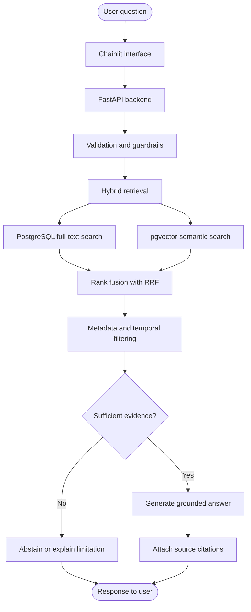
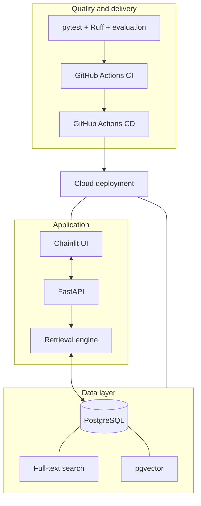
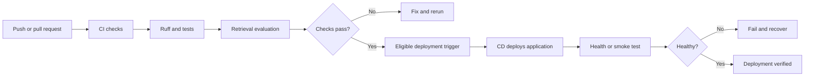

# Advanced-RAG

### Evidence-grounded AI for Indian tax, legal, and regulatory information

Advanced-RAG is an applied AI engineering project that makes complex regulatory documents easier to search and understand through **hybrid retrieval, evidence-grounded answers, and traceable citations**.

> **Retrieve first. Explain second. Cite the evidence. Abstain when evidence is insufficient.**

**Status:** Under active development. The architecture and features described below represent the intended design unless explicitly verified as implemented.

## The problem

Indian tax and regulatory documents can be lengthy, technical, and subject to amendments. Finding the right provision is only part of the challenge; understanding its context, validity, and supporting evidence matters just as much.

Advanced-RAG aims to help users locate relevant source passages and understand them in plain language without losing the connection to the underlying documents.

### Core objectives

- **Hybrid retrieval:** Combine semantic similarity with PostgreSQL full-text search.
- **Evidence-grounded answers:** Generate explanations using retrieved source material.
- **Traceable citations:** Connect answers to the documents and passages that support them.
- **Temporal awareness:** Account for effective dates, amendments, and validity metadata when available.
- **Safe abstention:** Avoid confident answers when evidence is insufficient.
- **Measurable quality:** Use repeatable tests and evaluation datasets rather than relying on demos alone.

Advanced-RAG is an informational research aid, **not legal advice**. Users should verify important conclusions against authoritative sources and consult qualified professionals when necessary.

## How it works



*This is the intended request flow. It does not imply that each component has already been implemented or validated.*

## Technology stack

| Layer | Technology | Purpose |
|---|---|---|
| Language | Python 3.14 target | Application logic, subject to dependency compatibility |
| API | FastAPI | Asynchronous backend and HTTP interface |
| UI | Chainlit | Thin user-facing interface |
| Validation | Pydantic v2 | Typed request and response contracts |
| Database access | SQLAlchemy 2.x async + asyncpg | Asynchronous PostgreSQL operations |
| Database | PostgreSQL | Documents, chunks, metadata, and lexical search |
| Vector retrieval | pgvector | Embedding storage and similarity search |
| Ranking | Native Python + RRF | Hybrid candidate fusion and evidence selection |
| Testing | pytest | Unit, integration, and regression tests |
| Code quality | Ruff | Linting and formatting checks |
| Containers | Docker + Docker Compose | Reproducible local application environments |
| Automation | GitHub Actions | Continuous Integration and Continuous Delivery/Deployment |
| Hosting | Cloud deployment required | Remotely accessible application and compatible database |

The LLM provider, embedding provider, models, and cloud hosting services must be selected and verified before their configuration is finalized. They are not considered implemented merely because they appear in the planned architecture.

## Architecture at a glance



The component boundaries are intentional:

- **Frontend:** Collects questions and displays answers and citations.
- **API:** Validates requests, coordinates execution, and handles application errors.
- **Retrieval engine:** Performs retrieval orchestration, ranking, evidence selection, and guardrail checks.
- **Database:** Stores source content, metadata, and embeddings and supports lexical and semantic search.
- **Tests and evaluation:** Verify behavior and detect regressions.
- **CI/CD:** Automates quality checks and the agreed cloud deployment process.

See [Architecture](docs/architecture.md) and [ADR 0001](docs/decisions/0001-architecture-and-technology-stack.md) for the detailed design and rationale.

## Data integrity and retrieval quality

Retrieval quality alone does not guarantee a correct answer. The implementation must preserve provenance and test how evidence is used.

Key requirements include:

1. Preserve source identifiers and relevant metadata during document processing and chunking.
2. Retrieve candidates through both lexical and semantic search.
3. Combine rankings using Reciprocal Rank Fusion (RRF).
4. Apply supported jurisdiction and temporal filters.
5. Assess whether the retrieved evidence is relevant and sufficient.
6. Generate an answer tied to retrieved evidence, or abstain.
7. Test whether citations actually support the claims they accompany.

Where available, document metadata should distinguish publication dates from effective dates and represent amendments and validity periods accurately. Missing metadata must not be invented.

## Quality and evaluation

The project will use automated checks and repeatable evaluation to assess whether the system works as intended.

| Area | Evidence we expect |
|---|---|
| Chunking | Tests for boundaries and source-metadata preservation |
| Retrieval | Lexical, semantic, and hybrid-ranking tests |
| Ranking | RRF behavior and candidate-selection tests |
| Temporal correctness | Tests for supported validity and jurisdiction filters |
| Grounding | Citation traceability and evidence-support checks |
| Abstention | Tests for missing, weak, or conflicting evidence |
| API | Request validation and safe error handling |
| Regression | Repeatable evaluation dataset and recorded metrics |
| Delivery | Successful CI checks and verified cloud deployment |

Metrics such as Recall@K and MRR may be used to evaluate retrieval. Results will be published only after the evaluation process and measurements are reproducible.

## Local development and containers

Docker and Docker Compose are part of the planned development setup.

The intended local environment will make it easier to run the application and its required services consistently. The actual container configuration, dependency installation commands, database initialization, and health checks will be documented once the configuration files are implemented and tested.

Python 3.14 is the target version, subject to compatibility verification across the chosen dependencies.

**Configuration and secrets**
- Use `.env.example` as the environment-variable template.
- Keep real credentials in an untracked local `.env` file or a hosting provider's secret manager.
- Never commit API keys, database passwords, or deployment tokens.
- Keep database access inside the backend; the UI must not connect directly to PostgreSQL.

## Mandatory cloud deployment and CI/CD

Cloud deployment is a required deliverable—not an optional future enhancement.

The chosen hosting arrangement must support the application and PostgreSQL with pgvector. Free-tier services will be preferred where feasible, after checking current limits, compatibility, sleep behavior, egress, and potential charges. Free database hosting does not necessarily include free application hosting.

### Intended delivery pipeline



The actual workflows must implement appropriate triggers, secret handling, deployment verification, and recovery behavior. The diagram describes the intended pipeline; it is not proof that CI/CD is already operational.

No cloud resources should be created and no charges incurred without an explicit cost estimate and approval.

## Repository structure

```text
Advanced-RAG/
├── .github/
│   └── workflows/
│       ├── ci.yml
│       └── cd.yml
├── database/
│   ├── __init__.py
│   ├── connection.py
│   ├── models.py
│   └── schema.sql
├── frontend/
│   ├── __init__.py
│   ├── .env.example
│   └── app.py
├── services/
│   ├── __init__.py
│   ├── api/
│   │   ├── __init__.py
│   │   ├── dependencies.py
│   │   ├── main.py
│   │   ├── schemas.py
│   │   └── routers/
│   │       ├── __init__.py
│   │       └── search.py
│   └── engine/
│       ├── __init__.py
│       ├── chunking.py
│       ├── guardrails.py
│       └── retrieval.py
├── tests/
│   ├── __init__.py
│   ├── conftest.py
│   ├── test_chunking.py
│   ├── test_guardrails.py
│   ├── test_retrieval.py
│   └── test_api.py
├── docs/
│   ├── architecture.md
│   └── decisions/
│       └── 0001-architecture-and-technology-stack.md
├── .dockerignore
├── .env.example
├── .gitignore
├── CODE_OF_CONDUCT.md
├── CONTRIBUTING.md
├── Dockerfile
├── compose.yaml
├── LICENSE
├── pyproject.toml
├── README.md
└── SECURITY.md
```

This is the intended repository layout. Files and services remain planned until implemented and verified.

## Scope discipline

The agreed design excludes:

- LangChain, LlamaIndex, and LangGraph.
- Redis.
- A separate vector database service.
- Heavy external tracing platforms.
- Local OCR pipelines.
- Additional infrastructure without a demonstrated requirement.

The objective is not to maximize the number of technologies. It is to build a maintainable, testable system whose design choices can be justified with evidence.

## Project documentation

- [Architecture](docs/architecture.md) — components, data flow, and system boundaries.
- [Architecture decision record](docs/decisions/0001-architecture-and-technology-stack.md) — technology choices, alternatives, and trade-offs.
- [Contributing](CONTRIBUTING.md) — development and review expectations.
- [Code of Conduct](CODE_OF_CONDUCT.md) — community standards.
- [Security Policy](SECURITY.md) — vulnerability reporting and security priorities.
- [License](LICENSE) — project licensing terms.

## Production-readiness standard

A successful demo is not enough to establish production readiness.

Before making that claim, the project must demonstrate correct retrieval, trustworthy citations, safe abstention, tested failure behavior, secure configuration, meaningful automated evaluation, a verified cloud deployment, and working CI/CD.

**The goal is a small, professionally engineered applied AI system—not a large architecture that only looks production-grade.**