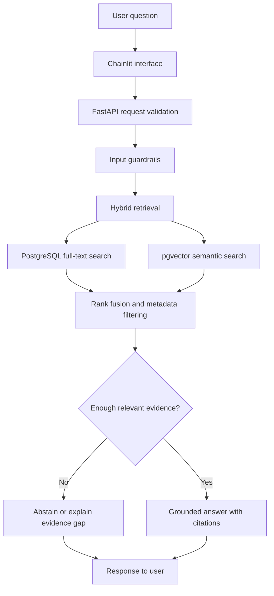
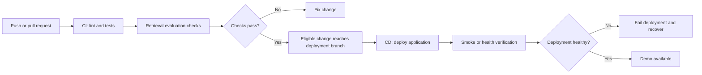

# Advanced-RAG
### Evidence-grounded answers for Indian tax, legal, and regulatory information

Advanced-RAG is an applied AI engineering project exploring how a Retrieval-Augmented Generation (RAG) system can make complex regulatory documents easier to search and understand—while keeping answers tied to inspectable source evidence.

> **Design principle:** retrieve first, explain second, cite the evidence, and abstain when the evidence is not good enough.

**Project status:** Under active development. Features described here are project goals until implemented and verified. Do not treat this repository as a deployed legal-information service unless a live deployment is explicitly linked and tested.

## Why it exists

Legal and regulatory material can be long, technical, amended over time, and difficult to navigate. A fluent answer is not necessarily a correct answer. Advanced-RAG is designed to help users find relevant passages and understand them in plain language without hiding where the information came from.

The system is intended to:
- retrieve relevant passages from a curated collection of authoritative digital documents;
- combine semantic and lexical search;
- return answers with source-linked citations;
- retain document provenance and applicable temporal metadata where the source supports it;
- avoid presenting unsupported claims as facts; and
- evaluate retrieval and answer behavior with repeatable tests.

It is an informational research aid, **not legal advice** and not a substitute for checking the governing source or consulting a qualified professional.

## How a question flows through the system



The diagram describes the intended flow, not proof that every step is already implemented.

## Technology at a glance

| Area | Technology | Responsibility |
|---|---|---|
| Language | Python 3.14 target | Application logic; dependency compatibility must be verified |
| API | FastAPI | Request handling and backend boundary |
| UI | Chainlit | Thin user-facing interface; no direct database access |
| Validation | Pydantic v2 | Typed input and output contracts |
| Database access | SQLAlchemy 2.x async + asyncpg | Asynchronous PostgreSQL access |
| Data store | PostgreSQL | Documents, chunks, metadata, and lexical search |
| Vector search | pgvector | Embedding storage and semantic similarity |
| Retrieval | Native Python + PostgreSQL | Hybrid retrieval and Reciprocal Rank Fusion (RRF) |
| Quality | pytest + Ruff | Automated tests and code-quality checks |
| Automation | GitHub Actions | Continuous Integration and deployment workflow |
| Hosting | Cloud deployment required | Publicly demonstrable application and hosted database, subject to verified free-tier limits |

The final embedding and language-model providers, cloud hosting providers, and exact model choices must be recorded once selected and verified. They are not claimed to be configured merely because this README mentions them.

## Architecture boundaries

- **Chainlit** presents the interaction and renders answers/citations.
- **FastAPI** owns request validation, orchestration, and application-level error handling.
- **The retrieval engine** owns chunking-related logic, retrieval orchestration, evidence checks, and guardrails.
- **PostgreSQL + pgvector** provide the relational store, lexical search, and vector search.
- **Tests and evaluation data** check behavior and help prevent regressions.
- **CI/CD** checks changes and automates the agreed cloud deployment workflow.

See [Architecture](docs/architecture.md) for component responsibilities and [Architecture Decision Record 0001](docs/decisions/0001-architecture-and-technology-stack.md) for the rationale and trade-offs.

## Quality bar

The project should not claim quality based only on a successful demo. Evidence should include:

- tests for chunking, guardrails, retrieval, and API behavior;
- a repeatable evaluation set and documented retrieval metrics;
- citation checks that verify cited sources support the answer;
- tests for insufficient evidence and relevant temporal filters;
- secure secret handling and parameterized database operations;
- a working cloud deployment with deployment verification; and
- CI/CD runs that can be inspected in the repository.

Metrics and readiness claims will be published only after they have been measured. No benchmark numbers are invented in this document.

## Development status

The repository structure and documentation are being established before implementation. Until the relevant code, tests, and deployment are present and verified, treat capabilities as **planned**, not complete.

## Local development

The exact setup commands will be added to this section after `pyproject.toml`, the dependency set, and the supported Python version have been verified together. The project targets Python 3.14, but the dependency stack must be tested for compatibility before that version is locked in.

Do not commit secrets. Use the root `.env.example` as the documented template for environment configuration; put real credentials in an untracked local environment file or the hosting provider's secret manager.

## Cloud deployment and CI/CD

Cloud deployment is a required deliverable. The chosen hosting arrangement must support the application and a PostgreSQL service with pgvector. Free-tier terms, sleeping/pausing behavior, resource limits, egress, and application-hosting costs must be checked before deployment.

The intended delivery path is:



The actual trigger, branch protection, hosting integration, smoke tests, and recovery mechanism must match the implemented workflow. This diagram is the intended process, not a claim that CD is already operational.

## Scope discipline

The agreed design does not include LangChain, LlamaIndex, LangGraph, Redis, a separate vector database, heavy external tracing platforms, or local OCR. Components should be added only when a concrete requirement and evidence justify them.

## Repository map

```text
.
├── .github/workflows/       # CI and CD automation
├── database/                # Database connection, models, schema
├── frontend/                # Chainlit UI
├── services/
│   ├── api/                  # FastAPI application and routes
│   └── engine/               # Chunking, guardrails, retrieval
├── tests/                   # Automated tests
├── docs/
│   ├── architecture.md
│   └── decisions/           # Architecture decision records
├── .env.example
├── .gitignore
├── pyproject.toml
├── README.md
├── CODE_OF_CONDUCT.md
├── CONTRIBUTING.md
└── SECURITY.md
```

## Contributing and security

Read [CONTRIBUTING.md](CONTRIBUTING.md) before proposing changes, follow [CODE_OF_CONDUCT.md](CODE_OF_CONDUCT.md), and use [SECURITY.md](SECURITY.md) to report vulnerabilities responsibly.

## License

See [LICENSE](LICENSE). The license file in the repository is authoritative.
