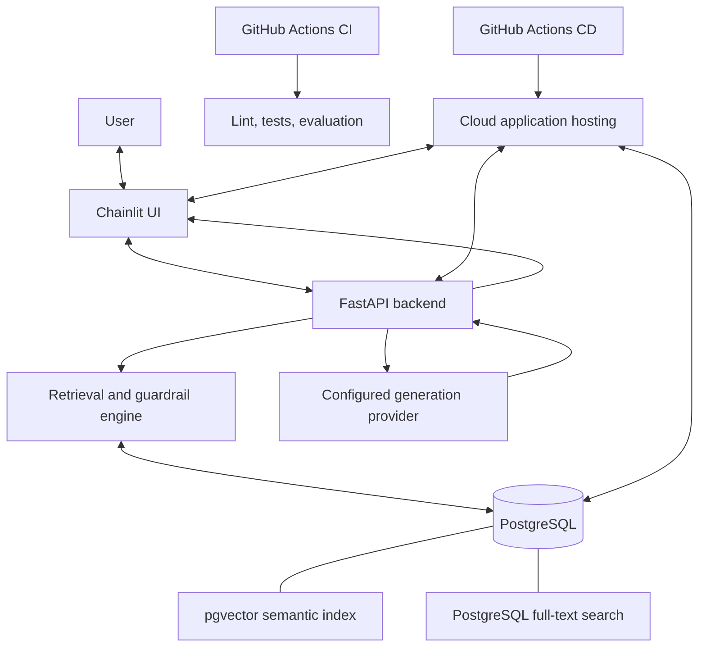
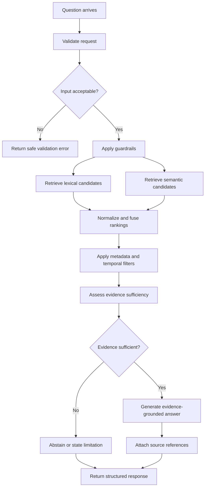
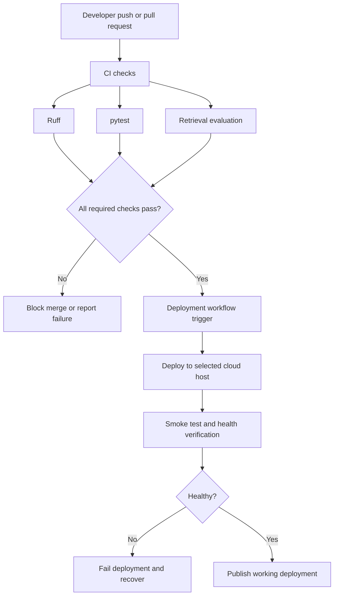

# Architecture

This document defines the intended architecture of Advanced-RAG. It is a design contract, not evidence that every component is already implemented. Update it when implementation decisions materially change.

## 1. System goal

Answer questions about curated Indian tax, legal, and regulatory documents with plain-language explanations grounded in retrievable source passages. Preserve source provenance, respect supported temporal and jurisdiction metadata, and abstain when evidence is insufficient.

## 2. System context

The generation provider and cloud providers are deployment decisions that must be selected, verified, and documented. The diagram shows required integration points, not confirmed provider configuration.

## 3. Runtime request flow

The implementation must ensure that the final answer does not imply that a source supports a claim unless the source was actually retrieved and checked. If citation validation is incomplete, that limitation must be explicit in the project status.

## 4. Component responsibilities

### Chainlit — `frontend/`
- Collect user questions and display responses.
- Render citations and safe error messages.
- Call the backend through its API contract.
- Never hold database credentials or query PostgreSQL directly.
- Avoid owning retrieval, ranking, or legal-validity logic.

### FastAPI — `services/api/`
- Expose the HTTP interface.
- Validate request and response shapes using Pydantic.
- Coordinate guardrails, retrieval, generation, and response construction.
- Apply appropriate timeouts and controlled error handling.
- Keep HTTP concerns separate from retrieval implementation.

### Retrieval engine — `services/engine/`
- `chunking.py`: deterministic splitting of supported digital source text into retrievable chunks while retaining provenance.
- `retrieval.py`: lexical and vector retrieval, candidate combination, ranking, and evidence selection.
- `guardrails.py`: input constraints, evidence sufficiency policy, and safe abstention behavior.

Avoid circular imports and avoid placing unrelated responsibilities into a single large module.

### Database — `database/`
- `connection.py`: asynchronous engine/session lifecycle and connection configuration.
- `models.py`: SQLAlchemy data models.
- `schema.sql`: explicit SQL schema where appropriate.
- PostgreSQL stores source metadata, document/chunk text, and related records.
- pgvector stores or indexes embeddings; PostgreSQL full-text search supports lexical retrieval.

Use bound parameters or safe ORM expressions. Never build SQL by concatenating untrusted user input.

### Tests — `tests/`
- Unit tests for chunking and guardrails.
- Retrieval tests for ranking, filtering, and no-evidence cases.
- API tests for validation, response contracts, and error behavior.
- Evaluation checks for repeatable retrieval quality and regressions.

Tests should not require production credentials or incur cloud costs. External integrations should be mocked or isolated where appropriate.

## 5. Data and provenance

Each retrievable chunk should retain enough metadata to identify its source and interpret it correctly. The final schema must be defined before ingestion is implemented. Expected metadata includes, where available:

- stable source/document identifier;
- title and source URL or official reference;
- issuing authority;
- jurisdiction;
- document type;
- publication or effective date;
- `valid_from`, `valid_to`, and `is_amended` where applicable;
- chunk identifier and text;
- embedding and retrieval-related fields.

Do not invent missing metadata. Unknown dates or jurisdictions must remain unknown rather than being inferred without evidence. The validity model must distinguish publication date from legal effective date where the source provides both.

## 6. Hybrid retrieval

The intended retrieval sequence is:

1. Apply eligible document and metadata filters.
2. Retrieve lexical candidates using PostgreSQL full-text search.
3. Retrieve semantic candidates using pgvector similarity.
4. Combine ranked lists using Reciprocal Rank Fusion (RRF).
5. Select a bounded evidence set for answer generation.
6. Assess whether the evidence is sufficiently relevant and specific.
7. Answer with traceable source references or abstain.

RRF is a ranking-fusion method, not a guarantee of relevance. Retrieval thresholds and ranking choices must be validated against an evaluation set. Do not publish performance claims until they have been measured.

## 7. Reliability and security boundaries

- Validate inputs and bound request sizes.
- Use asynchronous database access with a controlled connection pool.
- Configure timeouts and handle dependency failures explicitly.
- Keep secrets out of source control and logs.
- Use parameterized database access.
- Do not treat retrieved document text as trusted instructions.
- Distinguish source evidence from generated explanation.
- Return a safe failure or abstention when evidence, retrieval, or generation fails.
- Avoid logging sensitive user content unless there is a justified, documented need.

## 8. CI/CD and cloud deployment

CI and CD are separate responsibilities. The exact branch triggers, deployment permissions, environment separation, and recovery strategy must be defined by the actual workflow. Do not store cloud credentials in workflow files. Use the provider's supported secret mechanism.

Cloud deployment is mandatory. Select services only after confirming that they support FastAPI, Chainlit, PostgreSQL with pgvector, required networking, and the intended free-tier limits. A free database does not guarantee free application hosting. Estimate possible charges before creating resources.

## 9. Explicit non-goals

The agreed architecture excludes:
- LangChain, LlamaIndex, and LangGraph;
- Redis;
- a separate vector database service;
- heavy external tracing platforms;
- local OCR;
- infrastructure added only for appearance.

These are scope decisions, not claims that such technologies are universally unsuitable.

## 10. Architecture quality gates

Before calling the implementation complete, verify:
- module boundaries match the responsibilities above;
- source references survive chunking and retrieval;
- lexical and semantic results are both tested;
- temporal and jurisdiction filters are tested for supported cases;
- insufficient evidence results in abstention;
- citation behavior is tested against source passages;
- database access is parameterized and credentials are protected;
- tests and evaluation checks run in CI;
- CD deploys and verifies the real application;
- the deployed demo and its limitations are documented.

## 11. Known design constraints

Python 3.14 is the target, but dependency compatibility must be checked before locking the environment. The final LLM, embedding model, cloud host, and deployment topology must be documented once chosen. Do not present these unresolved choices as implemented decisions.
