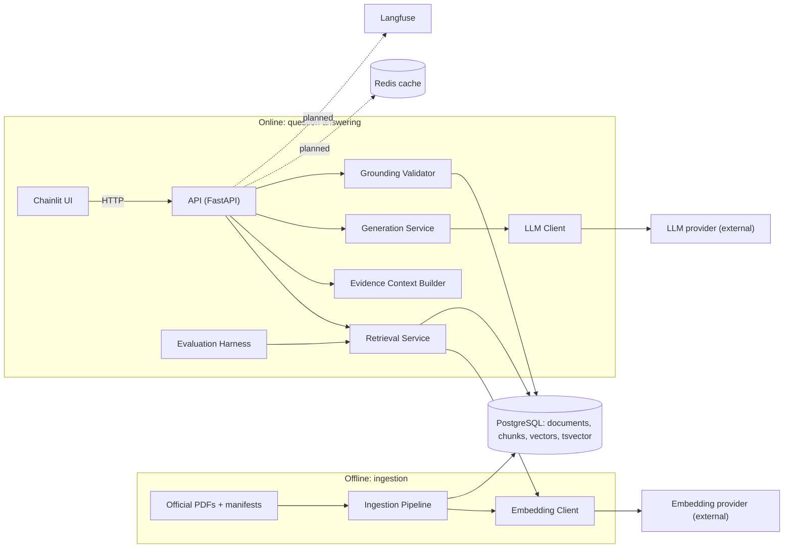
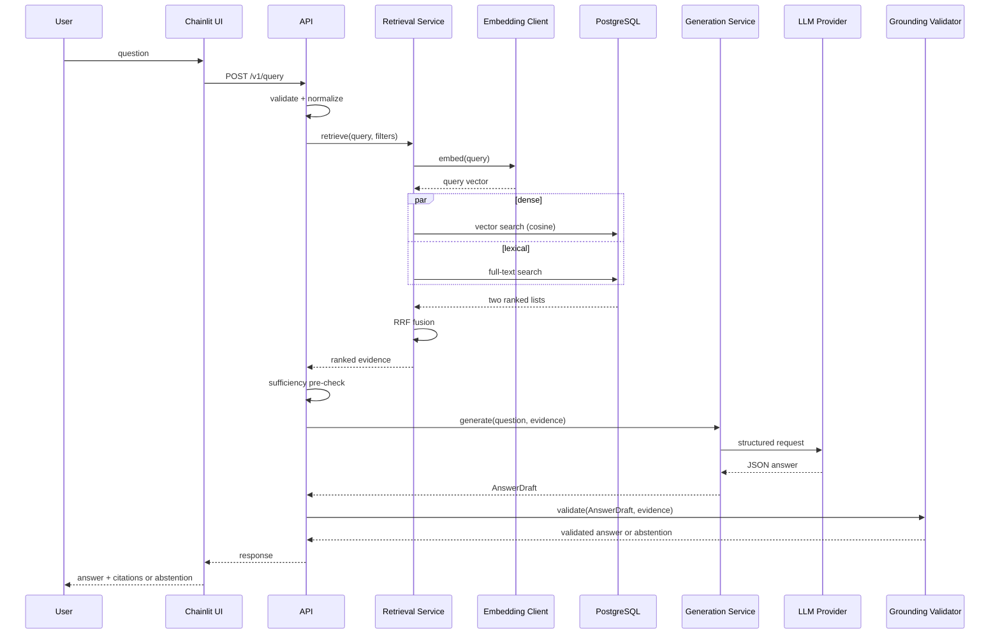

# Architecture

> **Status:** **[Proposed]** design. Requirements live in [project-specification.md](project-specification.md).

## 1. System context

Advanced-RAG has two independent workflows sharing one PostgreSQL database:

- **Ingestion (offline, batch):** turns official documents into searchable evidence.
- **Question answering (online, per request):** retrieves evidence, generates a structured answer, validates citations, answers or abstains.

Ingestion is separate because it is slow, failure-prone, batch-shaped and writes data, whereas answering must be fast, read-mostly and safe to run concurrently. Separating them lets you re-ingest or re-embed without touching serving code, and lets you test each in isolation.

## 2. Component diagram



The diagram shows that only the Ingestion Pipeline writes corpus data, that provider access goes through two client interfaces, and that the UI never touches the database. Dashed edges are **[Planned]**.

## 3. Component responsibilities

| Component | Responsibility | Must not |
|---|---|---|
| Ingestion Pipeline | parse, clean, chunk, embed, persist, version | serve queries |
| Embedding Client | batch embeddings, timeouts, retries, model/dimension reporting | know about chunks or SQL |
| Retrieval Service | dense search, lexical search, RRF, metadata filters | call the LLM |
| Evidence Context Builder | choose, order, label and bound the evidence passed to the LLM | retrieve |
| Generation Service | prompt, structured output, retries on parse failure | decide what is true |
| Grounding Validator | citation resolution, quote anchoring, sufficiency checks | modify answers silently |
| API | validation, orchestration, error mapping, auth hook (future) | contain retrieval logic |
| Chainlit UI | render answers, evidence, abstentions | access DB or providers |
| Evaluation Harness | run golden sets against Retrieval/Generation, emit reports | run in the serving path |

## 4. Package layout and dependency direction **[Proposed]**

```
src/advanced_rag/
  core/         config, logging, errors
  domain/       Pydantic models: Document, Chunk, Evidence, Answer, Citation
  db/           engine, SQLAlchemy models, repositories (Alembic in ./alembic)
  providers/    EmbeddingClient / LLMClient protocols + adapters
  ingestion/
  retrieval/
  generation/
  grounding/
  api/
  evaluation/
ui/chainlit_app.py
```

Dependencies point inward: `api → retrieval/generation/grounding → db, providers → domain, core`. `domain` and `core` import nothing from the project. `ui` talks to `api` over HTTP only. See [ADR 0001](adr/0001-python-src-layout.md) and [ADR 0004](adr/0004-application-service-boundaries.md).

## 5. Query sequence



## 6. Data ownership

PostgreSQL is the **system of record** for documents, chunks, embeddings and ingestion history ([database.md](database.md)). Redis is disposable and never authoritative ([caching.md](caching.md)). Provider-side data (prompts sent) is governed by [security.md](security.md).

## 7. Error propagation

Domain-specific exceptions are raised at the layer that detects them and mapped to HTTP at the API edge only.

| Failure | Raised by | API result |
|---|---|---|
| Invalid request | API validation | 422 |
| Embedding/LLM timeout after retries | provider client | 504 |
| Provider rate limit exhausted | provider client | 503 |
| DB unavailable | repository | 503 |
| LLM output fails schema twice | Generation Service | abstention (`generation_failure`), not 500 |
| Citation validation fails after retry | Grounding Validator | abstention (`ungrounded_output`) |
| No relevant evidence | Retrieval/sufficiency | abstention (`insufficient_evidence`) |

Abstention is a **valid outcome**, not an error. Details: [grounding-and-abstention.md](grounding-and-abstention.md), [api-and-ui.md](api-and-ui.md).

## 8. Async execution boundaries

- Async: HTTP handlers, DB access ([ADR 0007](adr/0007-async-database-access.md)), provider calls, the dense and lexical queries (run concurrently).
- Synchronous, CPU-bound: PDF parsing and chunking, executed by the ingestion CLI, outside the event loop.
- Blocking calls are never made inside request handlers; if a sync library is unavoidable it runs in a thread executor.

## 9. Trade-offs

| Choice | Benefit | Cost |
|---|---|---|
| One PostgreSQL for vectors, text and metadata | transactional consistency, fewer moving parts, SQL filters | less specialized than dedicated vector DBs; index tuning is on you |
| Hybrid retrieval | covers semantic and exact-match queries | two queries per request; fusion adds a tunable parameter |
| Quote-anchored citations | cheap, deterministic grounding signal | does not prove entailment |
| Local-first, no GPU | zero infra cost | no local reranker/LLM at scale |
| Ingestion separate from serving | clean failure domains | requires a corpus-version concept for cache correctness |

---
Related: [data-flow.md](data-flow.md) · [database.md](database.md) · [retrieval.md](retrieval.md) · [generation.md](generation.md) · [ADR index](adr/README.md)
