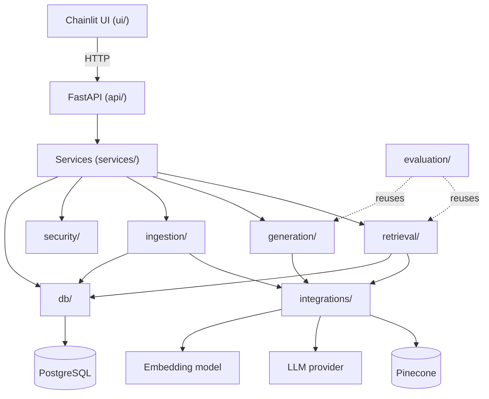
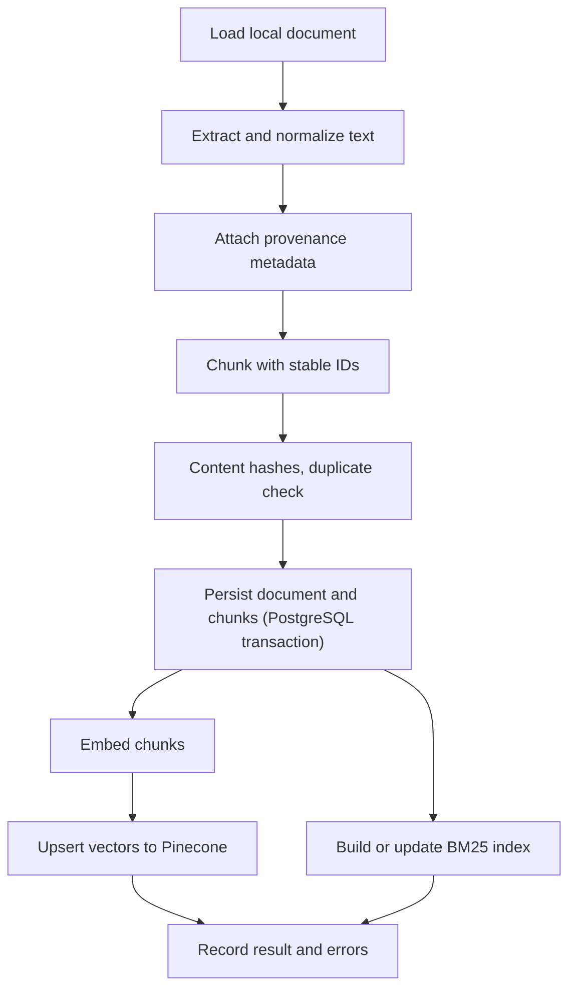
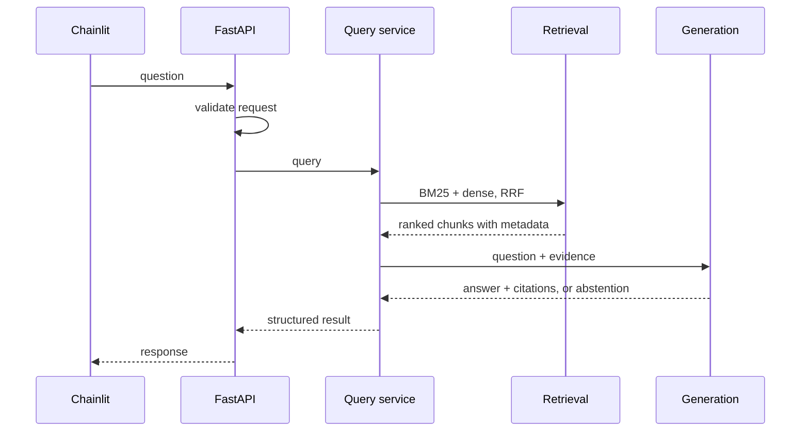

# Architecture

A modular monolith: one Python package, clear module boundaries, no microservices.

## System diagram

## Dependency direction

`Chainlit UI → FastAPI → Services → Retrieval / Generation / Ingestion → Integrations / Database`

Lower layers never import upper ones. Evaluation reuses the same retrieval and generation code as the application, so measured behaviour equals served behaviour. A layer that only forwards calls without adding value should not exist.

## Component responsibilities

| Module | Responsibility |
|---|---|
| `api/` | HTTP transport: routes, request validation, response schemas, error mapping |
| `services/` | Application workflows (query, ingestion); no HTTP, no vendor SDKs |
| `ingestion/` | Load, parse, clean, chunk, hash, pipeline |
| `retrieval/` | BM25, dense retrieval, hybrid orchestration, RRF, filters |
| `generation/` | Prompt construction, answer generation, citations, abstention |
| `integrations/` | Embedding, LLM and Pinecone clients; mockable boundary |
| `db/` | Sessions, ORM models, repositories only when justified |
| `evaluation/` | Datasets, metrics, runner, reports |
| `security/` | Prompt-injection and input-safety helpers |
| `config.py` | Validated configuration from the environment |
| `ui/` | Chainlit app and an API client; no retrieval or generation logic |
| `scripts/` | CLI entry points for ingestion and evaluation |

## Data flow: ingestion

Ingestion should be idempotent where practical: unchanged content (same hash) is skipped, not duplicated.

## Data flow: query

All retrieval results share one structure: chunk text, source identity, metadata and ranking information, so BM25-only, dense-only and hybrid can be compared directly.

## Storage responsibilities

| Store | Holds | Note |
|---|---|---|
| PostgreSQL | Document metadata and chunk text | Source of truth for content |
| Pinecone | Chunk vectors with minimal metadata (chunk ID) | Derived data; can be rebuilt from PostgreSQL |
| BM25 index | In-memory lexical index | Built from PostgreSQL chunks; rebuildable |

Database metadata and vector-store state are kept conceptually separate.

## Failure boundaries

- **Database commit succeeds, vector upsert fails:** chunks exist without vectors. Design: record an indexing state per chunk or document so incomplete items can be found and retried. *Planned; may need a migration.*
- **Vector upsert succeeds, database later rolled back:** write to PostgreSQL first, then index, and only mark success after both.
- **LLM or embedding provider error:** return a clear error; never fabricate an answer.
- **No relevant evidence:** abstain.
- **Pinecone unavailable at query time:** fail clearly, or fall back to BM25-only if that behaviour is explicitly designed and tested. *Open decision.*

## Design decisions and trade-offs

| Decision | Reason | Cost |
|---|---|---|
| Modular monolith | Simple to run, test and debug | Not independently scalable |
| Hybrid retrieval with RRF | Combines exact-term and semantic strengths using ranks only | Two retrievers to maintain |
| Chunk text in PostgreSQL | One source of truth; vectors are rebuildable | Larger database |
| Pinecone for vectors | Managed, no vector infrastructure to run | Hosted dependency, cost, latency |
| `rank-bm25` in memory | Easy start | Per-process index; rebuild on start |
| UI calls API over HTTP | One place for validation and logic | Extra hop |
| Custom evaluation first | Transparent, few dependencies | More code to write |

## Deferred features

Reranking (reconsider only if evaluation shows a need), LangGraph workflows, authentication and authorization, multi-tenancy, RAGAS integration, streaming, and cloud object storage. Each needs a concrete requirement before it is added.

Related: [Database](database.md) · [Evaluation](evaluation.md) · [Security](security.md) · [Data sources](data-sources.md) · [Development setup](development-setup.md)
