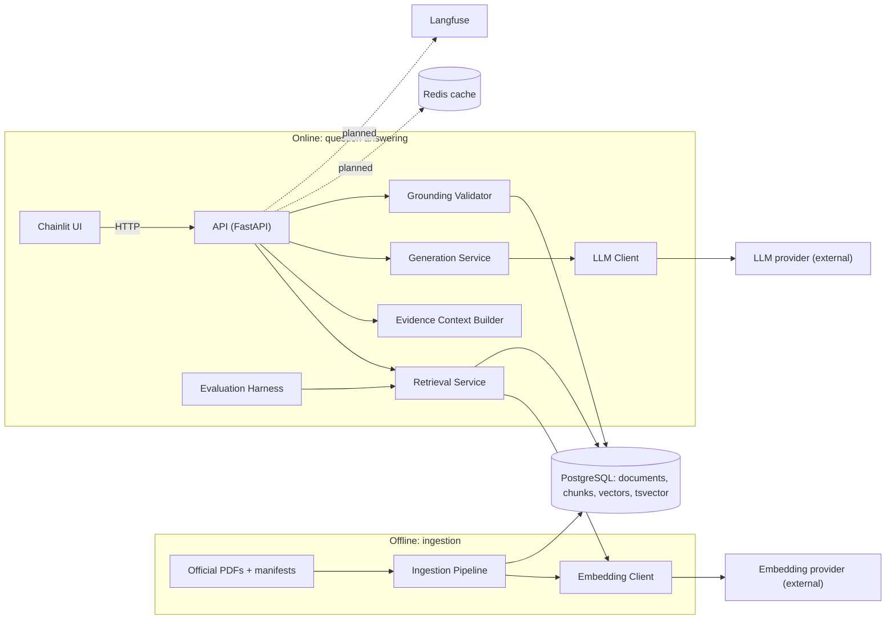
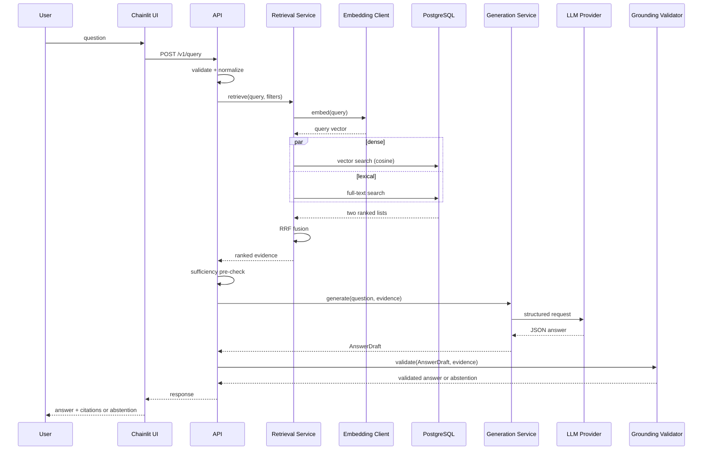
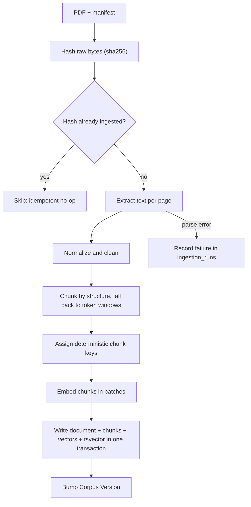
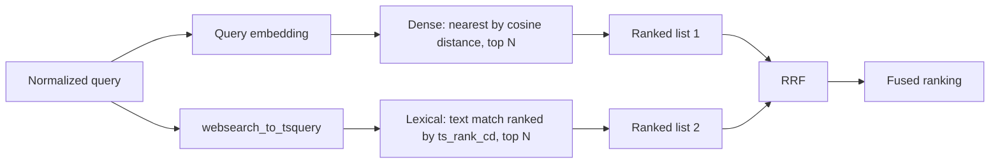
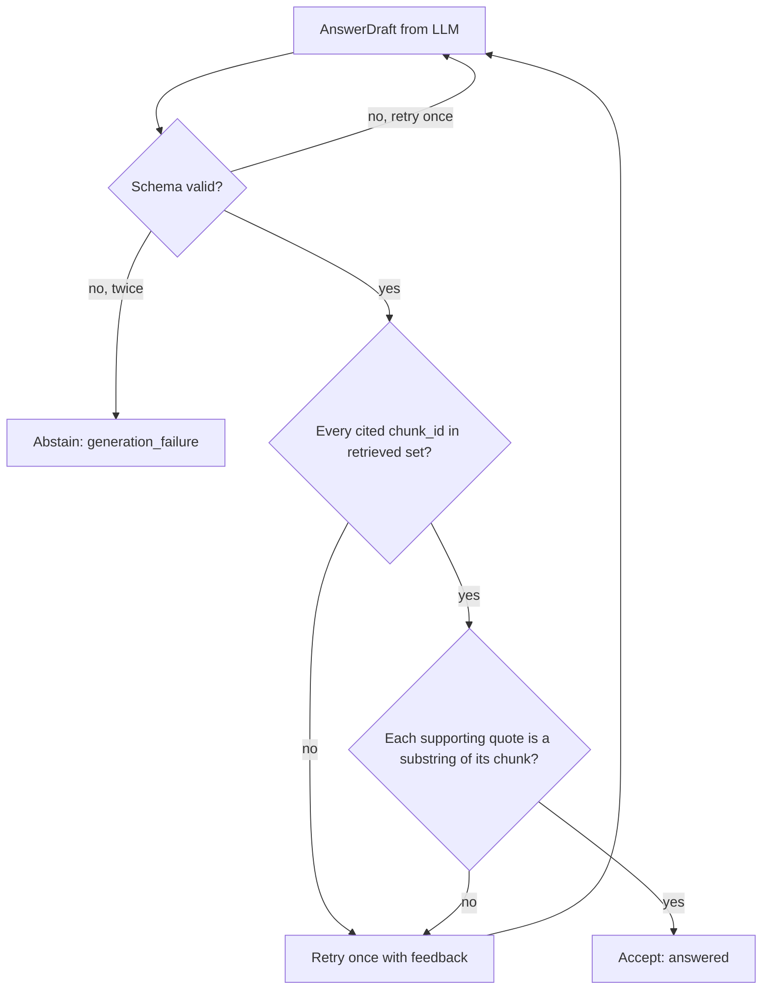
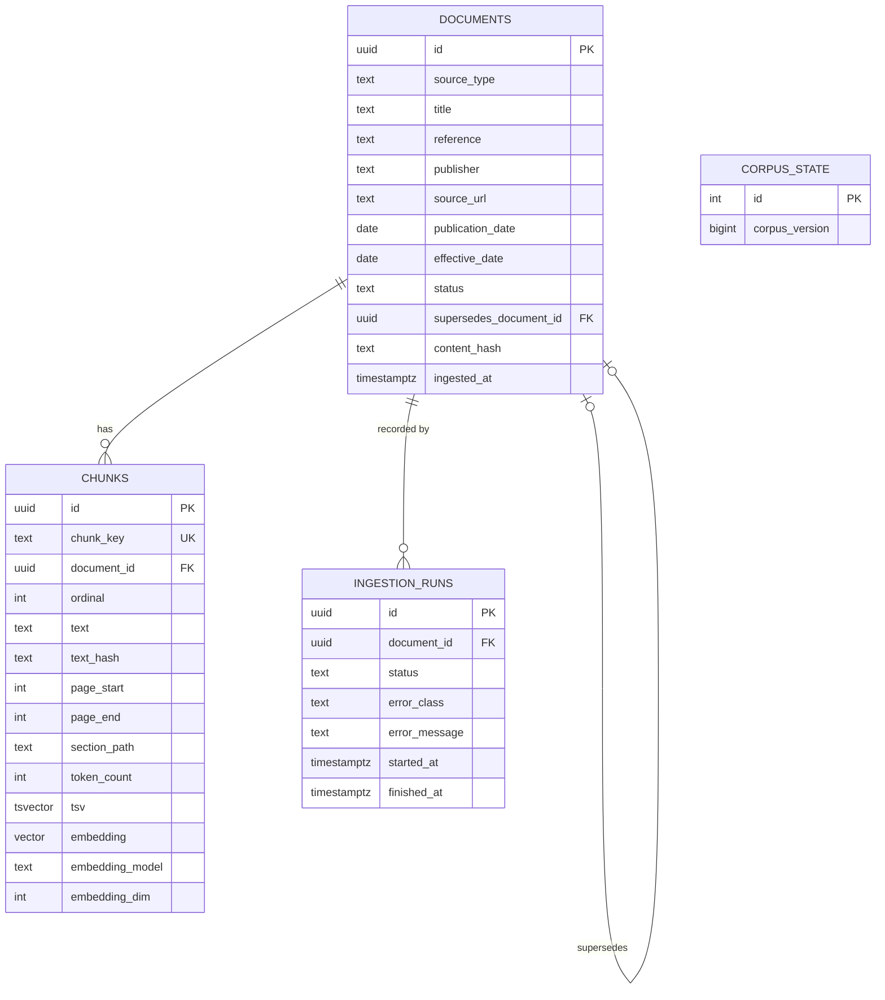

# Architecture

## Architecture

# Architecture

> **Status:** **[Proposed]** design. Requirements live in [project-specification.md](project-specification.md).

## 1. System context

Advanced-RAG has two independent workflows sharing one PostgreSQL database:

- **Ingestion (offline, batch):** turns official documents into searchable evidence.
- **Question answering (online, per request):** retrieves evidence, generates a structured answer, validates citations, answers or abstains.

Ingestion is separate because it is slow, failure-prone, batch-shaped and writes data, whereas answering must be fast, read-mostly and safe to run concurrently. Separating them lets you re-ingest or re-embed without touching serving code, and lets you test each in isolation.

## 2. Component diagram



The diagram shows that only the Ingestion Pipeline writes corpus data, that provider access goes through two client interfaces, and that the UI never touches the database. Dashed edges are **[Planned]**.

## 3. Component responsibilities

| Component | Responsibility | Must not |
|---|---|---|
| Ingestion Pipeline | parse, clean, chunk, embed, persist, version | serve queries |
| Embedding Client | batch embeddings, timeouts, retries, model/dimension reporting | know about chunks or SQL |
| Retrieval Service | dense search, lexical search, RRF, metadata filters | call the LLM |
| Evidence Context Builder | choose, order, label and bound the evidence passed to the LLM | retrieve |
| Generation Service | prompt, structured output, retries on parse failure | decide what is true |
| Grounding Validator | citation resolution, quote anchoring, sufficiency checks | modify answers silently |
| API | validation, orchestration, error mapping, auth hook (future) | contain retrieval logic |
| Chainlit UI | render answers, evidence, abstentions | access DB or providers |
| Evaluation Harness | run golden sets against Retrieval/Generation, emit reports | run in the serving path |

## 4. Package layout and dependency direction **[Proposed]**

```
src/advanced_rag/
  core/         config, logging, errors
  domain/       Pydantic models: Document, Chunk, Evidence, Answer, Citation
  db/           engine, SQLAlchemy models, repositories (Alembic in ./alembic)
  providers/    EmbeddingClient / LLMClient protocols + adapters
  ingestion/
  retrieval/
  generation/
  grounding/
  api/
  evaluation/
ui/chainlit_app.py
```

Dependencies point inward: `api → retrieval/generation/grounding → db, providers → domain, core`. `domain` and `core` import nothing from the project. `ui` talks to `api` over HTTP only. See [ADR 0001](adr/0001-python-src-layout.md) and [ADR 0004](adr/0004-application-service-boundaries.md).

## 5. Query sequence



## 6. Data ownership

PostgreSQL is the **system of record** for documents, chunks, embeddings and ingestion history ([database.md](database.md)). Redis is disposable and never authoritative ([caching.md](caching.md)). Provider-side data (prompts sent) is governed by [security.md](security.md).

## 7. Error propagation

Domain-specific exceptions are raised at the layer that detects them and mapped to HTTP at the API edge only.

| Failure | Raised by | API result |
|---|---|---|
| Invalid request | API validation | 422 |
| Embedding/LLM timeout after retries | provider client | 504 |
| Provider rate limit exhausted | provider client | 503 |
| DB unavailable | repository | 503 |
| LLM output fails schema twice | Generation Service | abstention (`generation_failure`), not 500 |
| Citation validation fails after retry | Grounding Validator | abstention (`ungrounded_output`) |
| No relevant evidence | Retrieval/sufficiency | abstention (`insufficient_evidence`) |

Abstention is a **valid outcome**, not an error. Details: [grounding-and-abstention.md](grounding-and-abstention.md), [api-and-ui.md](api-and-ui.md).

## 8. Async execution boundaries

- Async: HTTP handlers, DB access ([ADR 0007](adr/0007-async-database-access.md)), provider calls, the dense and lexical queries (run concurrently).
- Synchronous, CPU-bound: PDF parsing and chunking, executed by the ingestion CLI, outside the event loop.
- Blocking calls are never made inside request handlers; if a sync library is unavoidable it runs in a thread executor.

## 9. Trade-offs

| Choice | Benefit | Cost |
|---|---|---|
| One PostgreSQL for vectors, text and metadata | transactional consistency, fewer moving parts, SQL filters | less specialized than dedicated vector DBs; index tuning is on you |
| Hybrid retrieval | covers semantic and exact-match queries | two queries per request; fusion adds a tunable parameter |
| Quote-anchored citations | cheap, deterministic grounding signal | does not prove entailment |
| Local-first, no GPU | zero infra cost | no local reranker/LLM at scale |
| Ingestion separate from serving | clean failure domains | requires a corpus-version concept for cache correctness |

---
Related: [data-flow.md](data-flow.md) · [database.md](database.md) · [retrieval.md](retrieval.md) · [generation.md](generation.md) · [ADR index](adr/README.md)

---

## Data Flow

# Data Flow

> **Status:** **[Proposed]** design. Chunk texts and IDs below are **illustrative placeholders**, not real statutory text and not real corpus content.

This document follows one piece of data through the system. Component roles are in [architecture.md](architecture.md).

## 1. PDF → searchable evidence



Each chunk keeps `document_id`, page span, section path and `chunk_key`, so any retrieved passage traces back to its source file and version. Details: [ingestion.md](ingestion.md), [database.md](database.md).

## 2. Question → embedding

The API validates length and content type, normalizes whitespace and Unicode (NFKC), then the Embedding Client embeds the query **with the same model and dimension** that produced the stored vectors. A mismatch is a startup/configuration error, not a runtime surprise ([retrieval.md](retrieval.md#embeddings)).

## 3. Dense and lexical results



Both searches apply the same metadata filter (active documents, effective-date window, source type) inside SQL.

## 4. How RRF combines the lists

`score(c) = Σ 1 / (k + rank_i(c))` over the lists where `c` appears, with `k = 60` as the starting constant. Ranks are positions, so incomparable raw scores (cosine vs `ts_rank_cd`) never need normalizing. Worked example in [retrieval.md](retrieval.md#rrf).

## 5. Evidence to the LLM

The Evidence Context Builder takes the top `M` fused chunks, drops near-duplicates, orders them, and wraps each in a delimited block carrying its `chunk_id`, document title, reference, effective date and page span. Text inside the block is data; the system prompt states that instructions inside evidence must be ignored ([security.md](security.md)). Budgeting and prompt layout: [generation.md](generation.md).

## 6. Citation validation



Passing all checks proves **well-formedness and traceability**, not that the claim is entailed or legally correct. See [grounding-and-abstention.md](grounding-and-abstention.md).

## 7. Answer or abstention to the user

The API returns one of two shapes: `status: answered` with claims, citations and evidence metadata, or `status: abstained` with a reason code and a user-safe message. The Chainlit UI renders citations as expandable source cards ([api-and-ui.md](api-and-ui.md)).

## 8. Worked example (illustrative)

Question: *"Who must file Form X, and by when?"*

Illustrative retrieved lists (N = 4):

| Rank | Dense | Lexical |
|---|---|---|
| 1 | c_0141 | c_0033 |
| 2 | c_0207 | c_0141 |
| 3 | c_0033 | c_0310 |
| 4 | c_0099 | c_0207 |

RRF with k = 60:

| Chunk | Calculation | Score |
|---|---|---|
| c_0141 | 1/61 + 1/62 | 0.03252 |
| c_0033 | 1/63 + 1/61 | 0.03227 |
| c_0207 | 1/62 + 1/64 | 0.03175 |
| c_0310 | 1/63 | 0.01587 |
| c_0099 | 1/64 | 0.01563 |

c_0141 wins by appearing high in both lists. Suppose the builder passes the top three. The LLM returns:

```json
{
  "status": "answered",
  "answer": "<synthesized answer text>",
  "claims": [
    {"text": "<claim 1>", "citations": [{"chunk_id": "c_0141", "quote": "<verbatim span from c_0141>"}]},
    {"text": "<claim 2>", "citations": [{"chunk_id": "c_0033", "quote": "<verbatim span from c_0033>"}]}
  ]
}
```

The validator confirms both IDs are in the retrieved set and both quotes appear in their chunks. If claim 2 had cited `c_0999`, it would be rejected as an unresolved citation. If the question were about something none of the chunks address, the sufficiency rules would produce an abstention before or after generation.

---
Next: [database.md](database.md) · [retrieval.md](retrieval.md) · [generation.md](generation.md)

---

## Database

# Database Design

> **Status:** **[Proposed]**. All SQL below is conceptual and is not yet a migration. The embedding dimension `N` is undecided (OD-1), so `vector(N)` is a placeholder.

PostgreSQL stores documents, chunks, vectors, full-text vectors and ingestion history ([ADR 0002](adr/0002-postgresql-and-pgvector.md)).

## 1. Entity-relationship diagram



`CORPUS_STATE` is a one-row table; it is intentionally unrelated to the others, since it is a counter used for cache correctness.

## 2. Conceptual schema

```sql
CREATE EXTENSION IF NOT EXISTS vector;

CREATE TABLE documents (
  id uuid PRIMARY KEY,
  source_type text NOT NULL CHECK (source_type IN ('statute','rules','circular','notification','guidance')),
  title text NOT NULL,
  reference text NOT NULL,
  publisher text,
  source_url text,
  publication_date date,
  effective_date date,
  status text NOT NULL DEFAULT 'active' CHECK (status IN ('active','superseded','withdrawn')),
  supersedes_document_id uuid REFERENCES documents(id),
  content_hash text NOT NULL UNIQUE,
  ingested_at timestamptz NOT NULL DEFAULT now()
);

CREATE TABLE chunks (
  id uuid PRIMARY KEY,
  chunk_key text NOT NULL UNIQUE,
  document_id uuid NOT NULL REFERENCES documents(id) ON DELETE CASCADE,
  ordinal int NOT NULL,
  text text NOT NULL,
  text_hash text NOT NULL,
  page_start int, page_end int,
  section_path text,
  token_count int,
  tsv tsvector GENERATED ALWAYS AS (to_tsvector('english', text)) STORED,
  embedding vector(N) NOT NULL,
  embedding_model text NOT NULL,
  embedding_dim int NOT NULL,
  UNIQUE (document_id, ordinal)
);

CREATE INDEX chunks_tsv_gin ON chunks USING gin (tsv);
CREATE INDEX chunks_embedding_hnsw ON chunks USING hnsw (embedding vector_cosine_ops);
CREATE INDEX chunks_document_idx ON chunks (document_id);
```

The text-search configuration (`'english'`) is open decision OD-3 because stemming can mangle identifiers like "80C"; see [retrieval.md](retrieval.md#lexical-retrieval).

## 3. Integrity constraints

- `content_hash UNIQUE` blocks duplicate files; `chunk_key UNIQUE` makes chunk writes idempotent.
- `ON DELETE CASCADE` from documents to chunks; documents are normally superseded, not deleted.
- `CHECK` constraints on `status` and `source_type`.
- `embedding_model` / `embedding_dim` are stored per chunk so a mixed-model state is *detectable*. Retrieval refuses to run if the active config does not match.

## 4. Indexes

| Index | Purpose | Notes |
|---|---|---|
| HNSW on `embedding` with `vector_cosine_ops` | approximate nearest neighbours | pgvector HNSW indexes `vector` up to 2,000 dimensions **[Verify against installed version]**. Defaults `m=16`, `ef_construction=64`; `hnsw.ef_search` is tuned per query with `SET LOCAL`. |
| GIN on `tsv` | full-text matching | fast lookups; ranking still computed per matching row |
| B-tree on `document_id` | joins, filters | |

**Filtering caveat:** with approximate indexes, a selective SQL filter can leave fewer than N results after the index scan. Newer pgvector versions offer iterative index scans for this **[Verify the installed version supports them]**; otherwise over-fetch and filter, and measure.

## 4a. Similarity

Cosine distance operator is `<=>`; similarity is `1 - distance`. Dense rank order uses distance ascending.

## 5. Migration lifecycle

Alembic manages schema. Rules: one migration per logical change; migrations are forward-reviewed and tested against a throwaway database; the `vector(N)` dimension and index creation are explicit migration steps. A model-dimension change is a **new migration plus re-embedding**, not an edit ([retrieval.md](retrieval.md#re-embedding)). Alembic config and `alembic/` do not exist yet **[Planned]**.

## 6. Database permissions

Two roles **[Proposed]**: `advanced_rag_ingest` (write) and `advanced_rag_app` (read-only on corpus tables, write on nothing but its own tables). The serving API never holds write credentials to corpus data. See [security.md](security.md).

---
Related: [ingestion.md](ingestion.md) · [retrieval.md](retrieval.md) · [ADR 0007](adr/0007-async-database-access.md)
