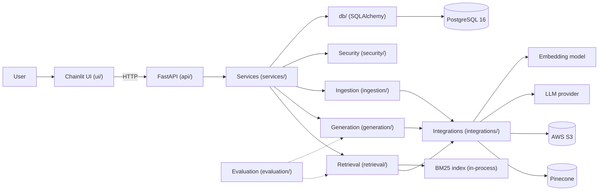
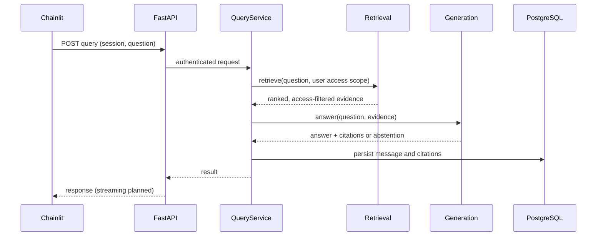

# Architecture

All components below are **Planned** unless marked otherwise. The repository currently contains the package layout and placeholder files.

## Goals and design principles

- **Evidence first.** Answers come from retrieved passages with citations, or the system abstains.
- **Measure, then keep.** Each retrieval or ranking stage must justify itself in evaluation ([ADR 0004](decisions/0004-evaluation-first-development.md)).
- **One place for logic.** Retrieval and generation live behind the FastAPI backend; the UI only calls HTTP.
- **Authorization outside the model.** Access control is enforced in code before any text reaches the LLM ([security](security.md)).
- **Swappable external services.** Pinecone, the embedder, the LLM and S3 are reached through `integrations/` so they can be mocked or replaced.

## Component diagram



## Package responsibilities and dependency direction

```text
domain  <-  ingestion / retrieval / generation / security / db / integrations
                         <-  services  <-  api  <-  (HTTP)  <-  ui
```

| Package | Responsibility |
|---|---|
| `domain` | Shared types (`Document`, `Chunk`, `RetrievalResult`, `Citation`). Imports nothing from the project. |
| `integrations` | Thin clients for Pinecone, the embedding model, the LLM and S3. No business logic. |
| `ingestion` | Load, parse, normalize, chunk, hash, embed and index documents. |
| `retrieval` | BM25, dense search, hybrid merge, RRF, optional reranking, metadata and access filters. |
| `generation` | Prompt construction, answer generation, citation building, abstention decisions. |
| `security` | Authentication, authorization, input and injection checks. |
| `db` | SQLAlchemy session, models and optional repositories. |
| `services` | Orchestrate one use case (`query_service`, `ingestion_service`). |
| `api` | HTTP transport only: routes, schemas, dependencies, error mapping. |
| `evaluation` | Metrics, RAGAS integration, dataset loading, run reports. |
| `ui` | Chainlit app and an API client. |

Rule: `api` schemas describe HTTP shapes only. Pipeline code uses `domain` types.

## Storage responsibilities

| Store | Holds |
|---|---|
| PostgreSQL | Users, sessions, messages, document and ingestion metadata, citation records |
| Pinecone | Dense vectors with filterable metadata |
| BM25 index | In-memory lexical index built from chunks; rebuildable, optionally persisted to a gitignored local path |
| AWS S3 | Original source documents |

The BM25 index is per process, so the first deployment uses a single API worker or a shared loaded index ([retrieval](retrieval.md)).

## Query lifecycle



## Evaluation integration

The evaluation runner calls the same retrieval and generation code as the service, with fixed configuration and a versioned dataset, so measured behaviour matches served behaviour ([evaluation](evaluation.md)).

## Deployment boundaries

Chainlit and FastAPI are separate processes/containers; PostgreSQL runs as a service; Pinecone, S3 and the LLM provider are external. See [deployment](deployment.md).

## Related

[Data flow](data-flow.md) · [Retrieval](retrieval.md) · [Security](security.md) · [Decisions](decisions/README.md)
