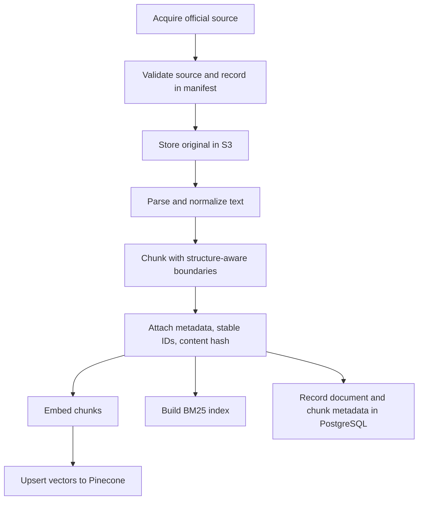
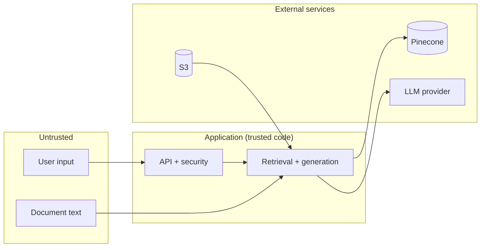

# Data Flow

End-to-end lifecycle of a document and of a query. All stages are **Planned**.

## Document lifecycle

| Stage | What happens | Typical failure |
|---|---|---|
| Acquisition | Download from an official portal; record URL, retrieval date, effective date | Wrong or superseded version |
| Validation | Check source domain, file type, size, hash | Unofficial copy, corrupted file |
| Parsing | Extract text and structure (PDF/HTML) | Broken tables, lost headings, scanned pages |
| Chunking | Split along legal structure | Section split mid-clause, oversized chunks |
| Metadata | Document ID, version, section path, dates | Missing effective date |
| Embedding | One consistent embedding model per index | Model mismatch between index and queries |
| Indexing | Upsert to Pinecone, rebuild BM25 | Partial upsert, stale BM25 index |
| Persistence | Metadata rows in PostgreSQL | Drift between PostgreSQL and Pinecone |

Details: [Chunking and indexing](chunking-and-indexing.md).

## Query lifecycle

1. **Receive and validate** the request (length, encoding, session ownership).
2. **Authenticate and resolve the user's access scope.**
3. **Process the query** (normalization; no model-driven rewriting at baseline).
4. **Retrieve candidates** from BM25 and Pinecone with the access filter applied.
5. **Deduplicate and fuse** with RRF; optionally rerank.
6. **Build evidence:** select the top passages that fit the context budget.
7. **Generate** an answer constrained to the evidence, or abstain.
8. **Format citations** that map to passage identifiers.
9. **Persist** the message, citations and run metadata.
10. **Return** the result to the UI.

Evaluation runs steps 3-8 with fixed settings and compare outputs to labels ([evaluation](evaluation.md)).

## Trust boundaries

- User input and **document content are both untrusted**: documents can contain instructions aimed at the model.
- External services receive only what is needed (queries, evidence), never secrets.
- Authorization is decided in application code, before context is built.

## Failure points to design for

- Retrieval returns nothing relevant: abstain.
- Evidence conflicts or spans versions: surface both or abstain ([generation](generation-and-citations.md)).
- External service timeout: fail clearly, do not fabricate an answer.
- Index and database out of sync: reconcile using content hashes ([chunking](chunking-and-indexing.md)).

## Related

[Architecture](architecture.md) · [Security](security.md) · [Threat model](threat-model.md)
