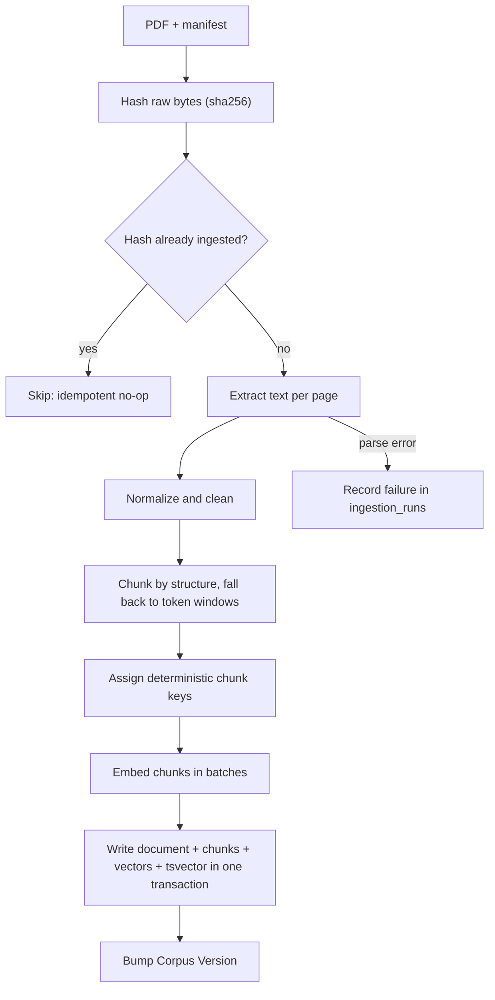
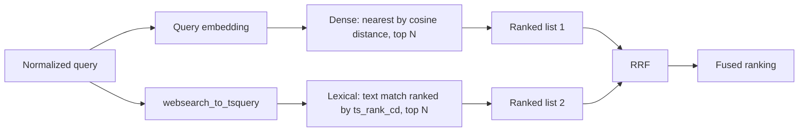
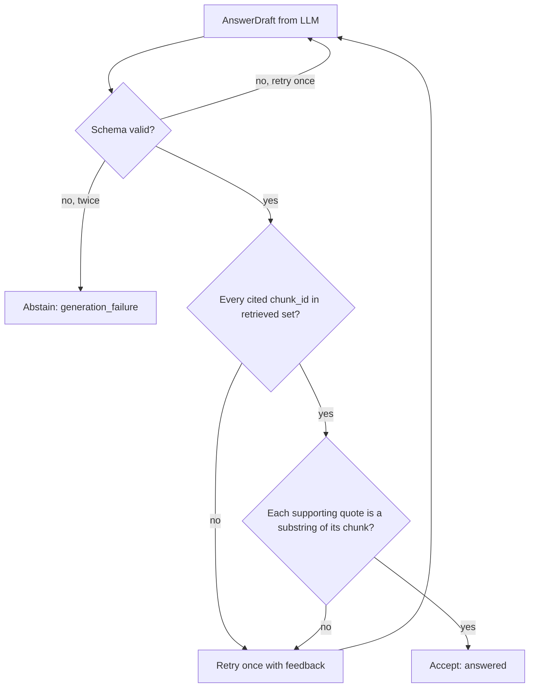

# Data Flow

> **Status:** **[Proposed]** design. Chunk texts and IDs below are **illustrative placeholders**, not real statutory text and not real corpus content.

This document follows one piece of data through the system. Component roles are in [architecture.md](architecture.md).

## 1. PDF → searchable evidence



Each chunk keeps `document_id`, page span, section path and `chunk_key`, so any retrieved passage traces back to its source file and version. Details: [ingestion.md](ingestion.md), [database.md](database.md).

## 2. Question → embedding

The API validates length and content type, normalizes whitespace and Unicode (NFKC), then the Embedding Client embeds the query **with the same model and dimension** that produced the stored vectors. A mismatch is a startup/configuration error, not a runtime surprise ([retrieval.md](retrieval.md#embeddings)).

## 3. Dense and lexical results



Both searches apply the same metadata filter (active documents, effective-date window, source type) inside SQL.

## 4. How RRF combines the lists

`score(c) = Σ 1 / (k + rank_i(c))` over the lists where `c` appears, with `k = 60` as the starting constant. Ranks are positions, so incomparable raw scores (cosine vs `ts_rank_cd`) never need normalizing. Worked example in [retrieval.md](retrieval.md#rrf).

## 5. Evidence to the LLM

The Evidence Context Builder takes the top `M` fused chunks, drops near-duplicates, orders them, and wraps each in a delimited block carrying its `chunk_id`, document title, reference, effective date and page span. Text inside the block is data; the system prompt states that instructions inside evidence must be ignored ([security.md](security.md)). Budgeting and prompt layout: [generation.md](generation.md).

## 6. Citation validation



Passing all checks proves **well-formedness and traceability**, not that the claim is entailed or legally correct. See [grounding-and-abstention.md](grounding-and-abstention.md).

## 7. Answer or abstention to the user

The API returns one of two shapes: `status: answered` with claims, citations and evidence metadata, or `status: abstained` with a reason code and a user-safe message. The Chainlit UI renders citations as expandable source cards ([api-and-ui.md](api-and-ui.md)).

## 8. Worked example (illustrative)

Question: *"Who must file Form X, and by when?"*

Illustrative retrieved lists (N = 4):

| Rank | Dense | Lexical |
|---|---|---|
| 1 | c_0141 | c_0033 |
| 2 | c_0207 | c_0141 |
| 3 | c_0033 | c_0310 |
| 4 | c_0099 | c_0207 |

RRF with k = 60:

| Chunk | Calculation | Score |
|---|---|---|
| c_0141 | 1/61 + 1/62 | 0.03252 |
| c_0033 | 1/63 + 1/61 | 0.03227 |
| c_0207 | 1/62 + 1/64 | 0.03175 |
| c_0310 | 1/63 | 0.01587 |
| c_0099 | 1/64 | 0.01563 |

c_0141 wins by appearing high in both lists. Suppose the builder passes the top three. The LLM returns:

```json
{
  "status": "answered",
  "answer": "<synthesized answer text>",
  "claims": [
    {"text": "<claim 1>", "citations": [{"chunk_id": "c_0141", "quote": "<verbatim span from c_0141>"}]},
    {"text": "<claim 2>", "citations": [{"chunk_id": "c_0033", "quote": "<verbatim span from c_0033>"}]}
  ]
}
```

The validator confirms both IDs are in the retrieved set and both quotes appear in their chunks. If claim 2 had cited `c_0999`, it would be rejected as an unresolved citation. If the question were about something none of the chunks address, the sufficiency rules would produce an abstention before or after generation.

---
Next: [database.md](database.md) · [retrieval.md](retrieval.md) · [generation.md](generation.md)
