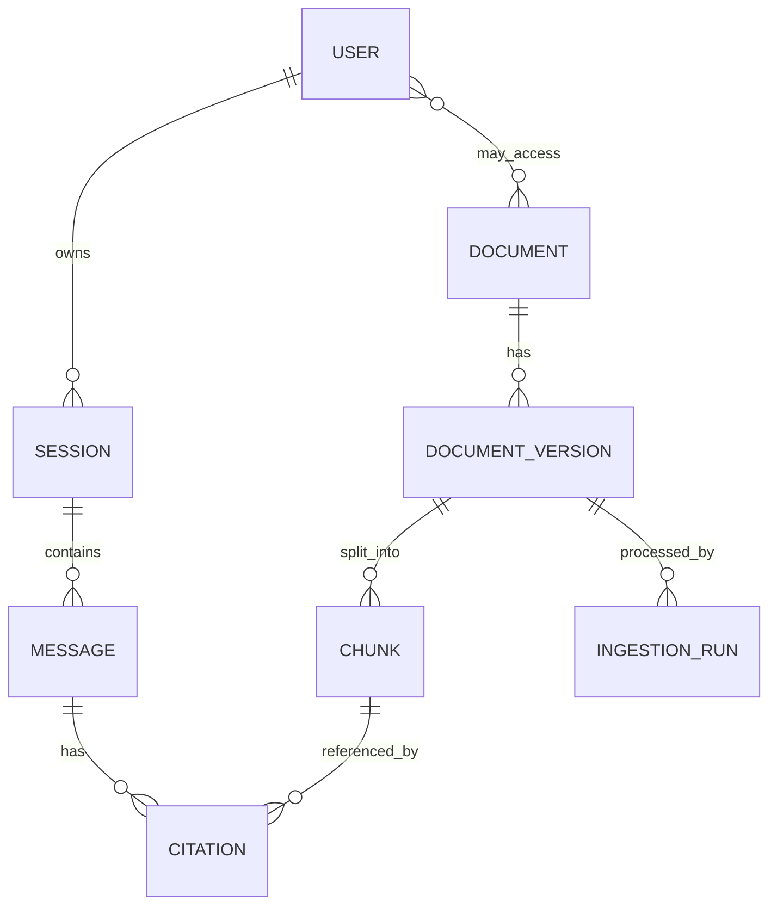

# Database

Status: **Proposed**. Entities and fields may change during implementation; migrations will be the source of truth. Rationale: [ADR 0002](decisions/0002-pinecone-and-postgresql.md).

## Responsibilities

PostgreSQL 16 stores structured application data. It does **not** store dense vectors (Pinecone) or original files (AWS S3). Chunk text for citation display may be stored here or fetched from S3; this is an open decision.

## Tooling

- **SQLAlchemy** for models and queries (`db/models/`, `db/session.py`, optional `db/repositories/`).
- **Alembic** for schema migrations (`migrations/versions/`).

## Proposed entities

| Entity | Purpose |
|---|---|
| User (and credentials, if implemented) | Identity and access scope |
| Session, Message | Conversation history |
| Citation | Links an answer to chunk IDs |
| Document, DocumentVersion | Source, version, effective dates, hash, S3 location |
| Chunk | Chunk ID, section path, content hash, embedding model, Pinecone ID reference |
| IngestionRun | Status, counts, errors |
| Access grants | Which users may read which documents |

## Transactions

One request is one unit of work. Ingestion records are written transactionally per document; Pinecone upserts are not part of the database transaction, so ingestion tracks state (`pending` to `indexed`) and can be retried or reconciled.

## Indexing and constraints

Unique constraints on stable IDs and `(document_id, version)`; foreign keys with sensible delete behaviour; indexes on session and user lookups, chunk IDs and content hashes. Add indexes from observed queries, not speculatively.

## Schema evolution

Every schema change is an Alembic migration, reviewed with the code. Prefer additive changes; avoid editing applied migrations. Test migrations up and down on a scratch database.

## Backup and migration considerations

Back up PostgreSQL regularly in any real deployment and test restores. Because Pinecone and S3 hold other state, a restore may need reconciliation of vectors and chunk records ([chunking](chunking-and-indexing.md)). Migrations run as an explicit step before the API starts ([deployment](deployment.md)).

Related: [Architecture](architecture.md) · [Configuration](configuration.md)
