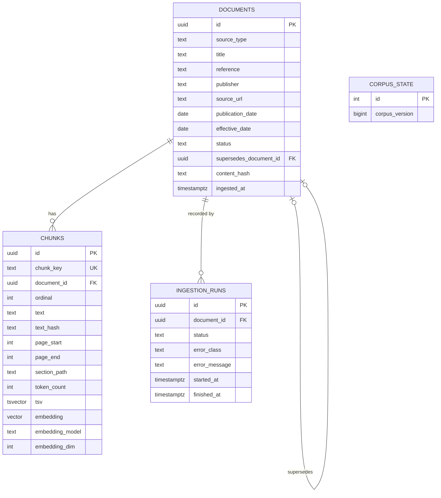

# Database Design

> **Status:** **[Proposed]**. All SQL below is conceptual and is not yet a migration. The embedding dimension `N` is undecided (OD-1), so `vector(N)` is a placeholder.

PostgreSQL stores documents, chunks, vectors, full-text vectors and ingestion history ([ADR 0002](adr/0002-postgresql-and-pgvector.md)).

## 1. Entity-relationship diagram



`CORPUS_STATE` is a one-row table; it is intentionally unrelated to the others, since it is a counter used for cache correctness.

## 2. Conceptual schema

```sql
CREATE EXTENSION IF NOT EXISTS vector;

CREATE TABLE documents (
  id uuid PRIMARY KEY,
  source_type text NOT NULL CHECK (source_type IN ('statute','rules','circular','notification','guidance')),
  title text NOT NULL,
  reference text NOT NULL,
  publisher text,
  source_url text,
  publication_date date,
  effective_date date,
  status text NOT NULL DEFAULT 'active' CHECK (status IN ('active','superseded','withdrawn')),
  supersedes_document_id uuid REFERENCES documents(id),
  content_hash text NOT NULL UNIQUE,
  ingested_at timestamptz NOT NULL DEFAULT now()
);

CREATE TABLE chunks (
  id uuid PRIMARY KEY,
  chunk_key text NOT NULL UNIQUE,
  document_id uuid NOT NULL REFERENCES documents(id) ON DELETE CASCADE,
  ordinal int NOT NULL,
  text text NOT NULL,
  text_hash text NOT NULL,
  page_start int, page_end int,
  section_path text,
  token_count int,
  tsv tsvector GENERATED ALWAYS AS (to_tsvector('english', text)) STORED,
  embedding vector(N) NOT NULL,
  embedding_model text NOT NULL,
  embedding_dim int NOT NULL,
  UNIQUE (document_id, ordinal)
);

CREATE INDEX chunks_tsv_gin ON chunks USING gin (tsv);
CREATE INDEX chunks_embedding_hnsw ON chunks USING hnsw (embedding vector_cosine_ops);
CREATE INDEX chunks_document_idx ON chunks (document_id);
```

The text-search configuration (`'english'`) is open decision OD-3 because stemming can mangle identifiers like "80C"; see [retrieval.md](retrieval.md#lexical-retrieval).

## 3. Integrity constraints

- `content_hash UNIQUE` blocks duplicate files; `chunk_key UNIQUE` makes chunk writes idempotent.
- `ON DELETE CASCADE` from documents to chunks; documents are normally superseded, not deleted.
- `CHECK` constraints on `status` and `source_type`.
- `embedding_model` / `embedding_dim` are stored per chunk so a mixed-model state is *detectable*. Retrieval refuses to run if the active config does not match.

## 4. Indexes

| Index | Purpose | Notes |
|---|---|---|
| HNSW on `embedding` with `vector_cosine_ops` | approximate nearest neighbours | pgvector HNSW indexes `vector` up to 2,000 dimensions **[Verify against installed version]**. Defaults `m=16`, `ef_construction=64`; `hnsw.ef_search` is tuned per query with `SET LOCAL`. |
| GIN on `tsv` | full-text matching | fast lookups; ranking still computed per matching row |
| B-tree on `document_id` | joins, filters | |

**Filtering caveat:** with approximate indexes, a selective SQL filter can leave fewer than N results after the index scan. Newer pgvector versions offer iterative index scans for this **[Verify the installed version supports them]**; otherwise over-fetch and filter, and measure.

## 4a. Similarity

Cosine distance operator is `<=>`; similarity is `1 - distance`. Dense rank order uses distance ascending.

## 5. Migration lifecycle

Alembic manages schema. Rules: one migration per logical change; migrations are forward-reviewed and tested against a throwaway database; the `vector(N)` dimension and index creation are explicit migration steps. A model-dimension change is a **new migration plus re-embedding**, not an edit ([retrieval.md](retrieval.md#re-embedding)). Alembic config and `alembic/` do not exist yet **[Planned]**.

## 6. Database permissions

Two roles **[Proposed]**: `advanced_rag_ingest` (write) and `advanced_rag_app` (read-only on corpus tables, write on nothing but its own tables). The serving API never holds write credentials to corpus data. See [security.md](security.md).

---
Related: [ingestion.md](ingestion.md) · [retrieval.md](retrieval.md) · [ADR 0007](adr/0007-async-database-access.md)
