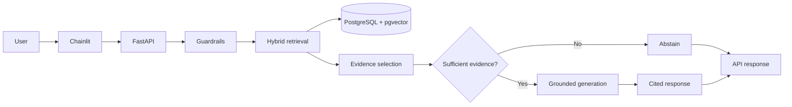

# ADR 0001: Focused RAG architecture and technology stack

- **Status:** Accepted as the current plan; implementation and provider choices remain to be verified.
- **Date:** 2026-10-28
- **Decision owners:** Project maintainers

## Context

Advanced-RAG needs to retrieve and explain Indian tax, legal, and regulatory information with source-linked evidence, relevant metadata, and safe abstention. The original design described a wider collection of subsystems, including dedicated embedding, generation, ingestion, evaluation, caching, observability, service, and UI areas. Many original repository files were empty or unimplemented, so the presence of a module in the old structure did not establish working functionality.

The project is a focused portfolio build with limited local compute and a requirement for cloud deployment. Engineering effort should go toward correctness, evaluation, secure implementation, and a working deployment before adding operational components that have no demonstrated need.

## Decision

Use a small modular Python application with:
- FastAPI for the backend API;
- Chainlit as a thin UI;
- Pydantic v2 for contracts;
- SQLAlchemy 2.x async with asyncpg;
- PostgreSQL as the primary database;
- pgvector for vector search;
- PostgreSQL full-text search for lexical retrieval;
- native Python retrieval orchestration, chunking, and guardrails;
- RRF to fuse lexical and semantic rankings;
- pytest and Ruff for automated quality checks;
- GitHub Actions for CI and CD; and
- a mandatory cloud deployment using verified compatible hosting.

Python 3.14 is the target version, conditional on validating dependency compatibility.

The application must preserve source provenance and supported temporal metadata, use parameterized database access, cite retrieved evidence, and abstain when evidence is insufficient.

## Intended architecture

## Alternatives considered

### Broader, multi-subsystem design
**Advantages:** clear expansion points for specialized ingestion, caching, tracing, and service modules.

**Disadvantages:** more dependencies, configuration, maintenance, and integration work before core quality is demonstrated. The original repository structure also contained many empty files, so structural breadth did not equal implementation maturity.

### PostgreSQL plus pgvector and full-text search
**Advantages:** one primary database can support relational metadata, lexical search, and vector search; fewer infrastructure components; simpler local development and operations.

**Trade-offs:** PostgreSQL may need careful indexing and query tuning as data volume or concurrency grows. A dedicated search or vector service may become justified only after measured limitations.

### Redis caching
Not included initially. Caching adds invalidation, consistency, memory, and operational concerns. Reconsider only if profiling demonstrates a meaningful repeated-work or latency problem.

### External tracing platform
Not included initially. Structured logs and targeted diagnostics are the baseline. Add a tracing platform only if the actual debugging or operational needs justify the dependency.

### RAG framework
LangChain, LlamaIndex, and LangGraph are excluded from the agreed scope to keep the retrieval path explicit and inspectable. This is a project-specific trade-off, not a general claim that frameworks are always inappropriate.

## Consequences

### Benefits
- Smaller implementation and maintenance surface.
- Clear separation between UI, API, retrieval, and persistence.
- Direct control over retrieval and evidence handling.
- A focused path to tests, evaluation, cloud deployment, and CI/CD.
- Fewer external infrastructure dependencies.

### Costs and risks
- The project must implement and test orchestration and retrieval behavior itself.
- PostgreSQL query performance and index choices require validation.
- Temporal legal metadata can be incomplete or difficult to normalize.
- Free-tier services can have limits, pauses, quotas, or pricing changes.
- A simpler design does not itself establish production readiness.
- Python 3.14 and all selected dependencies must be tested together.

## Decision guardrails

Do not add a component merely because it appears in a common production stack. Propose it only when there is:
1. a concrete unmet requirement;
2. evidence or a reproducible scenario demonstrating the gap;
3. a comparison of simpler alternatives; and
4. an explicit assessment of maintenance, security, and cost.

## Acceptance criteria

This decision is considered successfully implemented only when:
- the agreed components exist and have clear responsibilities;
- hybrid retrieval and RRF are tested;
- evidence insufficiency produces safe abstention;
- citations can be traced to retrieved source passages;
- supported temporal and jurisdiction filters are tested;
- CI executes linting, tests, and evaluation checks;
- CD deploys and verifies the application in the selected cloud environment; and
- deployment costs and free-tier limitations are documented.

## Revisit triggers

Revisit this ADR if measured workload, evaluation results, reliability incidents, or operational requirements demonstrate that the current design cannot meet its goals. Any reversal should be documented with evidence and trade-offs.
