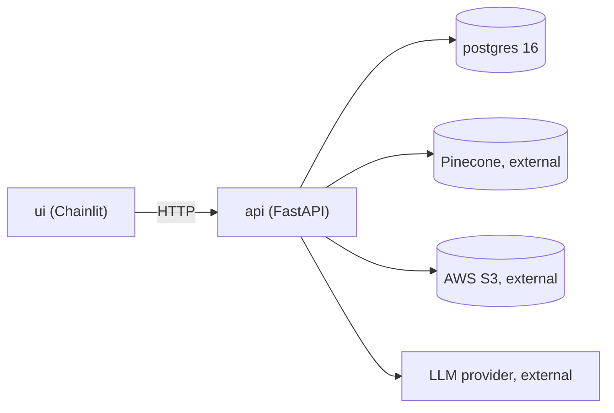

# Deployment

Status: **Planned**. The application is not deployed, and no deployment URLs exist. `Dockerfile`, `compose.yaml` and `ci.yml` are placeholders until implemented.

## Environments

| Environment | Purpose | Notes |
|---|---|---|
| Local development | Day-to-day work | Docker Compose or local services; `.env` |
| Test / CI | Automated checks | Throwaway database; mocked externals |
| Production (future) | Real use | Not defined; requires hardening and review |

## Service layout (Docker Compose, intended)

- **api** and **ui** are separate containers; the UI reaches the API over the Compose network.
- **postgres** uses a named volume for persistence.
- Pinecone, S3 and the LLM provider are external; no local substitute is assumed.
- The BM25 index is in-process, so start with a single API worker or a deliberate shared-index strategy ([retrieval](retrieval.md)).

## Configuration and secrets

Environment variables per [configuration](configuration.md). Secrets come from the environment or a secret store, not from images or Git.

## Migrations

Run `alembic upgrade head` as an explicit one-shot step before the API starts, not implicitly on every boot.

## Health checks and logs

Container health checks call `/health` ([api](api.md)). Logs go to stdout in a structured format; no secrets or private prompt text ([security](security.md)).

## Persistent data

PostgreSQL volume (back up), S3 for originals, Pinecone for vectors. BM25 index and caches are rebuildable and not authoritative.

## CI and pipeline (intended)

GitHub Actions: install, lint and type-check, run tests, build the image. Deployment automation is out of scope until a target exists. Pin dependency versions and scan them.

Related: [Architecture](architecture.md) · [Development setup](development-setup.md)
