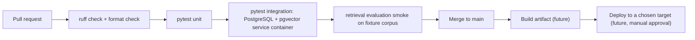
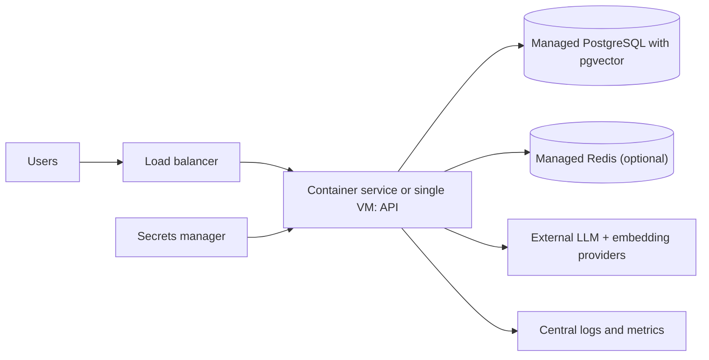

# Deployment

> **Status:** **[Planned]**. Nothing has been deployed or provisioned, and no cloud resources exist. AWS options are future work and need a cost estimate and explicit approval first.

## 1. Local-first development

Run the API and Chainlit UI directly in the virtual environment; PostgreSQL installed natively on Windows ([development-setup.md](development-setup.md)). Rationale: [ADR 0006](adr/0006-local-first-development.md).

## 2. Docker Compose for supporting services only

Compose may run **Redis** and **self-hosted Langfuse** (which has its own dependencies; follow Langfuse's own deployment docs **[Verify current requirements]**). The application and the primary PostgreSQL are not containerized in development.

## 3. Environment configuration

All configuration via environment variables ([../.env.example](../.env.example)), loaded through a typed settings class **[Proposed]**. Startup validates required variables and the embedding model/dimension against the database, and fails fast with a clear message.

## 4. CI/CD

CI uses a PostgreSQL service container with pgvector, so a container-based database exists in CI even though local development avoids it. Secrets come from GitHub repository secrets; CI never needs real provider keys because tests use fakes. Workflow files do not exist yet **[Planned]**.

## 5. AWS options (future, unprovisioned)

Two candidate shapes: (a) one small VM running the API with a managed or self-hosted database; (b) a container service plus managed PostgreSQL. Whether the chosen managed PostgreSQL supports the needed `pgvector` version must be checked **[Verify]**. No option is recommended until requirements and traffic are known.

## 6. Cost controls and teardown

Before provisioning anything: written monthly estimate, budget alerts, smallest instance sizes, tagging every resource, a documented teardown checklist (delete compute, database snapshots, load balancers, volumes, secrets), and an owner-approved spending cap. Provider API usage is also a cost: set per-day token limits.

## 7. Health checks and graceful shutdown

`/healthz` (process alive) and `/readyz` (DB reachable, config consistent) ([api-and-ui.md](api-and-ui.md)). On shutdown signal: stop accepting requests, finish in-flight work within a grace period, close DB pool and HTTP clients.

## Production hardening

Authentication and rate limiting, strict CORS, TLS termination, least-privilege DB roles, dependency audits, backups and restore tests, log retention policy, alerts on error and abstention spikes, provider-key rotation. See [security.md](security.md) and [observability.md](observability.md).

---
Related: [development-setup.md](development-setup.md) · [security.md](security.md)
