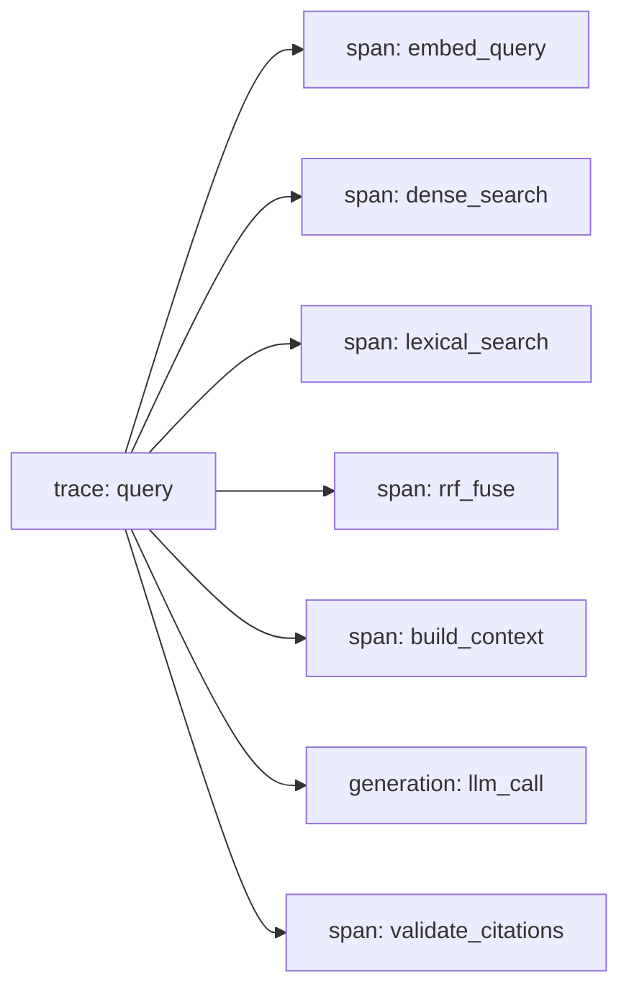
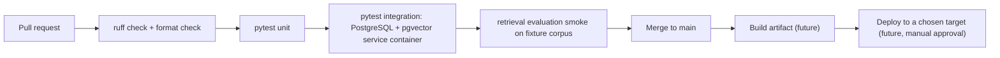
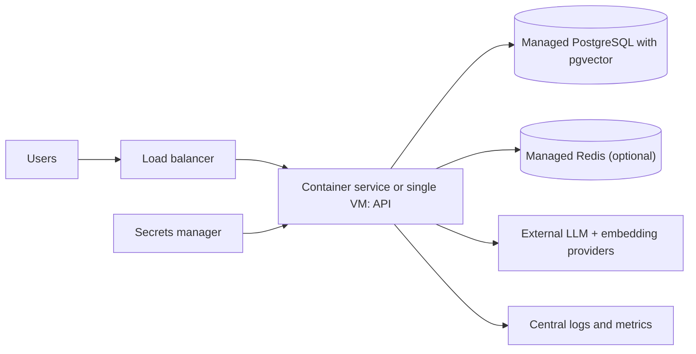

# Development And Operations

## Development Setup

# Development Setup

> **Status:** **None of these commands has been executed against this project.** Sections marked *(depends on planned files)* will work only after those files exist. Update this table as each step is verified.

| Step | Verified? |
|---|---|
| Python 3.14.6 + venv | not yet |
| Dependency install | not yet (no lock file exists) |
| PostgreSQL + pgvector on Windows | not yet |
| Migrations, ingestion, tests | not yet (code does not exist) |

## 1. Shell

Use **Git Bash** on Windows 11. Paths use forward slashes.

## 2. Python 3.14.6 and virtual environment

```bash
py -3.14 --version            # confirm interpreter is installed and reports 3.14.x
py -3.14 -m venv .venv
source .venv/Scripts/activate # Git Bash activation path on Windows
python --version
```

Do not downgrade Python silently. If a dependency lacks 3.14 support, record it in the compatibility table in the [specification](project-specification.md#7-technology-baseline) and decide deliberately.

### Compatibility check to run first **[Verify]**

In a clean venv, attempt to install each and note failures: `fastapi`, `pydantic`, `sqlalchemy`, `asyncpg`, `alembic`, `pgvector` (Python package), `instructor`, `chainlit`, `redis`, `httpx`, the chosen PDF library, `pytest`, `ruff`. Record versions that work.

## 3. Dependencies *(depends on planned `pyproject.toml`)*

```bash
pip install -e ".[dev]"       # planned; pyproject.toml does not exist yet
```

## 4. Environment variables

```bash
cp .env.example .env          # then edit; never commit .env
```

See [../.env.example](../.env.example).

## 5. PostgreSQL and pgvector prerequisites

1. Install PostgreSQL natively for Windows; confirm `psql --version`.
2. Install the pgvector extension. On native Windows the upstream project documents building from source with Visual Studio's C++ build tools (`nmake /F Makefile.win`) **[Verify against the pgvector README for your PostgreSQL and pgvector versions]**. Prebuilt binaries may exist; verify provenance before trusting them (OD-5).
3. Create the database and enable the extension:

```bash
psql -U postgres -c "CREATE DATABASE advanced_rag;"
psql -U postgres -d advanced_rag -c "CREATE EXTENSION IF NOT EXISTS vector;"
psql -U postgres -d advanced_rag -c "SELECT extversion FROM pg_extension WHERE extname='vector';"
```

Record the pgvector version; it determines features such as iterative index scans ([database.md](database.md#4-indexes)).

## 6. Redis and Langfuse (only when needed, phases 2 and 3)

Docker Compose file is **[Planned]**: `docker compose up -d redis langfuse`. Follow Langfuse's current self-hosting guide **[Verify]**.

## 7. Migrations, ingestion, run *(depend on planned code)*

```bash
alembic upgrade head                                  # planned
python -m advanced_rag.ingestion path/to/docs         # planned
uvicorn advanced_rag.api.main:app --reload            # planned
chainlit run ui/chainlit_app.py                       # planned
```

## 8. Tests and lint *(depend on planned tooling config)*

```bash
ruff check .
ruff format --check .
pytest
```

---
Related: [testing.md](testing.md) · [deployment.md](deployment.md) · [../CONTRIBUTING.md](../CONTRIBUTING.md)

---

## Observability

# Observability

> **Status:** structured logging **[Proposed]** for phase 1; Langfuse tracing **[Planned]** for phase 2. Nothing is instrumented yet.

## 1. Structured logs

JSON, one object per line, to stdout. Common fields: `timestamp`, `level`, `service`, `request_id`, `event`, `duration_ms`, `corpus_version`, `prompt_version`. A `request_id` is generated (or accepted from a header) at the API edge and carried through every layer using context variables.

Events: `query_received`, `embed_done`, `dense_done`, `lexical_done`, `fused`, `context_built`, `llm_done`, `validation_result`, `abstained`, `query_failed`.

## 2. Traces and spans (Langfuse)

One trace per query with child spans:



Self-hosted Langfuse via Docker Compose ([deployment.md](deployment.md)); Langfuse stays optional: if unreachable, the API continues and logs a warning. Dense and lexical spans overlap in time since they run concurrently.

## 3. Latency breakdown

Report p50/p95 per span so you can tell whether time goes to the embedding provider, the database, or the LLM. No latency numbers are claimed before measurement.

## 4. Token and provider usage

Record prompt tokens, completion tokens, model name, retries and estimated cost per LLM call and token counts per embedding batch. Cost tables come from the provider's own pricing and are not hard-coded as facts.

## 5. Error tracking

Log exception class, mapped error code, and stack trace server-side only. Count abstentions by reason code, validation failures, retries and timeouts.

## 6. Privacy

Default: **do not log raw questions, evidence text or answers.** Log hash, length, language-agnostic counts, chunk IDs and scores. A development-only flag may enable content logging and must be off in any shared environment. Traces sent to Langfuse follow the same rule. Redact secrets and authorization headers globally ([security.md](security.md#6-sensitive-data-and-privacy)).

## 7. Operational metrics

Request rate, error rate by code, abstention rate by reason, retrieval candidates returned, citation-validation failure rate, cache hit rate (when Redis exists), DB pool usage. A Prometheus-style endpoint is optional future work.

---
Related: [architecture.md](architecture.md) · [caching.md](caching.md) · [evaluation.md](evaluation.md)

---

## Caching

# Caching

> **Status:** **[Planned]**, phase 3. Nothing is cached in the baseline. Redis is an optimization, never a source of truth ([architecture.md](architecture.md#6-data-ownership)).

## 1. What to cache

| Item | Cache? | Reason |
|---|---|---|
| Query embeddings | Yes | deterministic per (model, text); saves provider cost and latency |
| Retrieval results (fused list) | Yes, keyed with Corpus Version | deterministic for a given corpus and config |
| Final answers | Cautiously; later, if at all | depend on prompt, model, evidence; stale-answer risk in a legal domain |
| Raw user questions as readable keys | **No** | privacy; use hashes |
| Secrets, API keys | **Never** | |
| Failures/abstentions caused by provider errors | **No** | transient |

## 2. Key design

```
advrag:v1:emb:{embedding_model}:{sha256(normalized_query)}
advrag:v1:ret:{corpus_version}:{config_hash}:{sha256(normalized_query + filters)}
```

`v1` is a key-schema version. `config_hash` covers `N`, `M`, `k`, text-search config and filters. Because `corpus_version` is part of retrieval keys, every committed ingestion invalidates old entries automatically without a flush.

## 3. TTLs and invalidation

Embeddings: long TTL (they only change if the model changes, which changes the key). Retrieval results: shorter TTL as a safety net plus Corpus Version keying. Manual flush by key prefix is available for emergencies. Document supersession bumps Corpus Version, so superseded text cannot be served from cache.

## 4. Correctness risks

- Serving evidence from a withdrawn or superseded document (mitigated by Corpus Version).
- Mixing embedding models (model is in the key).
- Serving a cached answer built with an older prompt or model (not cached initially).
- Cache poisoning via malformed values: store typed, versioned JSON; validate on read.

## 5. Bypass and failure behavior

A `Cache-Control: no-cache`-style request option or `debug` mode bypasses reads. Redis errors or timeouts are logged and treated as a **miss**; the request proceeds without caching. Short Redis timeouts prevent the cache from slowing the system it is meant to speed up.

---
Related: [retrieval.md](retrieval.md#embeddings) · [observability.md](observability.md) · [deployment.md](deployment.md)

---

## Deployment

# Deployment

> **Status:** **[Planned]**. Nothing has been deployed or provisioned, and no cloud resources exist. AWS options are future work and need a cost estimate and explicit approval first.

## 1. Local-first development

Run the API and Chainlit UI directly in the virtual environment; PostgreSQL installed natively on Windows ([development-setup.md](development-setup.md)). Rationale: [ADR 0006](adr/0006-local-first-development.md).

## 2. Docker Compose for supporting services only

Compose may run **Redis** and **self-hosted Langfuse** (which has its own dependencies; follow Langfuse's own deployment docs **[Verify current requirements]**). The application and the primary PostgreSQL are not containerized in development.

## 3. Environment configuration

All configuration via environment variables ([../.env.example](../.env.example)), loaded through a typed settings class **[Proposed]**. Startup validates required variables and the embedding model/dimension against the database, and fails fast with a clear message.

## 4. CI/CD



CI uses a PostgreSQL service container with pgvector, so a container-based database exists in CI even though local development avoids it. Secrets come from GitHub repository secrets; CI never needs real provider keys because tests use fakes. Workflow files do not exist yet **[Planned]**.

## 5. AWS options (future, unprovisioned)



Two candidate shapes: (a) one small VM running the API with a managed or self-hosted database; (b) a container service plus managed PostgreSQL. Whether the chosen managed PostgreSQL supports the needed `pgvector` version must be checked **[Verify]**. No option is recommended until requirements and traffic are known.

## 6. Cost controls and teardown

Before provisioning anything: written monthly estimate, budget alerts, smallest instance sizes, tagging every resource, a documented teardown checklist (delete compute, database snapshots, load balancers, volumes, secrets), and an owner-approved spending cap. Provider API usage is also a cost: set per-day token limits.

## 7. Health checks and graceful shutdown

`/healthz` (process alive) and `/readyz` (DB reachable, config consistent) ([api-and-ui.md](api-and-ui.md)). On shutdown signal: stop accepting requests, finish in-flight work within a grace period, close DB pool and HTTP clients.

## Production hardening

Authentication and rate limiting, strict CORS, TLS termination, least-privilege DB roles, dependency audits, backups and restore tests, log retention policy, alerts on error and abstention spikes, provider-key rotation. See [security.md](security.md) and [observability.md](observability.md).

---
Related: [development-setup.md](development-setup.md) · [security.md](security.md)
