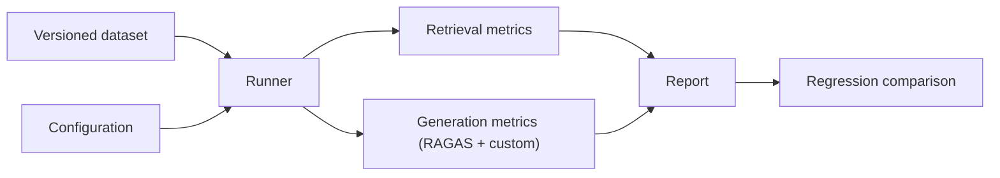

# Evaluation

Status: **Planned**. No dataset exists yet and no results have been produced. Rationale: [ADR 0004](decisions/0004-evaluation-first-development.md).

## Strategy

Evaluate retrieval and generation separately, because a good answer can hide bad retrieval (and the reverse). Run the same versioned dataset against each configuration and report the full configuration with every number ([benchmarking](benchmarking.md)).

## Dataset and categories

Each example has a query, answerability, expected relevant chunks and optionally a reference answer. Categories: exact statutory reference, paraphrase, exception/condition, temporal, multi-passage, ambiguous, unanswerable, access-restricted. Schema: [evaluation-dataset](evaluation-dataset.md).

## Compared configurations

BM25-only, dense-only, hybrid (BM25 + dense + RRF), and hybrid plus rerank (BGE or Cohere). Optionally the bounded workflow if it is ever built ([ADR 0006](decisions/0006-bounded-agent-orchestration.md)).

## Retrieval metrics

Computed per query against labelled relevant chunk IDs, then averaged. Let Q be the query set and K the cutoff.

- **Hit@K:** fraction of queries with at least one relevant chunk in the top K.
- **Recall@K:** relevant chunks in the top K divided by all relevant chunks, averaged over queries.
- **MRR:** mean of 1/rank of the first relevant chunk (0 if none): $\mathrm{MRR} = \frac{1}{|Q|}\sum_{q} \frac{1}{\mathrm{rank}_q}$
- **nDCG@K:** used only where graded relevance labels exist: $\mathrm{DCG@K} = \sum_{i=1}^{K} \frac{rel_i}{\log_2(i+1)}$, normalized by the ideal ordering's DCG.

Metrics are computed in `evaluation/retrieval_metrics.py` with deterministic unit tests on hand-built examples.

## Generation metrics

**RAGAS** (required): faithfulness (are claims supported by retrieved context), answer relevancy, context precision and context recall, using a configured judge model recorded in the run ([configuration](configuration.md)).

**Custom checks:**
- **Citation correctness:** each cited ID exists in the evidence and the passage supports the claim.
- **Grounding:** no claim without support in the evidence.
- **Correct abstention:** abstains on unanswerable queries; does not abstain on answerable ones. Report both abstention precision/recall-style rates.
- **Authorization:** restricted content never appears in context, answers or citations for an unauthorized user.

## Reproducibility

Record commit hash, dataset version, corpus manifest version, chunking and embedding settings, K values, fusion and rerank settings, model names, temperature and seeds, and run date. Cache embeddings and judge outputs where possible. Repeated runs quantify variance for LLM-dependent metrics.

## Regression reporting

Store summary results per run (committed) and detailed outputs (gitignored). Compare a candidate to the baseline per category, not just overall; flag any category that gets worse. CI runs a small fast subset; full runs are manual.

## Limitations

- **LLM-as-a-judge** can be biased, inconsistent and sensitive to prompts; it is a signal, not ground truth. Spot-check judged items by hand.
- A small dataset (this project's scale) gives wide uncertainty; avoid claiming small differences.
- Labels are subjective for legal relevance; record labelling guidelines.
- Retrieval metrics ignore answer quality; RAGAS ignores ranking detail.

Related: [Retrieval](retrieval.md) · [Testing](testing.md)
