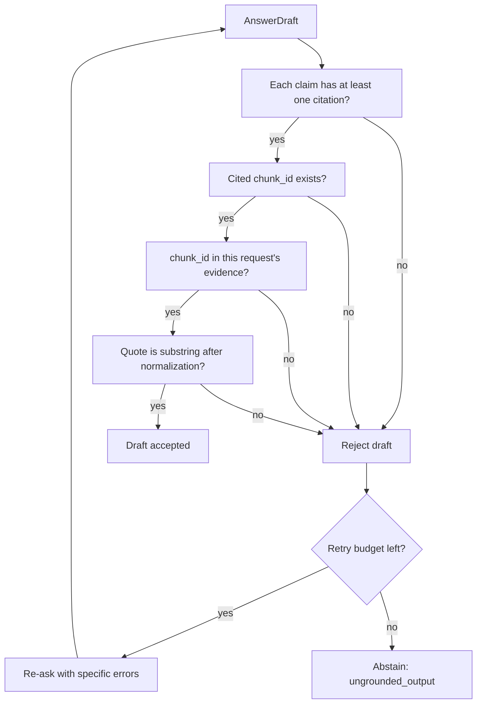
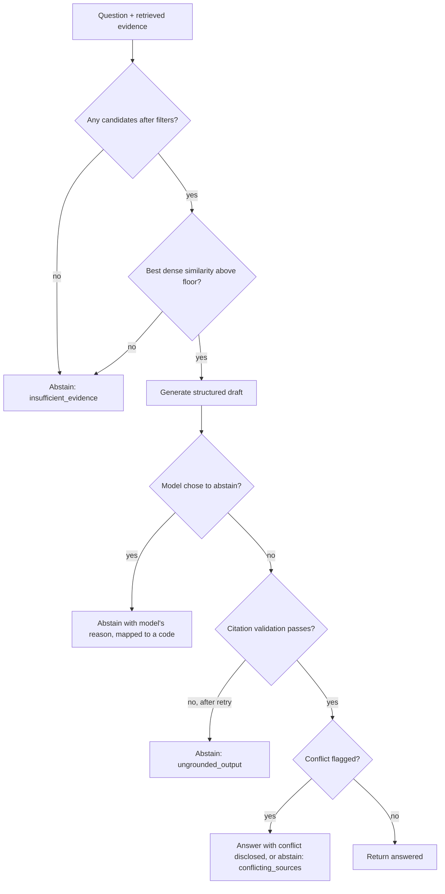

# Citations, Grounding and Abstention

> **Status:** **[Proposed]**. This document separates five different questions that are easy to conflate. A response can pass some and fail others.

## 1. Five levels of "is this answer supported?"

| Level | Question | Checked how | Automatable? |
|---|---|---|---|
| 1. Citation identifier validity | Does the cited ID exist in the database? | lookup | fully |
| 2. Citation-to-chunk resolution | Was the cited chunk actually in this request's retrieved evidence? | set membership | fully |
| 3. Quote anchoring | Is the supporting quote a verbatim (normalized) substring of the cited chunk? | string match | fully |
| 4. Claim-level evidence support | Does the cited text actually entail the claim? | human review or an LLM/NLI judge | partially (judge is fallible) |
| 5. Factual correctness and legal applicability | Is it true, current, and applicable to *this* person and year? | domain expert | **no** |

Levels 1 to 3 run at serving time. Level 4 runs in evaluation ([evaluation.md](evaluation.md)). Level 5 can never be automated; the system's notice says so.

A valid citation ID proves level 1 only. It does **not** guarantee the answer is grounded.

## 2. Citation validation flow

Normalization (case-folding, whitespace collapse, Unicode NFKC) is identical for chunk and quote.

What it does not catch: a real quote placed under a claim it does not support; a correct quote from a superseded or inapplicable provision; omitted exceptions; claims synthesized across chunks that no single chunk supports. These are why level 4 evaluation exists.

## 3. Abstention

Abstain when answering would be worse than declining. Reason codes **[Proposed]**:

| Code | Trigger |
|---|---|
| `insufficient_evidence` | no candidates, or evidence fails the sufficiency check |
| `conflicting_sources` | retrieved documents disagree and the conflict is unresolved by dates/status |
| `out_of_scope` | not about Indian tax/regulatory material in the corpus |
| `missing_document` | the question names a document/provision not in the corpus |
| `generation_failure` | schema failure after retry |
| `ungrounded_output` | citation validation failure after retry |

### Decision flow

### Contradictory sources

Prefer newer effective date and `active` status when documents genuinely supersede one another. If conflict remains (different scopes, ambiguous precedence), present both with citations and say they conflict, or abstain. The system never picks a winner it cannot justify from metadata.

### Thresholds and calibration

RRF scores are **not calibrated probabilities** and depend on list sizes, so they are poor abstention thresholds. Use signals that carry meaning, e.g. the best dense cosine similarity, lexical match presence, and number of distinct supporting chunks, with floors **calibrated on the golden set** by sweeping the threshold and plotting coverage vs unsupported-answer rate (OD-7). No default threshold is claimed.

### False abstentions vs unsupported answers

| Error | Cost | Mitigation |
|---|---|---|
| Unsupported answer (should have abstained) | user may rely on wrong information; reputational | bias toward abstention in a legal domain |
| False abstention (answer was available) | lost helpfulness | improve retrieval; show retrieved sources anyway |

The golden set includes both **answerable** and **deliberately unanswerable** questions so both rates are measured.

### Safe response behavior

Abstentions state the reason in plain language, may list the nearest sources retrieved (labelled as "possibly related, not an answer"), and never guess. See [api-and-ui.md](api-and-ui.md).

---
Related: [generation.md](generation.md) · [security.md](security.md) · [evaluation.md](evaluation.md) · [data-sources.md](data-sources.md)
