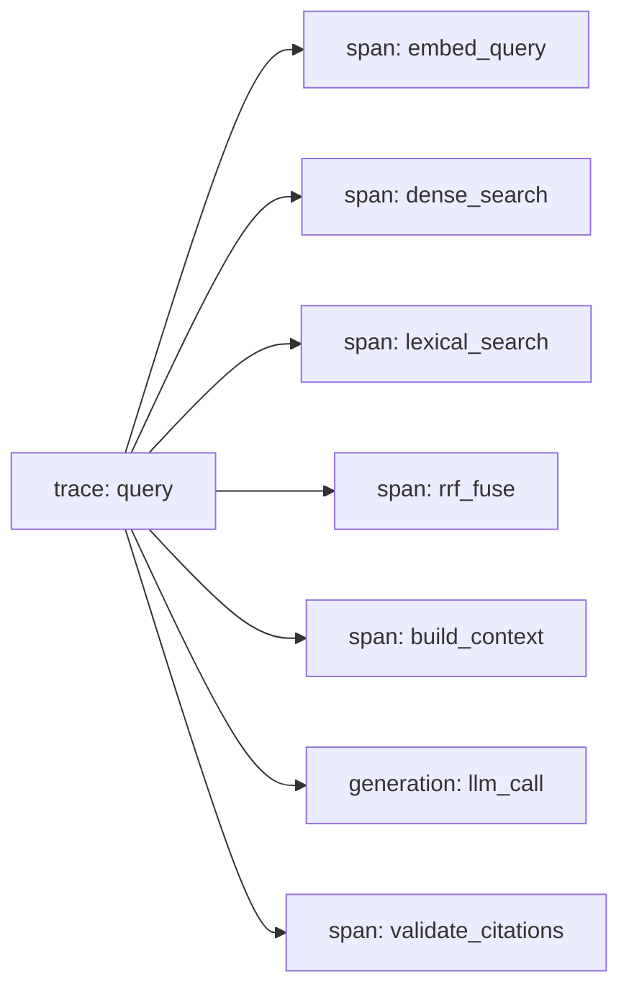

# Observability

> **Status:** structured logging **[Proposed]** for phase 1; Langfuse tracing **[Planned]** for phase 2. Nothing is instrumented yet.

## 1. Structured logs

JSON, one object per line, to stdout. Common fields: `timestamp`, `level`, `service`, `request_id`, `event`, `duration_ms`, `corpus_version`, `prompt_version`. A `request_id` is generated (or accepted from a header) at the API edge and carried through every layer using context variables.

Events: `query_received`, `embed_done`, `dense_done`, `lexical_done`, `fused`, `context_built`, `llm_done`, `validation_result`, `abstained`, `query_failed`.

## 2. Traces and spans (Langfuse)

One trace per query with child spans:

Self-hosted Langfuse via Docker Compose ([deployment.md](deployment.md)); Langfuse stays optional: if unreachable, the API continues and logs a warning. Dense and lexical spans overlap in time since they run concurrently.

## 3. Latency breakdown

Report p50/p95 per span so you can tell whether time goes to the embedding provider, the database, or the LLM. No latency numbers are claimed before measurement.

## 4. Token and provider usage

Record prompt tokens, completion tokens, model name, retries and estimated cost per LLM call and token counts per embedding batch. Cost tables come from the provider's own pricing and are not hard-coded as facts.

## 5. Error tracking

Log exception class, mapped error code, and stack trace server-side only. Count abstentions by reason code, validation failures, retries and timeouts.

## 6. Privacy

Default: **do not log raw questions, evidence text or answers.** Log hash, length, language-agnostic counts, chunk IDs and scores. A development-only flag may enable content logging and must be off in any shared environment. Traces sent to Langfuse follow the same rule. Redact secrets and authorization headers globally ([security.md](security.md#6-sensitive-data-and-privacy)).

## 7. Operational metrics

Request rate, error rate by code, abstention rate by reason, retrieval candidates returned, citation-validation failure rate, cache hit rate (when Redis exists), DB pool usage. A Prometheus-style endpoint is optional future work.

---
Related: [architecture.md](architecture.md) · [caching.md](caching.md) · [evaluation.md](evaluation.md)
