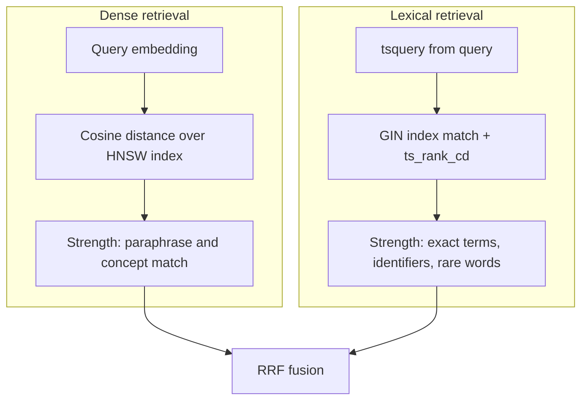
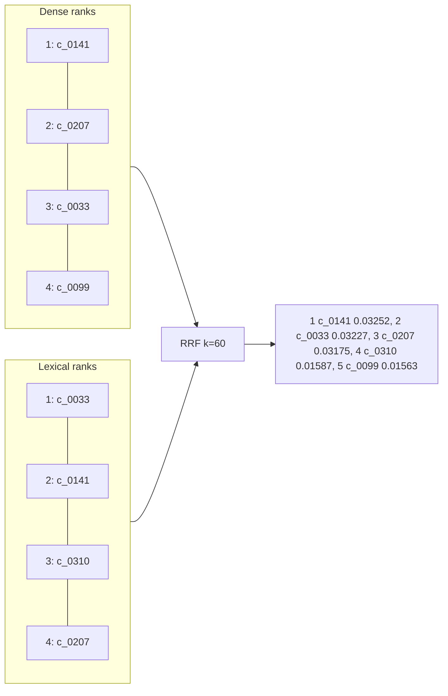

# Retrieval

> **Status:** **[Proposed]**. Numbers in worked examples are illustrative arithmetic, not measured results.

Retrieval finds candidate evidence; it never calls the LLM. Decision record: [ADR 0003](adr/0003-hybrid-retrieval-and-rrf.md).

## 1. Dense vs lexical



| | Dense | Lexical |
|---|---|---|
| Finds | semantically similar text | literally matching terms |
| Weak at | exact identifiers, rare tokens | paraphrase, synonyms |
| Score | cosine distance | `ts_rank_cd` |
| Index | HNSW | GIN |

## 2. Vector similarity search

```sql
SET LOCAL hnsw.ef_search = 100;  -- tuned by measurement
SELECT id, 1 - (embedding <=> :qvec) AS similarity
FROM chunks c JOIN documents d ON d.id = c.document_id
WHERE d.status = 'active' AND (:as_of IS NULL OR d.effective_date <= :as_of)
ORDER BY embedding <=> :qvec
LIMIT :n;
```

HNSW is approximate: recall is traded for speed, controlled by `ef_search`. Measure recall of the index against exact search on the golden set before trusting it.

## Lexical retrieval

```sql
SELECT id, ts_rank_cd(tsv, q, 32) AS score
FROM chunks c JOIN documents d ON d.id = c.document_id,
     websearch_to_tsquery('english', :query) q
WHERE tsv @@ q AND d.status = 'active'
ORDER BY score DESC
LIMIT :n;
```

### BM25 vs `ts_rank` and `ts_rank_cd`

PostgreSQL's `ts_rank` and `ts_rank_cd` are **not BM25**. They score using term frequency with optional weights and normalization flags (and, for `ts_rank_cd`, term proximity / cover density). They do **not** use corpus-wide inverse document frequency or BM25's term-frequency saturation and document-length formulation in the standard way. Therefore this project names its lexical leg **"PostgreSQL full-text search ranked with `ts_rank_cd`"** and never "BM25". A true BM25 implementation would need an extension or application-side scoring; whether to adopt one is open decision OD-4 and should be justified by an ablation ([evaluation.md](evaluation.md#6-baselines-and-ablations)).

Known issues to test (OD-3): stemming under `'english'` can alter identifiers (e.g. "80C"); stopword removal can drop meaningful short tokens; `websearch_to_tsquery` ANDs terms, which can return nothing for long natural-language questions, so a fallback (OR-style query or keyword extraction) may be needed.

## RRF

```
score(c) = Σ_i  1 / (k + rank_i(c)),   k = 60 (starting value)
```

Rank-based, so no normalization between cosine and `ts_rank_cd` is needed. A chunk absent from a list contributes nothing from that list. `k` damps the advantage of rank 1 over rank 2; it is a tunable parameter.



Worked arithmetic: c_0141 = 1/61 + 1/62 = 0.016393 + 0.016129 = 0.03252. c_0310 appears only in the lexical list at rank 3: 1/63 = 0.01587, which beats c_0099 (dense rank 4 only: 1/64 = 0.01563).

## 5. Candidate limits and filtering

Per-leg candidate count `N` (starting hypothesis 50), fused list truncated to `M` (hypothesis 8) for context. Both are tuned by evaluation ([evaluation.md](evaluation.md)). Filters (status, effective-date window, source type) apply inside both SQL queries so neither leg returns excluded documents. Access constraints are enforced here too if multi-user access is ever added (currently out of scope).

## 6. Reranking (optional)

A cross-encoder reranker re-scores the top candidates and can improve precision, but costs latency and, on CPU only, may be slow; it also adds a model dependency. **Adopt only if** an ablation on the golden set shows a meaningful gain in nDCG@K or answer quality that justifies the cost. Until then it is **[Planned]**, not part of the baseline.

## Embeddings

- **Compatibility:** query and chunk vectors must come from the **same model and dimension**; some models need different prefixes/instructions for queries vs documents; follow the provider's guidance **[Verify per chosen model]**.
- **Dimension:** fixed by the column type `vector(N)`. HNSW on `vector` is limited to 2,000 dims **[Verify]**; large dimensions raise storage and index cost.
- **Batching and limits:** batch size and rate limits are provider-specific; use bounded concurrency, timeouts, backoff with jitter. The provider is behind the `EmbeddingClient` interface; no provider is chosen (OD-1).
- **Versioning:** `embedding_model` and `embedding_dim` are stored per chunk; startup checks that config matches stored values.
- **Caching:** query embeddings may be cached by `(model, normalized_query_hash)` ([caching.md](caching.md)); chunk embeddings are already persisted.

### Re-embedding

Changing the model or dimension: (1) add `embedding_next vector(N2)` plus metadata columns via migration; (2) backfill in batches, resumable; (3) build the new HNSW index; (4) run the golden set against both and compare; (5) switch config and rename columns in a migration; (6) drop the old column and index. Serving stays on the old model until the switch. Never mix vectors from two models in one searched column.

## 8. Failure modes and diagnostics

| Symptom | Likely cause | Check |
|---|---|---|
| Exact section number not found | tokenization/stemming | run the lexical query alone; inspect `to_tsvector` output |
| Paraphrase query returns junk | embedding mismatch or weak model | dense-only Recall@K; verify model/dim |
| Fewer than N results with filters | HNSW post-filtering | raise `ef_search`; iterative scans **[Verify]** |
| Right chunk at rank 30 | `N` or `M` too small | Recall@N vs Hit@M |
| Superseded text returned | missing status filter | inspect evidence metadata |
| Slow queries | missing index or high `ef_search` | `EXPLAIN (ANALYZE)` |

A debug mode in the Evaluation Harness prints both ranked lists and the fused list for a single query **[Planned]**.

---
Related: [database.md](database.md) · [generation.md](generation.md) · [evaluation.md](evaluation.md) · [ingestion.md](ingestion.md)
