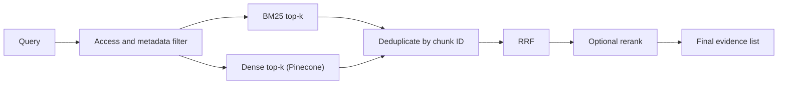

# Retrieval

Status: **Planned**. Describes the intended design; nothing is implemented or measured yet. Decision rationale: [ADR 0001](decisions/0001-hybrid-retrieval.md).

## Pipeline

## BM25 (lexical)

BM25 scores a chunk by query-term frequency, weighted by term rarity (inverse document frequency) and normalized for chunk length. Initial implementation: `rank_bm25`.

Strengths: exact section numbers, form names, defined terms. Limits: no understanding of synonyms or paraphrase; sensitive to tokenization (for example, `80C` or `Section 194-I` must not be split badly); the index is in memory and per process, so it is built from stored chunks at startup or loaded from a persisted copy (gitignored, rebuildable).

## Dense retrieval

Chunks and queries are embedded by the same embedding model; Pinecone returns the nearest vectors. Strengths: paraphrase and conceptual matches. Limits: can miss exact identifiers, and quality depends on the embedding model (not yet chosen) and on chunk quality. Mixing embedding models in one index is not allowed ([chunking](chunking-and-indexing.md)).

## Hybrid retrieval and deduplication

Both retrievers return candidates for the same query. Candidates are merged by stable `chunk_id`; a chunk found by both appears once and carries both ranks.

## Reciprocal Rank Fusion

$$\mathrm{RRF}(d) = \sum_{r \in R} \frac{1}{k + \mathrm{rank}_r(d)}$$

- **d**: a candidate chunk.
- **R**: the set of ranked lists being fused (here, BM25 and dense).
- **rank_r(d)**: the 1-based position of d in list r. If d is absent from r, that term is omitted.
- **k**: a smoothing constant that limits how much top ranks dominate. The original RRF paper used 60; this project treats k as a tunable setting, evaluated rather than assumed.

RRF uses ranks only, so it avoids normalizing BM25 and cosine scores that live on different scales.

## Optional reranking

A cross-encoder (BGE) or hosted reranker (Cohere Rerank) rescores the top-N fused candidates against the query. It can improve precision but adds latency and, for hosted options, cost. It is kept only if evaluation shows a worthwhile gain ([benchmarking](benchmarking.md)). The choice depends on compatibility, cost, latency and measured effectiveness.

## Metadata and access filters

Filters are applied at retrieval time, not after generation:

- **Access filter:** only documents the user may read ([security](security.md)).
- **Metadata filters:** document type, act/source, effective-date range, version.

Pinecone filters run server-side; BM25 candidates are filtered against the same allowed set. Results are re-checked against PostgreSQL before evidence is built.

## Configuration (proposed names; see [configuration](configuration.md))

| Setting | Meaning |
|---|---|
| `bm25_top_k` | Candidates from BM25 |
| `dense_top_k` | Candidates from Pinecone |
| `rrf_k` | RRF constant |
| `rerank_enabled`, `rerank_top_n` | Whether and how many to rerank |
| `final_k` | Passages passed to generation |

## Common failure cases

- Exact identifier missed by dense search; paraphrase missed by BM25.
- Tokenization splits legal identifiers.
- The right passage is split across chunks.
- Old and new versions of a provision both retrieved.
- Many near-duplicates crowd out distinct evidence.
- Over-aggressive filters hide relevant documents.
- Reranker demotes a correct but terse passage.

## Comparing methods fairly

Same corpus, same chunks, same labelled queries, same K, same embedding model; change one variable at a time; report the full configuration. Protocol: [benchmarking](benchmarking.md). Metrics: [evaluation](evaluation.md).
