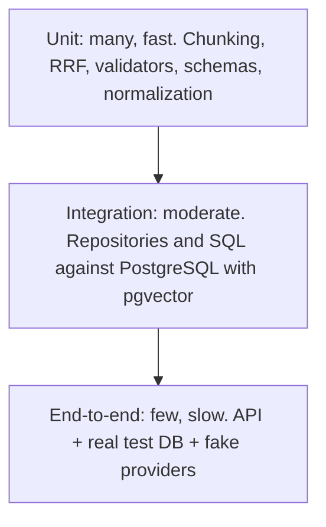

# Testing And Evaluation

## Evaluation

# Evaluation

> **Status:** **[Proposed]** methodology. **No dataset exists and no result is reported or implied.** Principle: [ADR 0008](adr/0008-evaluation-driven-quality.md).

## 1. Two layers of metrics

| Layer | Question | Needs LLM? |
|---|---|---|
| Retrieval metrics | Did the right chunks reach the candidate list? | No |
| Answer-quality metrics | Is the final answer supported, cited and appropriately abstained? | Often (judge) or human |

Retrieval quality caps answer quality: if the evidence never appears, generation cannot be grounded. Measuring them separately tells you which layer to fix.

## 2. Golden dataset format **[Proposed]**

JSONL, one record per question:

```json
{"id": "q001", "question": "...", "type": "answerable|unanswerable|identifier|paraphrase|multi_chunk",
 "relevant_chunks": [{"chunk_key": "...", "grade": 2}],
 "expected_status": "answered|abstained",
 "expected_reason": null,
 "reference_notes": "free text for reviewers",
 "as_of_date": null}
```

Labels are **chunk_key**-based; because keys derive from content and chunking rules, a rechunk invalidates labels, so the dataset records `corpus_version` and chunking config. Graded relevance (0 to 2 or 3) supports nDCG. Include identifier-style queries (section numbers), paraphrases, multi-chunk questions, superseded-document traps, and deliberately unanswerable questions. Labeling is done by the owner from source documents; labels are reviewed.

## 3. Retrieval metrics

For a query with relevant set `R` and ranked list `L`:

- **Hit@K:** 1 if any item of `R` is in the top K, else 0; averaged.
- **Recall@K:** `|R ∩ top-K| / |R|`.
- **MRR:** mean of `1 / rank` of the first relevant result (0 if none).
- **nDCG@K:** `DCG@K / IDCG@K`, with `DCG@K = Σ (2^rel_i − 1) / log2(i + 1)`; uses graded labels.

Report at several K (e.g. the candidate size and the context size M) and per question type.

## 4. Answer metrics

| Metric | Meaning | Method |
|---|---|---|
| Citation validity rate | levels 1 to 3 pass ([grounding-and-abstention.md](grounding-and-abstention.md)) | deterministic |
| Claim support (faithfulness) | level 4: citations entail claims | human review on a sample; LLM judge calibrated against it |
| Abstention precision/recall | abstains when it should, answers when it can | against `expected_status` |
| Unsupported-answer rate | answered where `expected_status = abstained` | deterministic |
| Answer correctness | matches reference notes | human |

Correctness is never fully automated; LLM judges have biases and must be checked against human labels on a sample.

## 5. Contamination risks

- Tuning chunk size, `k`, thresholds and prompts on the same questions you report (overfitting). Split into **dev** (tune) and **test** (report once).
- Writing questions by copying chunk wording inflates lexical scores. Write some by paraphrase.
- A judge model that is the same as the generator rates its own style favorably.
- Public documents may already be in a model's training data, so "answerable without retrieval" must be tested with a no-retrieval baseline.

## 6. Baselines and ablations

Compare on the same dataset, config logged: dense-only; lexical-only; hybrid RRF; hybrid with different `k`; `N` and `M` sweeps; text-search config variants (OD-3); `ts_rank_cd` vs a BM25 candidate (OD-4); with/without reranker; no-retrieval LLM baseline. Adopt a feature only when the ablation shows a gain worth its cost.

## 7. Reproducibility

Pin dataset version, `corpus_version`, chunking config, embedding model, prompt version, LLM model and parameters, random seeds. Record provider outputs (a recorded-response mode) so reports can be re-scored without new API calls. Evaluation is invoked by the Evaluation Harness **[Planned]**: `python -m advanced_rag.evaluation run --config <file>`.

## 8. Report format

Markdown + JSON, written to `reports/<timestamp>/`: configuration block, metric tables by config and question type, per-question failures (expected vs retrieved), abstention confusion matrix, cost/latency summary. Reports contain only measured values; the first one becomes the baseline from which targets are set.

## 9. Limits of automated evaluation

Small golden sets give wide uncertainty (report counts, not just percentages); labels encode the labeler's judgment; legal applicability cannot be scored automatically; metrics do not capture user trust. Treat numbers as evidence, not proof.

---
Related: [retrieval.md](retrieval.md) · [testing.md](testing.md) · [generation.md](generation.md)

---

## Testing

# Testing

> **Status:** **[Proposed]** strategy. No tests exist yet. Evaluation (quality measurement) is separate: [evaluation.md](evaluation.md).

## 1. Testing pyramid



Width of effort decreases upward: most tests are unit tests.

## 2. Unit tests

Pure logic, no I/O: text cleaning, chunking determinism, `chunk_key` derivation, RRF arithmetic (assert the worked example in [retrieval.md](retrieval.md#rrf)), evidence context building and budgeting, Pydantic schemas, citation and quote validation, abstention decision logic, config validation.

## 3. Integration tests

Real PostgreSQL with the `vector` extension, migrated by Alembic, in a throwaway database per test session. Test: insert/select, unique-constraint idempotency, HNSW and GIN queries return expected order on a tiny fixed corpus, filters, transaction rollback on injected failure, migration up/down.

## 4. End-to-end tests

Start the FastAPI app against the test DB with fake providers; call `/v1/query`; assert answered, abstained, 422 and 503 paths and response shape. Chainlit UI tests are minimal smoke tests.

## 5. Security tests

Hostile-instruction documents, delimiter injection, SQL-metacharacter queries, oversize input, corrupt PDF, log scan for secrets and raw queries ([security.md](security.md)).

## 6. Mocking external providers

`EmbeddingClient` and `LLMClient` are interfaces, so tests inject fakes: a **deterministic embedder** (hash-based vectors so similar text maps predictably) and a **scripted LLM** returning canned structured outputs, including malformed JSON, invalid citations and abstentions. No test calls the network; CI fails if one tries. Provider adapters get a small number of contract tests using recorded responses.

## 7. Deterministic fixtures

Synthetic mini-PDFs and manifests committed to the repo; a golden mini-corpus with expected chunks; seeded randomness; frozen clock. Fixtures contain no real personal data.

## 8. CI expectations

On every pull request: `ruff check`, `ruff format --check`, unit and integration tests (PostgreSQL service container), coverage report. Failing any blocks merge. See [deployment.md](deployment.md#4-cicd). Commands appear in [development-setup.md](development-setup.md) once the tooling exists.

---
Related: [evaluation.md](evaluation.md) · [CONTRIBUTING](../CONTRIBUTING.md)
