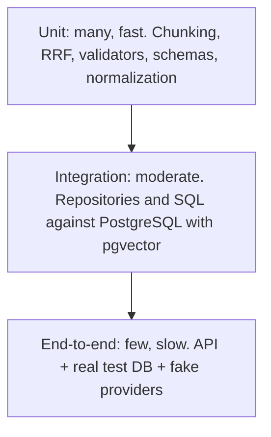

# Testing

> **Status:** **[Proposed]** strategy. No tests exist yet. Evaluation (quality measurement) is separate: [evaluation.md](evaluation.md).

## 1. Testing pyramid

Width of effort decreases upward: most tests are unit tests.

## 2. Unit tests

Pure logic, no I/O: text cleaning, chunking determinism, `chunk_key` derivation, RRF arithmetic (assert the worked example in [retrieval.md](retrieval.md#rrf)), evidence context building and budgeting, Pydantic schemas, citation and quote validation, abstention decision logic, config validation.

## 3. Integration tests

Real PostgreSQL with the `vector` extension, migrated by Alembic, in a throwaway database per test session. Test: insert/select, unique-constraint idempotency, HNSW and GIN queries return expected order on a tiny fixed corpus, filters, transaction rollback on injected failure, migration up/down.

## 4. End-to-end tests

Start the FastAPI app against the test DB with fake providers; call `/v1/query`; assert answered, abstained, 422 and 503 paths and response shape. Chainlit UI tests are minimal smoke tests.

## 5. Security tests

Hostile-instruction documents, delimiter injection, SQL-metacharacter queries, oversize input, corrupt PDF, log scan for secrets and raw queries ([security.md](security.md)).

## 6. Mocking external providers

`EmbeddingClient` and `LLMClient` are interfaces, so tests inject fakes: a **deterministic embedder** (hash-based vectors so similar text maps predictably) and a **scripted LLM** returning canned structured outputs, including malformed JSON, invalid citations and abstentions. No test calls the network; CI fails if one tries. Provider adapters get a small number of contract tests using recorded responses.

## 7. Deterministic fixtures

Synthetic mini-PDFs and manifests committed to the repo; a golden mini-corpus with expected chunks; seeded randomness; frozen clock. Fixtures contain no real personal data.

## 8. CI expectations

On every pull request: `ruff check`, `ruff format --check`, unit and integration tests (PostgreSQL service container), coverage report. Failing any blocks merge. See [deployment.md](deployment.md#4-cicd). Commands appear in [development-setup.md](development-setup.md) once the tooling exists.

---
Related: [evaluation.md](evaluation.md) · [CONTRIBUTING](../CONTRIBUTING.md)
